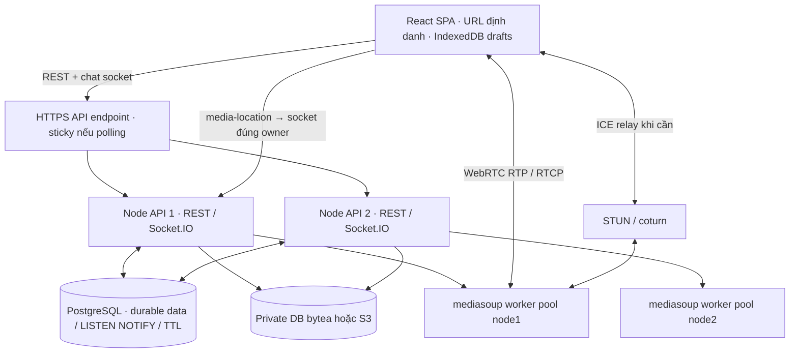
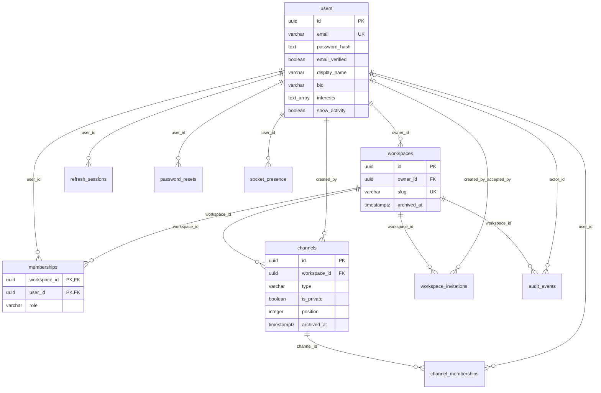
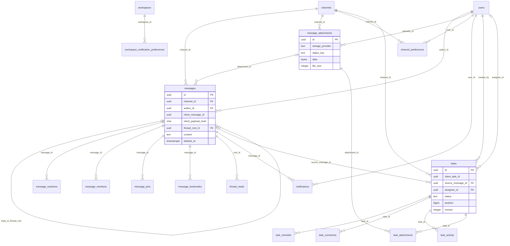
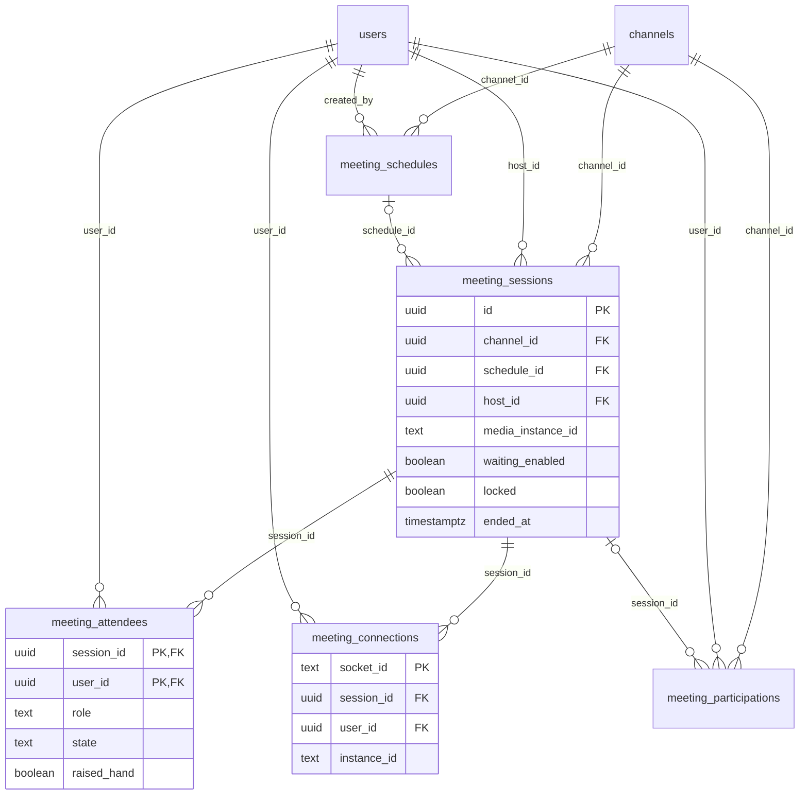
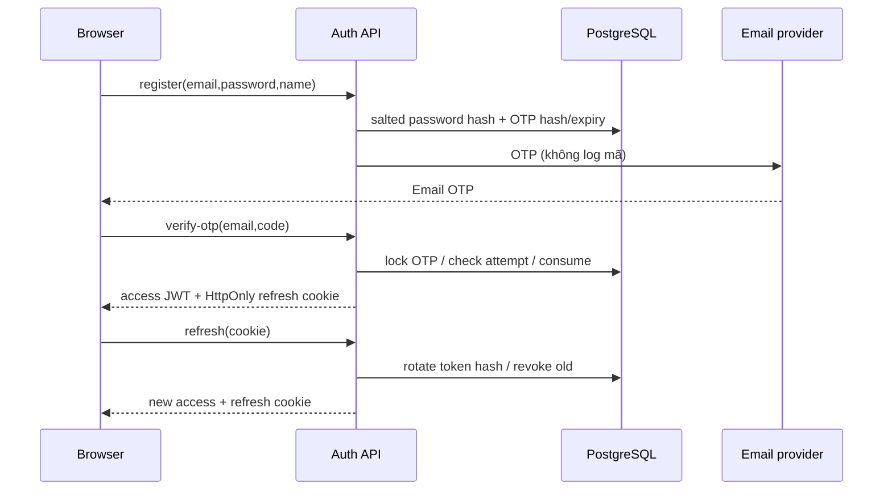

# Kiến trúc, schema và luồng — 01/10/2026

Tài liệu này mô tả source hiện tại, thay cho giả định Redis/eventname cũ trong bản thiết kế ban đầu. Snapshot PostgreSQL sau20migration: [schema-2026-10-01.json](../evidence/schema-2026-10-01.json), đầy đủ cột/nullability/FK/check/unique/index của36table và view `channel_access`. Tạo lại bằng `node scripts/database/schema-evidence.mjs` sau build. ERD dưới đây chia theo miền, chỉ hiển thị cột quan trọng để đọc; dùng snapshotSQL cho chi tiết.

## Kiến trúc



Một room có một SFU router trên một worker/node. DB session affinity chọn owner, adapter chỉ đồng bộ ứng dụng; không chia sẻ transport/router. Chat socket giữ ở endpointAPI, media có socket riêng tới SFUowner nếu cần. Lease45s/heartbeat15s áp dụng cảlocal để dọn crash; modepostgres mở broadcast liên node. Đường media tới node2 tương tựnode1.

## ERD quản trị và xác thực



`channel_access` làview memberships ×channels, kênh riêng yêu cầu channel_memberships **kể cảowner/admin**; `can_write` kiểm workspace/kênh không lưu trữ. Owner có thể tự cấp membership qua quản trị; không bypass để đọc nội dung. Owner integrity: một ownerrole, khớpworkspaces.owner_id, deferredconstraint khi commit. Invitationtoken lưuSHA256, không lưu token gốc. `email_otps` khóa theo email (khôngFKuser); rate_limits theo key; api_instances/helperattachments/cleanup/schema_migrations là bảng vận hành độc lập.

## ERD chat và công việc



Các bảng reaction/mention/bookmark/read/preference còn FKuser, pin FKpinned_by, comment/activity FKactor; chi tiết trongsnapshot. Message unique(author_id,client_message_id), task unique(created_by,client_task_id). Tệpproviderdb giữbytea, providers3 giữobject_key; check chỉ một dạng lưu. Message softdelete và quyền root còn hiệu lực khi đọc thread/search/file/notif. Trigger xóa metadataS3 đưaobject vào queue kể cảcascade.

## ERD họp



`media_instance_id`/`instance_id` làrouting key, không FKapi_instances vìlease có thể hết/xóa trong khi cần giữ lịch sử. Một sessionactive/channel bằng partialuniqueindex. Waiting/admitted/kicked tách host/cohost/member; đếmuserdistinct vàtabsriêng.

## Sequence auth



Email cần provider cấu hình; nhánh lỗi trả trạng thái, không coi delivery production đã kiểm. Login xác minh passwordhash+email_verified; logout revoke refresh và dọn draftcục bộ. Passwordreset dùng hash domainriêng, đổi mật khẩu revoke refresh khác; accessJWT đã cấp còn tớiTTL.

## Sequence chat / reconnect

```mermaid
sequenceDiagram
 participant U as Sender / IndexedDB outbox
 participant A as Socket API
 participant D as PostgreSQL
 participant R as Authorized recipients / adapter
 U->>A: send_message(clientMessageId,content,mentions,file)
 A->>D: lock workspace/channel/member + current rights
 A->>D: advisory lock(author,ID) + compare fingerprint
 alt First request
 D-->>A: insert message + mention/notification, commit
 A-->>R: new_message / notifications_changed
 else Identical retry
 D-->>A: existing message (no second broadcast)
 end
 A-->>U: ACK success/message
 U->>U: remove immutable outbox ID
 Note over U,A: On missing ACK keep same ID and payload
 U->>A: reconnect then REST messages?after=cursor
 A->>D: current access + timeline page
 A-->>U: backfill
 U->>U: merge by message ID; paginate until caught up
```

Broadcast recipients lấy quyền DB hiện tại, không dựa channelroom đãjoin trước. Thu hồi private/membership ngắt socketmọinode; REST/backfill/download tiếp tụccheckDB. Replythread root đãxóa không lọt context/search/notif/file.

## Sequence invitation

```mermaid
sequenceDiagram
 participant O as Owner/Admin
 participant A as Governance API
 participant D as PostgreSQL
 participant M as Invitee
 O->>A: create invite(email optional)
 A->>D: random token hash + expiry + audit
 A-->>O: copyable one-time link + email status
 O-->>M: Share link
 M->>A: accept token after login/verified email
 A->>D: lock invite/workspace; check recipient/expiry/revocation
 A->>D: insert membership + mark accepted + audit
 A-->>M: workspace ID
 Note over A,D: Same invite/user replay succeeds; other user or revoked/expired fails
```

## Sequence task

```mermaid
sequenceDiagram
 participant U as Chat / Kanban panel
 participant A as Tasks API
 participant D as PostgreSQL
 participant R as Current channel recipients
 U->>A: create(clientTaskId,sourceMessageId)
 A->>D: current rights + source/check assignee + fingerprint
 D-->>A: created task/version1 or identical existing task
 A-->>R: task_changed(ID,version)
 U->>A: PATCH(version,fields/action/beforeTaskId)
 A->>D: channel lock + task row lock
 alt Version matches
 A->>D: mutation + version increment + stable position + activity
 A-->>U: saved task
 A-->>R: task_changed
 else Conflict
 A-->>U: 409 TASK_CONFLICT
 U->>U: preserve local draft; user reloads before retry
 end
```

## Sequence meeting

```mermaid
sequenceDiagram
 participant U as Lobby
 participant A as API / session owner
 participant D as PostgreSQL
 participant S as mediasoup worker
 U->>A: media-location(channel ID)
 A-->>U: existing owner endpoint or initial endpoint
 U->>A: join_meeting(room,schedule)
 A->>D: access/limits/session lock/affinity
 alt Waiting enabled
 A-->>U: waiting (no SFU peer/media)
 else Admitted
 A->>S: join router, least-room worker
 A-->>U: router capabilities / existing producers
 U->>U: Device.load; create transports; request enabled devices only
 U->>A: connect transport / produce enabled source
 A->>D: requireAdmitted again
 A->>S: create producer/consumer
 U-->>S: WebRTC media
 end
 U->>A: meeting_action(waiting/lock/admit/kick/end)
 A->>D: current host/cohost rights
 A-->>U: meeting state changed / closed
 U->>U: stop tracks / close transports on cancel, leave or failure
 Note over A,D: Expired API lease leaves stale connections and closes history; next session chooses live owner
```

Hủy/nativeoperation timeout có cleanup cho tài nguyên trả vềmuộn. ACK10s, Device.load10s, xin thiết bị30s; quyền thiết bị vẫn do người dùng/trình duyệtquyết định. Worker chết dọn phòng của nó; room khác trên worker khác còn. Chi tiết TURN/simulcast/layer ở [16](../modules/16-dieu-hanh-hop-va-media.md).
