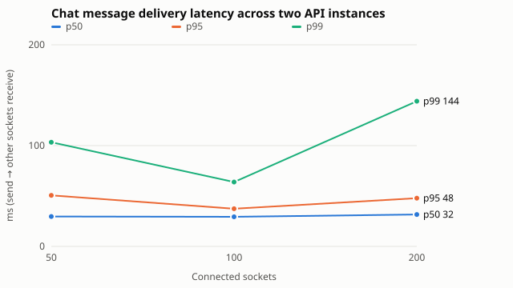
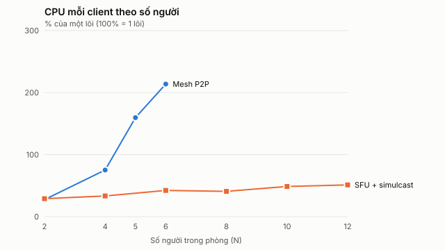
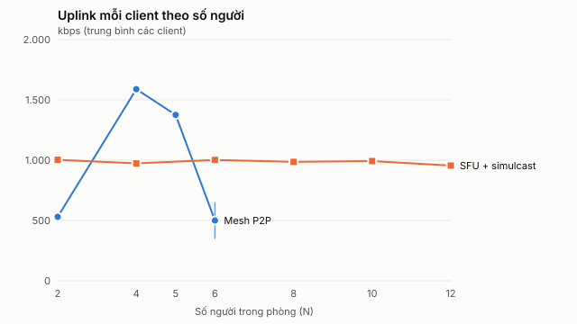

# Kết quả đo kiểm thực nghiệm (cải tiến 2.4)

Đo ngày 2026-10-19 trên một máy, bằng các công cụ có sẵn trong repo. Mỗi mục ghi lệnh chạy chính xác, số liệu gốc và các giới hạn cần biết khi đưa vào báo cáo.

## Máy đo

| Thành phần | Giá trị |
| --- | --- |
| Máy | ASUS ROG Strix G513RC |
| CPU | AMD Ryzen 7 6800HS, 8 lõi / 16 luồng, 3,2 GHz |
| RAM | 24 GB (VM WSL2 của Docker Desktop: 12 GB, 16 CPU) |
| Hệ điều hành | Windows 11 Home 10.0.26300 |
| Node.js | v22.19.0 |
| Docker | 29.8.2 (Docker Desktop, kernel WSL2 6.6.87.2) |
| PostgreSQL | 17.11 (`postgres:17-alpine`) |
| Asterisk | 22.11.0 (image build từ `infra/asterisk`) |
| Trình duyệt (media lab) | Google Chrome 155 headless |
| Mạng | loopback / Docker bridge trên cùng máy |

Client, API, SFU, Asterisk và PostgreSQL chạy chung một máy. Vì vậy số liệu phản ánh chi phí xử lý trên một máy chứ không phản ánh mạng thật. Ở các mức tải cao, chỉ số xấu đi một phần do tranh chấp CPU giữa bên tạo tải và bên chịu tải.

## Tóm tắt

| Thực nghiệm | Kết quả chính |
| --- | --- |
| k6 HTTP, 50 VU | 16.228 request, 153 req/s, p95 8,2 ms, 0% lỗi |
| Chat Socket.IO, 2 instance API | 200 socket: p95 nhận tin 48 ms, p99 144 ms, 0 lỗi, 0 trùng |
| ACD qua ARI (kênh Local) | Đến 50 cuộc đồng thời: 100% cuộc được ghi nhận và vào hàng đợi. Từ 100 cuộc trở lên, ARI bị từ chối do giới hạn 100 phiên HTTP của Asterisk |
| SIPp vào hotline 9000 | Đến 50 cuộc đồng thời: 100% thành công, INVITE→200 OK p50 12 ms. Từ cuộc thứ 51: `488 Not Acceptable Here` vì hết cổng RTP (dải 10000–10099) |
| Mesh và SFU | SFU chạy ổn định đến 12 người (mất gói 0%, 20 fps). Mesh sập ở 6 người (CPU mỗi client khoảng 214%, RTT khoảng 9 s, không nhận được khung hình) và không khởi chạy được từ 8 người |

## 1. HTTP API với k6

```bash
docker run --rm -i -e BASE=http://host.docker.internal:3001 -e TOKEN grafana/k6:0.53.0 run --summary-export /out/k6-summary.json - < scripts/benchmarks/k6-api.js
```

`TOKEN` là access token của `giaovu@demo.nexo.test`, tạo bằng `createAccessToken` trong `dist/api/modules/auth/tokens.js` với `JWT_SECRET` của `.env`. API là server dev đang chạy trên cổng 3001. Kịch bản tăng dần lên 50 VU trong 30 s, giữ 1 phút rồi giảm trong 15 s. Mỗi vòng lặp gọi 4 đường đọc chính (`/api/callcenter/me`, `/api/elearning/courses`, `/api/meetings/schedules`, `/api/workspaces`) rồi nghỉ 1 s.

| Request | Thông lượng | Trung bình | p50 | p90 | p95 | max | Lỗi |
| ---: | ---: | ---: | ---: | ---: | ---: | ---: | ---: |
| 16.228 | 153 req/s | 5,9 ms | 5,5 ms | 7,5 ms | 8,2 ms | 93 ms | 0% |

Cả hai ngưỡng của kịch bản (`p95<300ms`, `failed<1%`) đều đạt. Số liệu gốc: [raw/k6.txt](raw/k6.txt), [raw/k6-summary.json](raw/k6-summary.json).

## 2. Độ trễ tin nhắn WebSocket (Socket.IO)

```bash
npm run benchmark:chat
```

```bash
node scripts/benchmarks/summarize-chat-load.mjs
```

Cấu hình mặc định: các mức 50, 100 và 200 socket, mỗi mức chạy 2 lượt × 30 s. Có hai tiến trình API riêng (bắt cặp qua adapter của Socket.IO), dùng chung PostgreSQL, 4 workspace × 2 kênh, 4 tin/s. "Ack" là thời gian từ lúc gửi đến khi server xác nhận đã lưu. "Nhận" là thời gian từ lúc gửi đến khi các socket khác nhận được tin, kể cả các socket nối vào instance API còn lại.

| Socket | Tin | Lượt nhận | Ack p50 / p95 / p99 (ms) | Nhận p50 / p95 / p99 (ms) | Lỗi | CPU API tối đa (1 lõi) | RSS API tối đa (MiB) |
| ---: | ---: | ---: | --- | --- | ---: | ---: | ---: |
| 50 | 244 | 3.052 | 31 / 62 / 102 | 30 / 51 / 103 | 0 | 5,9% | 103 |
| 100 | 244 | 6.096 | 30 / 52 / 75 | 29 / 37 / 64 | 0 | 3,4% | 99 |
| 200 | 244 | 12.196 | 32 / 58 / 165 | 32 / 48 / 144 | 0 | 5,6% | 118 |



p50 gần như không đổi khi số socket tăng gấp 4. Chỉ đuôi p99 tăng ở mức 200 socket. Không có tin bị mất hoặc trùng. Số liệu gốc: [../evidence/chat-load-2026-10-01.json](../evidence/chat-load-2026-10-01.json) (tên tệp có ngày cố định trong script, nội dung là lượt đo 2026-10-19), [../evidence/chat-load-summary-2026-10-01.json](../evidence/chat-load-summary-2026-10-01.json) và [raw/chat-load.log](raw/chat-load.log).

Bổ sung về RTT chat và signaling SFU ở quy mô nhỏ (`npm run benchmark`, 1/3/5/8 client): RTT p95 từ 33 đến 36 ms, join SFU từ 15 đến 24 ms sau lần khởi tạo worker đầu tiên. Xem [benchmark-report.md](benchmark-report.md). Báo cáo đó ghi "PostgreSQL 16" do chuỗi viết cứng trong script; bản thực tế là 17.11.

## 3. Tổng đài: ACD dưới tải

### 3a. Cuộc gọi do Asterisk tự sinh qua ARI

```bash
node scripts/benchmarks/callcenter-load.mjs --calls 40 --concurrency 20 --hold 8
```

Chạy lại với `--calls 100 --concurrency 50`, `--calls 200 --concurrency 100` và `--calls 400 --concurrency 200`. Mỗi cuộc gọi là một kênh Local vào số 9000, đi qua ACD của API, nghe IVR, bấm phím 1, vào hàng đợi phòng ban, chờ 8 s rồi gác máy. Không có tổng đài viên nhận cuộc nào, nên mọi cuộc đều kết thúc là `abandoned`. "Setup" là khoảng từ lệnh originate đến khi ACD ghi dòng `cc_calls` (gồm sự kiện ARI, ACD và PostgreSQL). "IVR→hàng đợi" gồm lời chào, phím bấm và định tuyến.

| Đồng thời | Cuộc | Ghi nhận | Lỗi originate | Setup p50 / p95 / max (ms) | IVR→hàng đợi p50 / p95 (ms) | Kết quả |
| ---: | ---: | ---: | ---: | --- | --- | --- |
| 20 | 40 | 40 | 0 | 206 / 354 / 364 | 1.645 / 1.777 | 40 abandoned |
| 50 | 100 | 100 | 0 | 433 / 775 / 829 | 1.693 / 1.746 | 100 abandoned |
| 100 | 200 | 199 | 200 | 794 / 1.409 / 1.526 | – | 52 abandoned, 147 failed |
| 200 | 400 | 253 | 400 | 1.759 / 2.744 / 2.922 | – | 201 abandoned, 52 dở dang |

Từ 100 cuộc đồng thời, log Asterisk ghi `HTTP session count exceeded 100 sessions`. Máy chủ HTTP của Asterisk (`http.conf`) mặc định `sessionlimit = 100`, và giới hạn này dùng chung cho bên tạo tải lẫn các lệnh ARI của chính ACD. Vì vậy cả lệnh DTMF/hangup của bên tạo tải (409, `fetch failed`) lẫn lệnh của ACD đều bị từ chối, và ACD kết thúc cuộc với `failed`. Ở mức 200, có 100 cuộc bị treo trên Asterisk. Các cuộc này đã được gác thủ công qua ARI và các dòng thử đã bị xóa. Muốn vượt mức này cần tăng `sessionlimit` trong `infra/asterisk/config/http.conf`. Lượt đo này không thay đổi cấu hình. Số liệu gốc: [raw/callcenter-load.txt](raw/callcenter-load.txt).

### 3b. SIPp (tầng SIP/RTP) vào hotline

```bash
docker build -t nexo-sipp scripts/benchmarks/sipp
```

```bash
node scripts/benchmarks/sipp/run-sipp.mjs --levels 10,25,50,75,100
```

Ở mỗi mức N, SIPp chạy `uac-hotline.xml` trong Docker trên mạng `infra_default` với các tham số `-l N -m 2N -r 10 -d 20000 -rtp_echo`. Mỗi cuộc gọi xác thực bằng một extension UDP tạm (1290), gọi 9000, gửi và nhận G.711 trong 20 s rồi gác máy. Script tạo extension qua ARI trước khi chạy và xóa sau khi chạy, đồng thời xóa các dòng `cc_calls` của lượt thử. CPU và RAM của container được lấy mẫu bằng `docker stats` khoảng 1 lần/giây. "INVITE→200" là `rtd` của SIPp, tính từ INVITE đầu tiên (kể cả vòng thách thức 401) đến khi ACD trả lời. Giá trị này bao gồm sự kiện ARI, ghi `cc_calls` và lệnh answer. Đồng hồ của SIPp có bước khoảng 4 ms.

| Đồng thời (-l) | Cuộc (-m) | Thành công | Lỗi | INVITE→200 p50 (ms) | p95 | max | CPU Asterisk đỉnh | RAM Asterisk đỉnh (MiB) | CPU PostgreSQL đỉnh |
| ---: | ---: | ---: | ---: | ---: | ---: | ---: | ---: | ---: | ---: |
| 10 | 20 | 20 | 0 | 12 | 80 | 80 | 9,5% | 74 | 4,4% |
| 25 | 50 | 50 | 0 | 12 | 16 | 24 | 19,9% | 79 | 4,3% |
| 50 | 100 | 100 | 0 | 12 | 12 | 12 | 31,3% | 86 | 5,3% |
| 75 | 150 | 50 | 100 | 12 | 12 | 16 | 34,7% | 87 | 5,0% |
| 100 | 200 | 50 | 150 | 12 | 12 | 80 | 32,8% | 89 | 4,3% |

(Cột CPU tính theo % của một lõi, theo `docker stats`.)

Trần 50 cuộc là do cấu hình chứ không phải do CPU: `rtp.conf` chỉ cấp dải cổng 10000–10099, và `docker-compose.yml` chỉ publish đúng dải này, tức khoảng 50 luồng RTP. Từ cuộc thứ 51, Asterisk ghi `couldn't allocate a port for RTP instance` và trả `488 Not Acceptable Here`. Ở mức 50 cuộc, Asterisk dùng khoảng 31% của một lõi, còn PostgreSQL khoảng 5%. Muốn phục vụ hàng trăm cuộc đồng thời, cần mở rộng dải cổng RTP (ví dụ 10000–20000) ở cả `rtp.conf` lẫn phần publish cổng của Docker, rồi đo lại. Số liệu gốc: [raw/sipp/](raw/sipp/) (log màn hình, CSV thống kê, CSV `rtt`, mẫu `docker stats`) và [raw/sipp-run.log](raw/sipp-run.log).

## 4. Mesh và SFU (media lab)

```bash
node experiments/media-lab/harness.mjs --mode=sfu --clients=2,4,6,8,10,12 --seconds=40 --warmup=20 --render=0 "--chrome=C:/Program Files/Google/Chrome/Application/chrome.exe"
```

```bash
node experiments/media-lab/harness.mjs --mode=mesh --clients=2,4,6,8,10,12 --seconds=40 --warmup=20 --render=0 "--chrome=C:/Program Files/Google/Chrome/Application/chrome.exe"
```

```bash
node experiments/media-lab/harness.mjs --mode=mesh --clients=5,6 --seconds=40 --warmup=20 --render=0 "--chrome=C:/Program Files/Google/Chrome/Application/chrome.exe"
```

```bash
node experiments/media-lab/summarize.mjs
```

Toàn bộ bảng (băng thông lên/xuống, CPU, RTT, jitter, mất gói, FPS, CPU worker SFU) và 5 hình nằm trong [media-lab-summary.md](media-lab-summary.md). Các hình nằm ở `docs/thesis/figures/fig-5-*.svg`. Trích các cột chính:

| N | Mesh: CPU mỗi client | Mesh: uplink (kbps) | Mesh: RTT (ms) | Mesh: FPS nhận | SFU: CPU mỗi client | SFU: uplink (kbps) | SFU: downlink (kbps) | SFU: RTT (ms) | SFU: CPU worker |
| ---: | ---: | ---: | ---: | ---: | ---: | ---: | ---: | ---: | ---: |
| 2 | 27,5% | 530 | 0,9 | 19,9 | 29,0% | 1.003 | 600 | 0,3 | 3,3% |
| 4 | 75,2% | 1.589 | 0,8 | 20 | 33,4% | 974 | 919 | 0,3 | 9,8% |
| 5 | 159,6% | 1.376 | 183 | 18,2 | – | – | – | – | – |
| 6 | 213,8% | 500 | 9.023 | – | 42,3% | 1.002 | 1.578 | 0,6 | 19,4% |
| 8 | không khởi chạy được | | | | 40,8% | 986 | 1.197 | 0,5 | 31,5% |
| 10 | không khởi chạy được | | | | 48,7% | 993 | 1.581 | 1,2 | 40,6% |
| 12 | không khởi chạy được | | | | 51,2% | 955 | 1.859 | 1,9 | 56,2% |





- Với Mesh, mỗi client mã hóa N−1 luồng. Uplink và CPU tăng gần tuyến tính theo N. Ở N = 6, sáu trình duyệt dùng khoảng 12,8/16 luồng CPU, RTT vọt lên 7–10 s và không còn khung hình nào được giải mã. Cả 2 lượt đo ở N = 6 đều cho kết quả này. Từ N = 8, trình duyệt không phản hồi CDP (`CDP timeout`).
- Với SFU, mỗi client chỉ phát một luồng simulcast (3 encoder), nên uplink giữ khoảng 1 Mbps bất kể N. CPU client tăng từ 29% lên 51% do số luồng cần giải mã tăng. Mất gói luôn bằng 0, FPS luôn khoảng 20. Chi phí dồn sang worker mediasoup: 56% của một lõi ở N = 12.
- Mesh ở N = 5 nằm sát ngưỡng. Một lượt khác (chạy ngay trước lượt trong bảng, file JSON không giữ lại) cho kết quả CPU 241%, RTT 1.352 ms, FPS 4,7 ở N = 5, và RTT 6.728 ms, FPS 5,3 ở N = 6.
- Đề cương nêu các mức 10/20/50 camera. Harness giới hạn N ≤ 12 vì mỗi người tham gia là một tiến trình Chrome trên cùng máy. Mesh đã sập từ N = 6, và SFU ở N = 12 đã dùng khoảng 6 lõi chỉ riêng cho phía client. Muốn đo 20–50 camera cần nhiều máy client (xem phần Giới hạn trong `experiments/media-lab/README.md`).

## 5. Prometheus và Grafana

Lượt đo này không bật profile `monitoring`. Prometheus cần tệp `infra/monitoring/operations_token` chứa `OPERATIONS_TOKEN` (bí mật trong `.env`), và tệp này không được tạo ra trong lượt đo. Các số liệu CPU/RAM/băng thông được đo trực tiếp bằng cách khác: `docker stats` (Asterisk, PostgreSQL), `process.cpuUsage` (API, trong `benchmark:chat`), `getResourceUsage` của worker mediasoup và CDP `SystemInfo.getProcessInfo` (media lab), `getStats()` của WebRTC (băng thông). Để có ảnh dashboard Grafana cho báo cáo, cần tạo tệp token rồi chạy `docker compose -f infra/docker-compose.yml --profile monitoring up -d` trước khi chạy lại một trong các lệnh trên.

## Sửa script trong lượt đo này

- `scripts/benchmarks/benchmark-realtime.mjs`: bước dọn dẹp xóa workspace ngay sau khi ngắt socket, trong khi server vẫn đang ghi tóm tắt cuộc họp, nên PostgreSQL báo deadlock (`40P01`). Đã thêm 2 s chờ trước khi xóa.
- `scripts/benchmarks/sipp/uac-hotline.xml`: SIPp 3.6 hiểu `[authentication_username]` là từ khóa `[authentication]` thứ hai và hủy mọi cuộc gọi. Đã đổi thành `[auth_user]`, truyền bằng `-key auth_user <ext>`.
- Mới: `scripts/benchmarks/sipp/Dockerfile` (SIPp từ gói `sip-tester` của Debian), `scripts/benchmarks/sipp/run-sipp.mjs` (chạy theo các mức tải và lấy mẫu container) và `scripts/benchmarks/summarize-results.mjs` (bảng SIPp, bảng chat và hình chat).
- Không có thay đổi nào trong mã ứng dụng.

Edge 155 headless thoát ngay khi khởi động trên máy này (đang có hai phiên bản cài song song, chờ cập nhật). Vì vậy media lab chạy bằng Chrome qua `--chrome`.
