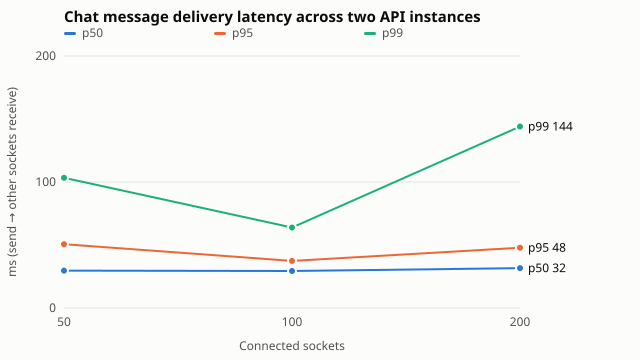
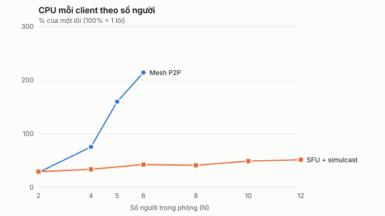
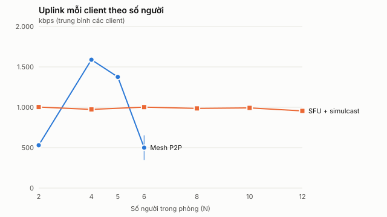

# Kết quả đo kiểm thực nghiệm (cải tiến 2.4)

Đo ngày 2026-10-19 trên một máy, bằng các công cụ có sẵn trong repo. Ngày 2026-11-02/03 đo lại tổng đài sau khi mở trần cấu hình (mục 3a, 3b) và đo thêm chất lượng thoại (3c), KPI ca trực mô phỏng (3d) và họp qua TURN (4b). Mỗi mục ghi lệnh chạy chính xác, số liệu gốc và các giới hạn cần biết khi đưa vào báo cáo.

## Máy đo

| Thành phần | Giá trị |
| --- | --- |
| Máy | ASUS ROG Strix G513RC |
| CPU | AMD Ryzen 7 6800HS, 8 lõi / 16 luồng, 3,2 GHz |
| RAM | 24 GB (VM WSL2 của Docker Desktop: 12 GB, 16 CPU) |
| Hệ điều hành | Windows 11 Home 10.0.26300 |
| Node.js | v22.19.0 |
| Docker | 29.8.2 (Docker Desktop, kernel WSL2 6.6.87.2) |
| PostgreSQL | 17.11 (`postgres:17-alpine`) |
| Asterisk | 22.11.0 (image build từ `infra/asterisk`) |
| Trình duyệt (media lab) | Google Chrome 155 headless |
| Mạng | loopback / Docker bridge trên cùng máy |

Client, API, SFU, Asterisk và PostgreSQL chạy chung một máy. Vì vậy số liệu phản ánh chi phí xử lý trên một máy chứ không phản ánh mạng thật. Ở các mức tải cao, chỉ số xấu đi một phần do tranh chấp CPU giữa bên tạo tải và bên chịu tải.

## Tóm tắt

| Thực nghiệm | Kết quả chính |
| --- | --- |
| k6 HTTP, 50 VU | 16.228 request, 153 req/s, p95 8,2 ms, 0% lỗi |
| Chat Socket.IO, 2 instance API | 200 socket: p95 nhận tin 48 ms, p99 144 ms, 0 lỗi, 0 trùng |
| ACD qua ARI (kênh Local) | Đến 200 cuộc đồng thời: 100% cuộc được ghi nhận và vào hàng đợi (`sessionlimit = 500`). Bão hòa ở 150–200 cuộc: IVR→hàng đợi p50 tăng từ 1,7 s lên 3,3 s, Asterisk khoảng 8 lõi |
| SIPp vào hotline 9000 | Đến 200 cuộc đồng thời: 100% thành công (1.220/1.220 cuộc), INVITE→200 OK p50 12 ms, Asterisk khoảng 60% một lõi. Trần mới là dải RTP 10000–10499 (khoảng 250 cuộc) |
| Chất lượng thoại (pcap + E-model) | 10 cuộc: MOS 4,39 (LAN), 4,38 (Wi-Fi giả lập), 4,29–4,32 (4G), 3,94–4,00 (4G yếu, 2% mất gói), 2,91–3,06 (quá tải, 5%) |
| KPI ca trực mô phỏng (ACD thật, PBX giả lập) | Ca thường: ASA 9,8 s, bỏ máy 3,6%, SL 20 s 88,5% (đạt cả ba mục tiêu). Ca cao điểm (2 đợt gọi dồn): ASA 32,1 s, bỏ máy 3,6%, SL 20 s 60%. Cuộc hẹn gọi lại tách riêng, không tính bỏ máy |
| Họp qua TURN (relay) | 3 và 6 người qua TURN/UDP và TURN/TCP (mô phỏng chặn UDP): có hình/tiếng, mất gói 0%, khoảng 20 fps |
| Mesh và SFU | SFU chạy ổn định đến 12 người (mất gói 0%, 20 fps). Mesh sập ở 6 người (CPU mỗi client khoảng 214%, RTT khoảng 9 s, không nhận được khung hình) và không khởi chạy được từ 8 người |

## 1. HTTP API với k6

```bash
docker run --rm -i -e BASE=http://host.docker.internal:3001 -e TOKEN grafana/k6:0.53.0 run --summary-export /out/k6-summary.json - < scripts/benchmarks/k6-api.js
```

`TOKEN` là access token của `giaovu@demo.nexo.test`, tạo bằng `createAccessToken` trong `dist/api/modules/auth/tokens.js` với `JWT_SECRET` của `.env`. API là server dev đang chạy trên cổng 3001. Kịch bản tăng dần lên 50 VU trong 30 s, giữ 1 phút rồi giảm trong 15 s. Mỗi vòng lặp gọi 4 đường đọc chính (`/api/callcenter/me`, `/api/elearning/courses`, `/api/meetings/schedules`, `/api/workspaces`) rồi nghỉ 1 s.

| Request | Thông lượng | Trung bình | p50 | p90 | p95 | max | Lỗi |
| ---: | ---: | ---: | ---: | ---: | ---: | ---: | ---: |
| 16.228 | 153 req/s | 5,9 ms | 5,5 ms | 7,5 ms | 8,2 ms | 93 ms | 0% |

Cả hai ngưỡng của kịch bản (`p95<300ms`, `failed<1%`) đều đạt. Số liệu gốc: [raw/k6.txt](raw/k6.txt), [raw/k6-summary.json](raw/k6-summary.json).

## 2. Độ trễ tin nhắn WebSocket (Socket.IO)

```bash
npm run benchmark:chat
```

```bash
node scripts/benchmarks/summarize-chat-load.mjs
```

Cấu hình mặc định: các mức 50, 100 và 200 socket, mỗi mức chạy 2 lượt × 30 s. Có hai tiến trình API riêng (bắt cặp qua adapter của Socket.IO), dùng chung PostgreSQL, 4 workspace × 2 kênh, 4 tin/s. "Ack" là thời gian từ lúc gửi đến khi server xác nhận đã lưu. "Nhận" là thời gian từ lúc gửi đến khi các socket khác nhận được tin, kể cả các socket nối vào instance API còn lại.

| Socket | Tin | Lượt nhận | Ack p50 / p95 / p99 (ms) | Nhận p50 / p95 / p99 (ms) | Lỗi | CPU API tối đa (1 lõi) | RSS API tối đa (MiB) |
| ---: | ---: | ---: | --- | --- | ---: | ---: | ---: |
| 50 | 244 | 3.052 | 31 / 62 / 102 | 30 / 51 / 103 | 0 | 5,9% | 103 |
| 100 | 244 | 6.096 | 30 / 52 / 75 | 29 / 37 / 64 | 0 | 3,4% | 99 |
| 200 | 244 | 12.196 | 32 / 58 / 165 | 32 / 48 / 144 | 0 | 5,6% | 118 |



p50 gần như không đổi khi số socket tăng gấp 4. Chỉ đuôi p99 tăng ở mức 200 socket. Không có tin bị mất hoặc trùng. Số liệu gốc: [../evidence/chat-load-2026-10-01.json](../evidence/chat-load-2026-10-01.json) (tên tệp có ngày cố định trong script, nội dung là lượt đo 2026-10-19), [../evidence/chat-load-summary-2026-10-01.json](../evidence/chat-load-summary-2026-10-01.json) và [raw/chat-load.log](raw/chat-load.log).

Bổ sung về RTT chat và signaling SFU ở quy mô nhỏ (`npm run benchmark`, 1/3/5/8 client): RTT p95 từ 33 đến 36 ms, join SFU từ 15 đến 24 ms sau lần khởi tạo worker đầu tiên. Xem [benchmark-report.md](benchmark-report.md). Báo cáo đó ghi "PostgreSQL 16" do chuỗi viết cứng trong script; bản thực tế là 17.11.

## 3. Tổng đài: ACD dưới tải

### 3a. Cuộc gọi do Asterisk tự sinh qua ARI

Đo lại ngày 2026-11-02 sau khi mở trần cấu hình: `http.conf` có `sessionlimit = 500` (mặc định 100), `rtp.conf` dùng dải 10000–10499 (500 cổng, khoảng 250 cuộc), và Docker publish đúng dải này.

```bash
node scripts/benchmarks/callcenter-load.mjs --calls 40 --concurrency 20 --hold 8
```

Chạy lại với `--calls 100 --concurrency 50`, `--calls 200 --concurrency 100`, `--calls 300 --concurrency 150` và `--calls 400 --concurrency 200`. Mỗi cuộc gọi là một kênh Local vào số 9000, đi qua ACD của API, nghe IVR, bấm phím 1, vào hàng đợi phòng ban, chờ 8 s rồi gác máy. Không có tổng đài viên nhận cuộc nào, nên mọi cuộc đều kết thúc là `abandoned`. "Setup" là khoảng từ lệnh originate đến khi ACD ghi dòng `cc_calls` (gồm sự kiện ARI, ACD và PostgreSQL). "IVR→hàng đợi" gồm lời chào, phím bấm và định tuyến. CPU lấy bằng `docker stats` khoảng 2 s/mẫu trong lúc chạy (% của một lõi).

| Đồng thời | Cuộc | Ghi nhận | Vào hàng đợi | Setup p50 / p95 / max (ms) | IVR→hàng đợi p50 / p95 (ms) | CPU Asterisk p50 / p95 | CPU PostgreSQL p95 | RAM Asterisk đỉnh |
| ---: | ---: | ---: | ---: | --- | --- | --- | ---: | ---: |
| 20 | 40 | 40 | 40 | 189 / 330 / 337 | 1.693 / 1.808 | 66% / 68% | 4% | 87 MiB |
| 50 | 100 | 100 | 100 | 437 / 766 / 798 | 1.678 / 1.781 | 164% / 190% | 10% | 92 MiB |
| 100 | 200 | 200 | 200 | 883 / 1.721 / 1.806 | 1.701 / 1.854 | 338% / 461% | 22% | 98 MiB |
| 150 | 300 | 300 | 300 | 1.170 / 2.237 / 2.363 | 1.733 / 2.046 | 467% / 798% | 21% | 93 MiB |
| 200 | 400 | 400 | 400 | 1.372 / 2.815 / 3.068 | 3.252 / 4.435 | 823% / 1.046% | 24% | 93 MiB |

Mọi mức đều 100% cuộc được ghi nhận và vào đúng hàng đợi, không có cuộc `failed` (lượt đo 2026-10-19 với `sessionlimit = 100`: 147/199 cuộc `failed` ở mức 100). Điểm bão hòa nằm quanh **150–200 cuộc đồng thời**: ở mức 200, thời gian IVR→hàng đợi tăng gần gấp đôi (p50 1,7 s → 3,3 s) vì hàng đợi sự kiện Stasis của ứng dụng ARI đầy (log Asterisk: `Taskprocessor 'stasis/m:ari:application/nexo' queue reached 500 scheduled tasks`), và Asterisk dùng khoảng 8 lõi cho 200 kênh Local (mỗi kênh Local là hai kênh, cộng phát IVR và nhạc chờ). PostgreSQL không phải nút cổ chai (≤ 24% một lõi).

Bên tạo tải đã được sửa để gửi lại phím DTMF khi Asterisk trả `409` (dưới tải, kênh có thể vào Stasis sau 1,5 s chờ của script), và in thêm số cuộc "vào hàng đợi" (`queued`). Số liệu gốc: [raw/callcenter-load.txt](raw/callcenter-load.txt), CPU/RAM: `raw/callcenter-load-stats-<mức>.csv`.

### 3b. SIPp (tầng SIP/RTP) vào hotline

```bash
docker build -t nexo-sipp scripts/benchmarks/sipp
```

```bash
node scripts/benchmarks/sipp/run-sipp.mjs --levels 10,25,50,75,100,150,200
```

Đo lại ngày 2026-11-02 với dải RTP 10000–10499. Ở mỗi mức N, SIPp chạy `uac-hotline.xml` trong Docker trên mạng `infra_default` với các tham số `-l N -m 2N -r 10 -d 20000 -rtp_echo`. Mỗi cuộc gọi xác thực bằng một extension UDP tạm (1290), gọi 9000, gửi và nhận G.711 trong 20 s rồi gác máy. Với 10 cuộc/s và 20 s giữ máy, số cuộc đồng thời thực tế lên tới khoảng 200, nên mức 150 và 200 chạm đúng trần `-l`. Script tạo extension qua ARI trước khi chạy và xóa sau khi chạy, đồng thời xóa các dòng `cc_calls` của lượt thử. CPU và RAM của container được lấy mẫu bằng `docker stats` khoảng 1 lần/giây. "INVITE→200" là `rtd` của SIPp, tính từ INVITE đầu tiên (kể cả vòng thách thức 401) đến khi ACD trả lời.

| Đồng thời (-l) | Cuộc (-m) | Thành công | Lỗi | INVITE→200 p50 (ms) | p95 | max | CPU Asterisk đỉnh | RAM Asterisk đỉnh (MiB) | CPU PostgreSQL đỉnh |
| ---: | ---: | ---: | ---: | ---: | ---: | ---: | ---: | ---: | ---: |
| 10 | 20 | 20 | 0 | 12 | 40 | 40 | 8,9% | 90 | 4,5% |
| 25 | 50 | 50 | 0 | 12 | 16 | 20 | 18,7% | 94 | 2,8% |
| 50 | 100 | 100 | 0 | 12 | 12 | 16 | 28,5% | 102 | 6,2% |
| 75 | 150 | 150 | 0 | 12 | 16 | 20 | 43,2% | 109 | 5,6% |
| 100 | 200 | 200 | 0 | 12 | 12 | 24 | 38,8% | 116 | 7,3% |
| 150 | 300 | 300 | 0 | 12 | 28 | 3.188 | 56,1% | 144 | 6,3% |
| 200 | 400 | 400 | 0 | 12 | 12 | 72 | 60,4% | 147 | 7,6% |

(Cột CPU tính theo % của một lõi, theo `docker stats`.)

- Đến 200 cuộc đồng thời: 100% thành công, INVITE→200 p50 giữ 12 ms, Asterisk dùng khoảng 60% một lõi và 147 MiB. Lượt 2026-10-19 (dải 10000–10099) dừng ở 50 cuộc với `488 Not Acceptable Here` vì hết cổng RTP.
- Ở tầng SIP/RTP, trần mới là **dải cổng**: 500 cổng RTP (RTP + RTCP) cho khoảng 250 cuộc. Chưa thấy dấu hiệu bão hòa CPU tới 200 cuộc. Nút cổ chai khi tải cao nằm ở tầng ARI/ACD (mục 3a: hàng đợi sự kiện Stasis đầy ở 200 kênh Local), không phải ở SIP/RTP.
- Mức 150 được đo lại: lượt đầu bị gián đoạn vì server API dev (`tsx --watch`) tự khởi động lại khi sửa mã nguồn giữa lượt đo, ARI WebSocket đóng (log Asterisk 17:12:18 `Web socket closed abruptly`, `Stasis app 'nexo' doesn't exist`) và ACD đóng các cuộc dở dang khi kết nối lại (146 cuộc nhận `603`). Lượt đo lại: 300/300. Một cuộc có INVITE→200 3,2 s (p95 vẫn 28 ms).

Số liệu gốc: [raw/sipp/](raw/sipp/) (log màn hình, CSV thống kê, CSV `rtt`, mẫu `docker stats`) và [raw/sipp-run.log](raw/sipp-run.log).

### 3c. Chất lượng thoại: bắt gói RTP và MOS theo E-model

Đo ngày 2026-11-02: 10 cuộc gọi SIPp vào hotline, 5 điều kiện mạng × 2 cuộc, mỗi cuộc giữ máy 30 s.

```bash
node scripts/benchmarks/sipp/run-sipp.mjs --levels 1 --rate 1 --hold 30 --pcap --netem "delay 60ms 15ms distribution normal loss 0.5%" --out docs/benchmarks/raw/voice-quality/4g
```

```bash
node experiments/packet-capture/voice-quality.mjs lan=docs/benchmarks/raw/voice-quality/lan/level-1/capture.csv wifi=… 4g=… 4g-yeu=… qua-tai=… --out=docs/benchmarks/raw/voice-quality/summary.json
```

- **Bắt gói**: `--pcap` chạy `tcpdump` trong network namespace của container Asterisk (`udp portrange 10000-10499`), rồi `tshark` xuất các trường RTP ra CSV (`capture.csv`).
- **Mô phỏng mạng**: `--netem` đặt `tc qdisc … netem` lên chiều gửi của SIPp, tức chặng người gọi → tổng đài (mạng di động của người gọi). SIPp `-rtp_echo` gửi trả nguyên từng gói RTP mà Asterisk phát (cùng SSRC và số thứ tự), nên mỗi gói cho một mẫu độ trễ vòng.
- **Chỉ số** (`voice-quality.mjs`, có test): mất gói = gói không quay về; jitter theo RFC 3550 của luồng quay về (đồng hồ 8 kHz của G.711); RTT = thời điểm gói quay về trừ thời điểm Asterisk gửi.
- **E-model rút gọn (ITU-T G.107, G.711, Ie = 0)**: độ trễ miệng–tai d = RTT (bảo thủ: tính cả vòng như một chiều) + 20 ms khung G.711 + bộ đệm jitter max(20 ms, 2 × jitter trung bình); Id = 0,024·d + 0,11·(d − 177,3)·[d > 177,3]; Ie,eff = 95·Ppl/(Ppl + Bpl); R = 93,2 − Id − Ie,eff; MOS = 1 + 0,035·R + 7·10⁻⁶·R·(R − 60)·(100 − R). Cột MOS dùng Bpl = 25,1 (G.711 có che mất gói, như NetEQ của WebRTC ở softphone trên web); cột cuối dùng Bpl = 4,3 (không che mất gói).

| Mạng (netem) | Cuộc | Gói gửi / quay về | Mất gói | RTT TB / p95 (ms) | Jitter TB / max (ms) | d (ms) | R | MOS | MOS không PLC |
| --- | ---: | --- | ---: | --- | --- | ---: | ---: | ---: | ---: |
| LAN (không) | 1 | 897 / 897 | 0% | 0,15 / 0,20 | 0,09 / 1,48 | 40 | 92,2 | 4,39 | 4,39 |
| LAN (không) | 2 | 894 / 894 | 0% | 0,14 / 0,19 | 0,08 / 1,41 | 40 | 92,2 | 4,39 | 4,39 |
| Wi-Fi (20 ± 5 ms) | 3 | 899 / 899 | 0% | 20,3 / 28,1 | 5,32 / 7,71 | 60 | 91,8 | 4,38 | 4,38 |
| Wi-Fi (20 ± 5 ms) | 4 | 896 / 896 | 0% | 20,1 / 28,1 | 5,46 / 8,04 | 60 | 91,8 | 4,38 | 4,38 |
| 4G (60 ± 15 ms, 0,5%) | 5 | 898 / 895 | 0,33% | 60,2 / 84,3 | 14,05 / 21,49 | 108 | 89,4 | 4,32 | 4,16 |
| 4G (60 ± 15 ms, 0,5%) | 6 | 899 / 893 | 0,67% | 60,4 / 85,2 | 13,91 / 18,94 | 108 | 88,1 | 4,29 | 3,94 |
| 4G yếu (120 ± 30 ms, 2%) | 7 | 906 / 885 | 2,32% | 120,3 / 170,0 | 29,84 / 43,41 | 200 | 77,9 | 3,94 | 2,71 |
| 4G yếu (120 ± 30 ms, 2%) | 8 | 901 / 882 | 2,11% | 119,7 / 169,6 | 27,19 / 39,54 | 194 | 79,3 | 4,00 | 2,86 |
| Quá tải (200 ± 40 ms, 5%) | 9 | 908 / 859 | 5,40% | 201,0 / 266,3 | 37,01 / 53,35 | 295 | 56,4 | 2,91 | 1,26 |
| Quá tải (200 ± 40 ms, 5%) | 10 | 904 / 864 | 4,42% | 199,2 / 267,2 | 37,15 / 56,75 | 293 | 59,1 | 3,06 | 1,42 |

- Phần của hệ thống (LAN: Asterisk + chuyển tiếp RTP) gần như không làm giảm chất lượng: RTT 0,15 ms, jitter < 0,1 ms, không mất gói, **MOS 4,39** (trần của G.711 theo E-model là 4,41).
- Đạt mục tiêu MOS ≥ 4,0 ở Wi-Fi (4,38) và 4G thường (4,29–4,32). Ở 4G yếu (2% mất gói, 120 ms) MOS rơi đúng ngưỡng 3,94–4,00; khi quá tải (5%, 200 ms) còn khoảng 3, mức "khá".
- Che mất gói (PLC) quan trọng: không có PLC, chỉ 0,5% mất gói đã kéo MOS xuống 3,94–4,16. Softphone web (WebRTC) có sẵn PLC; điện thoại SIP thường cũng có.
- Mỗi cuộc có khoảng 900 gói trong 30 s, ít hơn 1.500 gói của một luồng liên tục, vì Asterisk chỉ phát RTP khi đang phát lời chào hoặc nhạc chờ.
- Giới hạn: suy hao do `netem` tạo ra trên Docker bridge, mất gói ngẫu nhiên (BurstR = 1), độ trễ tính bảo thủ. Đây chưa phải số đo qua trunk Pitel và mạng di động thật; quy trình đo trên VPS ở mục 5.1 của chương đánh giá vẫn áp dụng được với cùng script phân tích.

Số liệu gốc: [raw/voice-quality/](raw/voice-quality/) (`capture.pcap`, `capture.csv`, `samples.json` cho từng điều kiện mạng; bảng tổng hợp `summary.json`).

### 3d. KPI của ca trực mô phỏng

```bash
node scripts/callcenter/simulate-shift.mjs giaovu@demo.nexo.test gv.ha@demo.nexo.test gv.lan@demo.nexo.test
```

```bash
node scripts/callcenter/simulate-shift.mjs --peak giaovu@demo.nexo.test gv.ha@demo.nexo.test gv.lan@demo.nexo.test
```

Script chạy `AcdService` và repository PostgreSQL thật trong tiến trình của nó; chỉ Asterisk được thay bằng PBX giả lập (phát lời chào xong sau vài giây, đổ chuông máy lẻ, nhấc máy, gác máy). Ca chạy theo thời gian thực vì cơ sở dữ liệu đóng dấu thời gian bằng `now()`. Ba tổng đài viên của phòng Tuyển sinh Sẵn sàng; 28 người gọi vào hotline, bấm phím 1, chờ; tổng đài viên nhấc máy sau 3–9 s đổ chuông, đàm thoại, rồi điền mã kết quả và ghi chú (như ở màn hình hoàn tất cuộc gọi). Một số người gọi được kịch bản cho bấm `*` (hẹn gọi lại) hoặc gác máy nếu chờ quá N giây mà chưa có người nghe. KPI tính bằng `kpiSummary` (cùng hàm của trang KPI) trên khoảng thời gian của ca; CDR xuất bằng `CallCenterReportService.exportCsv` ra `.csv` và `.xlsx`.

- **Ca thường**: 19 cuộc rải đều (80 s một cuộc, đàm thoại 40–110 s) và 3 đợt 3 cuộc gọi cùng lúc; người thứ ba của mỗi đợt bấm `*` sau 12–15 s (2 đợt) hoặc gác máy sau 15 s (1 đợt) nếu chưa có người nghe.
- **Ca cao điểm** (`--peak`): 18 cuộc rải đều, một đợt 6 cuộc và một đợt 4 cuộc với cuộc gọi dài 150–200 s, và một tổng đài viên để chuông reo hết 20 s.

| Chỉ số | Mục tiêu | Ca thường | Ca cao điểm |
| --- | --- | ---: | ---: |
| Cuộc vào hàng đợi / đã nghe | – | 28 / 25 | 28 / 24 |
| Hẹn gọi lại / bỏ máy | – | 2 / 1 | 3 / 1 |
| ASA | ≤ 20 s | 9,8 s | 32,1 s |
| AHT (đàm thoại + hoàn tất) | theo dõi | 84,4 s | 130,8 s |
| Tỉ lệ bỏ máy | ≤ 5% | 3,6% | 3,6% |
| Service level 20 s | ≥ 80% | 88,5% | 60,0% |

Ở ca thường, 25/28 cuộc được nghe, 23 cuộc trong vòng 20 s; 2 cuộc phải chờ 26 s và 51 s vì đến lúc cả ba người đang bận. ASA 9,8 s, tỉ lệ bỏ máy 3,6% (1/28) và service level 88,5% (23/26) đều đạt mục tiêu. Ở ca cao điểm, cả ba tổng đài viên bận liền khoảng 3 phút sau đợt gọi dồn, các cuộc đến sau phải chờ 40–184 s nên ASA và service level không đạt; tỉ lệ bỏ máy vẫn đạt. Cuộc hẹn gọi lại có kết quả `callback` và phiếu ưu tiên cao; chúng nằm trong số cuộc vào hàng đợi nhưng không tính là bỏ máy và không vào mẫu số service level.

Số liệu gốc: [raw/callcenter-shift/](raw/callcenter-shift/) và [raw/callcenter-shift-peak/](raw/callcenter-shift-peak/) (`kpi.json`, `cuoc-goi.csv`, `cuoc-goi.xlsx`, `events.log`).

## 4. Mesh và SFU (media lab)

```bash
node experiments/media-lab/harness.mjs --mode=sfu --clients=2,4,6,8,10,12 --seconds=40 --warmup=20 --render=0 "--chrome=C:/Program Files/Google/Chrome/Application/chrome.exe"
```

```bash
node experiments/media-lab/harness.mjs --mode=mesh --clients=2,4,6,8,10,12 --seconds=40 --warmup=20 --render=0 "--chrome=C:/Program Files/Google/Chrome/Application/chrome.exe"
```

```bash
node experiments/media-lab/harness.mjs --mode=mesh --clients=5,6 --seconds=40 --warmup=20 --render=0 "--chrome=C:/Program Files/Google/Chrome/Application/chrome.exe"
```

```bash
node experiments/media-lab/summarize.mjs
```

Toàn bộ bảng (băng thông lên/xuống, CPU, RTT, jitter, mất gói, FPS, CPU worker SFU) và 5 hình nằm trong [media-lab-summary.md](media-lab-summary.md). Các hình nằm ở `docs/thesis/figures/fig-5-*.svg`. Trích các cột chính:

| N | Mesh: CPU mỗi client | Mesh: uplink (kbps) | Mesh: RTT (ms) | Mesh: FPS nhận | SFU: CPU mỗi client | SFU: uplink (kbps) | SFU: downlink (kbps) | SFU: RTT (ms) | SFU: CPU worker |
| ---: | ---: | ---: | ---: | ---: | ---: | ---: | ---: | ---: | ---: |
| 2 | 27,5% | 530 | 0,9 | 19,9 | 29,0% | 1.003 | 600 | 0,3 | 3,3% |
| 4 | 75,2% | 1.589 | 0,8 | 20 | 33,4% | 974 | 919 | 0,3 | 9,8% |
| 5 | 159,6% | 1.376 | 183 | 18,2 | – | – | – | – | – |
| 6 | 213,8% | 500 | 9.023 | – | 42,3% | 1.002 | 1.578 | 0,6 | 19,4% |
| 8 | không khởi chạy được | | | | 40,8% | 986 | 1.197 | 0,5 | 31,5% |
| 10 | không khởi chạy được | | | | 48,7% | 993 | 1.581 | 1,2 | 40,6% |
| 12 | không khởi chạy được | | | | 51,2% | 955 | 1.859 | 1,9 | 56,2% |





- Với Mesh, mỗi client mã hóa N−1 luồng. Uplink và CPU tăng gần tuyến tính theo N. Ở N = 6, sáu trình duyệt dùng khoảng 12,8/16 luồng CPU, RTT vọt lên 7–10 s và không còn khung hình nào được giải mã. Cả 2 lượt đo ở N = 6 đều cho kết quả này. Từ N = 8, trình duyệt không phản hồi CDP (`CDP timeout`).
- Với SFU, mỗi client chỉ phát một luồng simulcast (3 encoder), nên uplink giữ khoảng 1 Mbps bất kể N. CPU client tăng từ 29% lên 51% do số luồng cần giải mã tăng. Mất gói luôn bằng 0, FPS luôn khoảng 20. Chi phí dồn sang worker mediasoup: 56% của một lõi ở N = 12.
- Mesh ở N = 5 nằm sát ngưỡng. Một lượt khác (chạy ngay trước lượt trong bảng, file JSON không giữ lại) cho kết quả CPU 241%, RTT 1.352 ms, FPS 4,7 ở N = 5, và RTT 6.728 ms, FPS 5,3 ở N = 6.
- Đề cương nêu các mức 10/20/50 camera. Harness giới hạn N ≤ 12 vì mỗi người tham gia là một tiến trình Chrome trên cùng máy. Mesh đã sập từ N = 6, và SFU ở N = 12 đã dùng khoảng 6 lõi chỉ riêng cho phía client. Muốn đo 20–50 camera cần nhiều máy client (xem phần Giới hạn trong `experiments/media-lab/README.md`).

## 4b. Họp qua TURN (relay) — mô phỏng mạng chặn UDP trực tiếp

Đo ngày 2026-11-02. Một coturn chạy tạm trong Docker (cùng tham số xác thực `--use-auth-secret` như profile `turn` của `docker-compose.prod.yml`, không TLS), API cấp thông tin TURN bằng `TURN_SHARED_SECRET`, và media lab ép `iceTransportPolicy = "relay"` nên trình duyệt chỉ được đi qua TURN:

```bash
docker run -d --name nexo-coturn-lab -p 3478:3478/udp -p 3478:3478/tcp -p 49160-49200:49160-49200/udp coturn/coturn:latest -n -v --log-file=stdout --listening-port=3478 --min-port=49160 --max-port=49200 --use-auth-secret --static-auth-secret=<bí mật> --realm=lab.local --fingerprint --no-tls
```

```bash
TURN_SHARED_SECRET=<bí mật> TURN_URLS="turn:192.168.1.240:3478?transport=udp" node experiments/media-lab/harness.mjs --mode=sfu --clients=3,6 --seconds=40 --warmup=20 --render=0 --policy=relay --label=sfu-relay-udp "--chrome=C:/Program Files/Google/Chrome/Application/chrome.exe"
```

Lượt thứ hai dùng `transport=tcp`: trình duyệt nói chuyện với TURN chỉ bằng TCP, tức là trường hợp mạng chặn hẳn UDP. Địa chỉ TURN phải là IP LAN của máy: Chrome không dùng TURN ở `127.0.0.1`.

| Đường đi | N | RTT (ms) | Jitter audio / video (ms) | Mất gói | FPS nhận | Uplink / downlink mỗi client (kbps) | Cặp candidate | Khung hình đầu tiên (ms) |
| --- | ---: | ---: | --- | ---: | ---: | --- | --- | ---: |
| TURN/UDP | 3 | 4,0 | 1,16 / 1,28 | 0% | 19,8 | 1.192 / 1.186 | `udp/prflx/turn-udp` | 6.499 |
| TURN/UDP | 6 | 2,7 | 1,12 / 1,67 | 0% | 20,1 | 1.195 / 1.655 | `udp/prflx/turn-udp` | 9.724 |
| TURN/TCP | 3 | 16,9 | 1,73 / 4,26 | 0% | 19,2 | 1.186 / 1.131 | `udp/prflx/turn-tcp` | 6.301 |
| TURN/TCP | 6 | 2,6 | 1,04 / 0,97 | 0% | 20,0 | 1.195 / 1.704 | `udp/prflx/turn-tcp` | 8.208 |

- Cả 4 lượt đều có hình và tiếng giữa mọi người, mất gói 0%. Log coturn ghi đúng 36 lần `ALLOCATE`, `CREATE_PERMISSION` và `CHANNEL_BIND` thành công (3 + 6 người × 2 transport × 2 lượt).
- Cột "Cặp candidate" lấy từ `getStats()`: `relayProtocol` (`turn-udp`/`turn-tcp`) chỉ có khi candidate cục bộ là relay. Chrome ghi kiểu `prflx` vì địa chỉ relay mà coturn cấp là IP trong Docker (172.17.x), còn SFU nhìn thấy địa chỉ sau NAT của Docker Desktop.
- RTT 16,9 ms ở lượt TURN/TCP 3 người là lượt có tranh chấp CPU lúc khởi động; lượt 6 người cùng đường đi cho 2,6 ms. Qua mạng thật, RTT sẽ cộng thêm độ trễ tới máy chủ TURN.

Số liệu gốc: `docs/evidence/media-lab/sfu-relay-udp-*.json`, `docs/evidence/media-lab/sfu-relay-tcp-*.json`, [raw/media-lab-relay-udp.log](raw/media-lab-relay-udp.log), [raw/media-lab-relay-tcp.log](raw/media-lab-relay-tcp.log), log coturn: [raw/coturn-relay.log](raw/coturn-relay.log).

## 5. Prometheus và Grafana

Lượt đo này không bật profile `monitoring`. Prometheus cần tệp `infra/monitoring/operations_token` chứa `OPERATIONS_TOKEN` (bí mật trong `.env`), và tệp này không được tạo ra trong lượt đo. Các số liệu CPU/RAM/băng thông được đo trực tiếp bằng cách khác: `docker stats` (Asterisk, PostgreSQL), `process.cpuUsage` (API, trong `benchmark:chat`), `getResourceUsage` của worker mediasoup và CDP `SystemInfo.getProcessInfo` (media lab), `getStats()` của WebRTC (băng thông). Để có ảnh dashboard Grafana cho báo cáo, cần tạo tệp token rồi chạy `docker compose -f infra/docker-compose.yml --profile monitoring up -d` trước khi chạy lại một trong các lệnh trên.

## Sửa script trong lượt đo này

- `scripts/benchmarks/benchmark-realtime.mjs`: bước dọn dẹp xóa workspace ngay sau khi ngắt socket, trong khi server vẫn đang ghi tóm tắt cuộc họp, nên PostgreSQL báo deadlock (`40P01`). Đã thêm 2 s chờ trước khi xóa.
- `scripts/benchmarks/sipp/uac-hotline.xml`: SIPp 3.6 hiểu `[authentication_username]` là từ khóa `[authentication]` thứ hai và hủy mọi cuộc gọi. Đã đổi thành `[auth_user]`, truyền bằng `-key auth_user <ext>`.
- Mới: `scripts/benchmarks/sipp/Dockerfile` (SIPp từ gói `sip-tester` của Debian), `scripts/benchmarks/sipp/run-sipp.mjs` (chạy theo các mức tải và lấy mẫu container) và `scripts/benchmarks/summarize-results.mjs` (bảng SIPp, bảng chat và hình chat).
- Không có thay đổi nào trong mã ứng dụng.

### Lượt đo 2026-11-02/03

- Cấu hình: `infra/asterisk/config/http.conf` thêm `sessionlimit = 500`; `rtp.conf` `rtpend = 10499`; publish `10000-10499/udp` trong cả hai tệp compose (Docker Desktop trên Windows chạy bình thường với 500 cổng).
- `scripts/benchmarks/callcenter-load.mjs`: gửi lại DTMF khi gặp `409`, in thêm `queued` và đổi `failedToOriginate` thành `generatorErrors` (đếm lỗi của bên tạo tải, không phải lỗi originate).
- `scripts/benchmarks/sipp/run-sipp.mjs`: thêm `--out`, `--netem`, `--pcap`; image `nexo-sipp` có thêm `tcpdump`, `tshark`, `iproute2`.
- Mới: `experiments/packet-capture/voice-quality.mjs` (RTT/mất gói/jitter từ luồng echo và E-model, có test); `analyze.mjs` nhận đồng hồ 8 kHz của G.711.
- Mới: `scripts/callcenter/simulate-shift.mjs` (ca trực mô phỏng, mục 3d).
- Mã ứng dụng: báo cáo KPI có thêm trường `callback` (số cuộc hẹn gọi lại) và thẻ "Hẹn gọi lại" trên trang KPI.

Edge 155 headless thoát ngay khi khởi động trên máy này (đang có hai phiên bản cài song song, chờ cập nhật). Vì vậy media lab chạy bằng Chrome qua `--chrome`.
