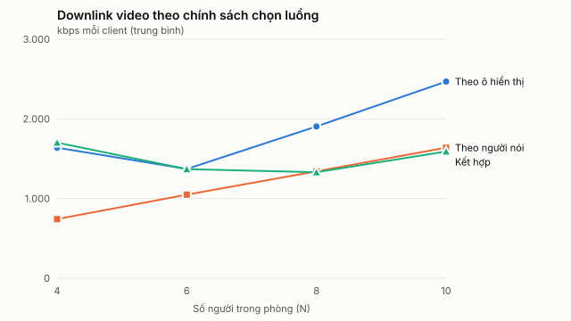

# Chính sách chọn luồng với người nói theo kịch bản

Sinh tự động bởi `node experiments/media-lab/summarize.mjs`. Mỗi client phát một giọng tổng hợp và lần lượt nói 5 s theo vòng tròn; chính sách chạy trên lưới ảo 1280×720 với tối đa 9 ô; mỗi lượt khởi động 30 s, đo 60 s; mọi client và SFU trên một máy.

Nguồn: [speaker-visible-2026-10-11-10-40-43.json](../evidence/media-lab/speaker-visible-2026-10-11-10-40-43.json), [speaker-speaker-2026-10-11-10-48-39.json](../evidence/media-lab/speaker-speaker-2026-10-11-10-48-39.json), [speaker-combined-2026-10-11-10-56-31.json](../evidence/media-lab/speaker-combined-2026-10-11-10-56-31.json)

| N | Chính sách | Downlink video (kbps) | CPU client (%) | Phát hiện người nói TB (ms) | p95 (ms) | Tỉ lệ lỡ slot | Sự kiện sai / slot | Lệnh đổi lớp / client |
| ---: | --- | ---: | ---: | ---: | ---: | ---: | ---: | ---: |
| 4 | Theo ô hiển thị | 1.639 | 38,4 | 693 | 806 | 0 | 0 | 3 |
| 4 | Theo người nói | 742 | 25,7 | 720 | 865 | 0 | 0 | 29,3 |
| 4 | Kết hợp | 1.702 | 32,8 | 736 | 857 | 0 | 0 | 3 |
| 6 | Theo ô hiển thị | 1.371 | 37,9 | 723 | 845 | 0 | 0 | 9 |
| 6 | Theo người nói | 1.049 | 36 | 732 | 860 | 0 | 0 | 34,2 |
| 6 | Kết hợp | 1.369 | 33,9 | 689 | 801 | 0 | 0 | 9 |
| 8 | Theo ô hiển thị | 1.905 | 48,4 | 745 | 863 | 0 | 0 | 11 |
| 8 | Theo người nói | 1.342 | 41,7 | 739 | 901 | 0 | 0 | 37,6 |
| 8 | Kết hợp | 1.330 | 37,5 | 722 | 869 | 0 | 0 | 45,9 |
| 10 | Theo ô hiển thị | 2.469 | 54,7 | 756 | 1.096 | 0 | 0 | 13 |
| 10 | Theo người nói | 1.639 | 41,8 | 868 | 1.798 | 0 | 0 | 42,3 |
| 10 | Kết hợp | 1.591 | 46,5 | 873 | 2.030 | 0 | 0 | 50,4 |

