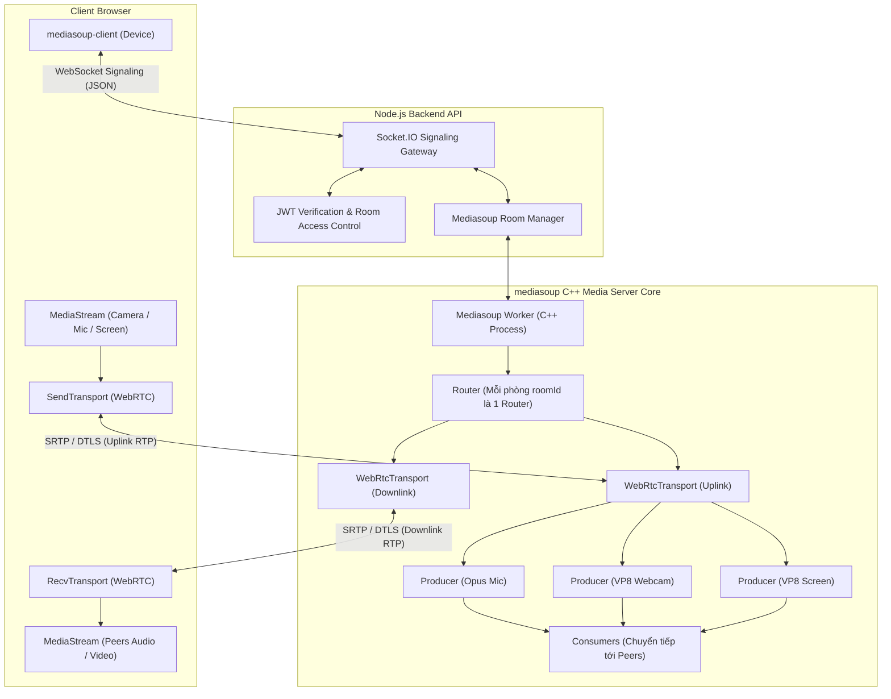
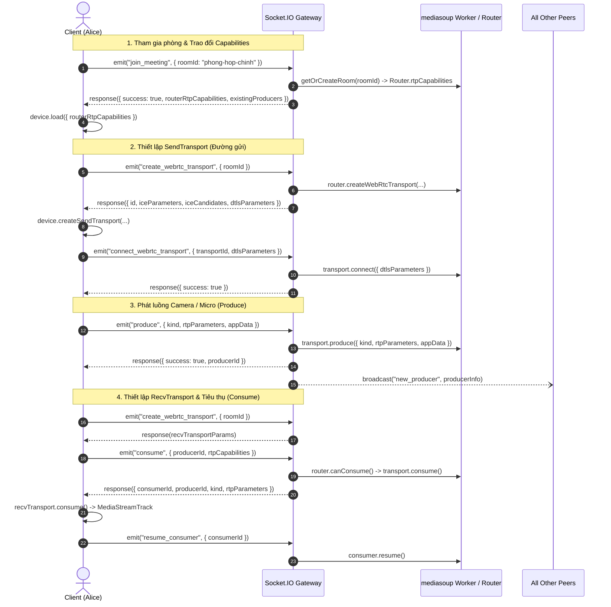

# 5. Hiện thực hóa Hội nghị truyền hình đa điểm (WebRTC + SFU mediasoup)

Tài liệu này mô tả chi tiết kiến trúc, thiết kế giao thức và hiện thực kỹ thuật của hệ thống hội nghị truyền hình đa điểm thời gian thực — phân hệ cốt lõi của đề tài Đồ án tốt nghiệp: **"Phát triển nền tảng không gian làm việc cộng tác thời gian thực tích hợp hội nghị truyền hình đa điểm"**.

---

## 5.1. So sánh và Lựa chọn Mô hình Hội nghị Đa điểm

Trong truyền thông WebRTC đa điểm, có ba mô hình kiến trúc mạng chính:

| Tiêu chí so sánh               | Mesh (P2P Full Mesh)                                                    | MCU (Multipoint Control Unit)                                                        | SFU (Selective Forwarding Unit) - **[Đề tài lựa chọn]**                                                      |
| :----------------------------- | :---------------------------------------------------------------------- | :----------------------------------------------------------------------------------- | :----------------------------------------------------------------------------------------------------------- |
| **Cơ chế hoạt động**           | Mỗi client mở kết nối P2P trực tiếp tới tất cả client khác trong phòng. | Server giải mã toàn bộ luồng, trộn thành một luồng video duy nhất rồi gửi về client. | Server chỉ đóng vai trò bộ định tuyến thông minh (RTP Router), chuyển tiếp các luồng media mà không giải mã. |
| **Băng thông Upload Client**   | $O(N-1)$ — Rất lớn khi số người tăng, dễ nghẽn mạng gia đình/văn phòng. | $O(1)$ — Rất thấp (chỉ gửi 1 luồng lên server).                                      | $O(1)$ — Rất thấp (chỉ gửi 1 luồng lên SFU).                                                                 |
| **Băng thông Download Client** | $O(N-1)$                                                                | $O(1)$                                                                               | $O(N-1)$ (nhưng có thể tối ưu bằng Simulcast / SVC).                                                         |
| **Tải CPU Máy chủ (Server)**   | $O(0)$ — Không tốn CPU server (thuần P2P).                              | Cực kỳ cao do phải giải mã và mã hóa lại toàn bộ video/audio thời gian thực.         | Rất thấp vì chuyển tiếp trực tiếp các gói tin RTP (Zero-transcoding forwarding).                             |
| **Độ trễ truyền thông**        | Rất thấp (P2P trực tiếp).                                               | Cao do tốn thời gian xử lý trộn hình (100 - 300ms).                                  | Cực thấp (gần tương đương P2P, chỉ chênh lệch vài mili-giây).                                                |
| **Khả năng mở rộng (Scale)**   | Kém (chỉ phù hợp 2 - 4 người).                                          | Rất đắt đỏ, cần server GPU/CPU cực mạnh.                                             | **Tối ưu nhất cho lớp học, hội nghị 10 - 100 người**.                                                        |

> [!TIP]
> **Kết luận lựa chọn:** Đề tài chọn mô hình **SFU** thông qua thư viện C++ cao cấp **mediasoup** vì vừa bảo đảm độ trễ tối thiểu (Low Latency), vừa tối ưu tải CPU máy chủ, đồng thời bảo toàn chất lượng hình ảnh gốc của từng thành viên.

---

## 5.2. Kiến trúc Tầng Media Server (mediasoup)

### Các thực thể cốt lõi trong Mediasoup:

1. **Worker:** Tiến trình nền C++ chạy đa luồng trên hệ điều hành, đảm nhiệm giải phóng và định tuyến gói tin mạng UDP ở mức socket kernel.
2. **Router:** Đại diện cho không gian phòng họp ảo (`roomId`). Các luồng media chỉ được trao đổi giữa các thành viên cùng thuộc một Router, đảm bảo cách ly dữ liệu giữa các phòng khác nhau.
3. **WebRtcTransport:** Đại diện cho kết nối WebRTC bảo mật giữa Client và SFU:
   - `SendTransport`: Chịu trách nhiệm gửi media từ trình duyệt lên máy chủ.
   - `RecvTransport`: Chịu trách nhiệm nhận media từ máy chủ về trình duyệt.
4. **Producer:** Luồng phát media được đẩy lên từ client (ví dụ: Micro, Camera hoặc Màn hình chia sẻ).
5. **Consumer:** Luồng nhận media từ một Producer cụ thể được SFU chuyển tiếp về cho client khác.

---

## 5.3. Quy trình Báo hiệu Thiết lập Phiên (Signaling Flow)

Quy trình thiết lập cuộc gọi giữa Client và SFU thông qua Socket.IO:

---

## 5.4. Cấu hình Tham số Truyền thông và Codecs

Hệ thống được cấu hình trong [services/api/src/modules/meetings/media/config.ts](../../services/api/src/modules/meetings/media/config.ts) với các thông số kỹ thuật tối ưu hóa theo tiêu chuẩn IETF và W3C:

### 1. Codecs hỗ trợ:

- **Audio (Âm thanh):**
  - Codec: `audio/opus`
  - Tần số lấy mẫu (Clock rate): `48000 Hz`
  - Số kênh (Channels): `2` (Stereo)
  - Payload type: `111`
- **Video (Hình ảnh):**
  - Codec: `video/VP8`
  - Clock rate: `90000 Hz`
  - Payload type: `96`
  - Khả năng tương thích: 100% các trình duyệt Chromium (Chrome, Edge, Brave), Firefox, Safari WebKit.

### 2. Cấu hình Cổng Mạng (RTC Ports):

- Dải cổng UDP: `40000 - 49999` (10,000 cổng dành riêng cho lưu lượng RTP/RTCP).
- Listen IP: `0.0.0.0`.
- Announced IP: `MEDIASOUP_ANNOUNCED_IP` (cung cấp IP tĩnh của server hoặc IP LAN cho các thiết bị cùng mạng).

### 3. An toàn thông tin và Bảo mật Media:

- **DTLS (Datagram Transport Layer Security):** Bắt tay mã hóa khóa phiên.
- **SRTP (Secure Real-time Transport Protocol):** Toàn bộ gói tin âm thanh và hình ảnh truyền trên mạng đều được mã hóa bằng AES-CM-128.
