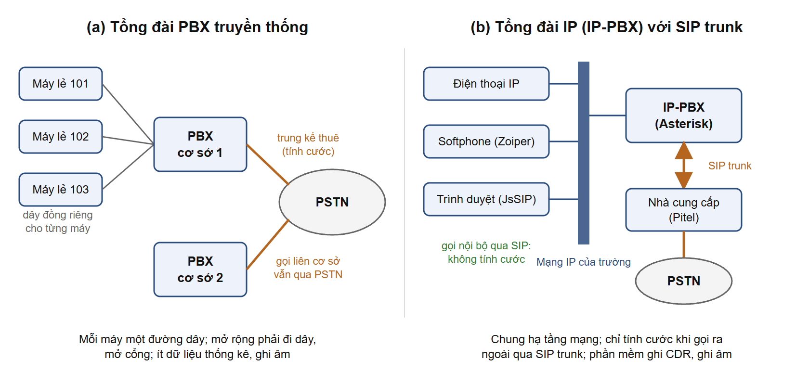
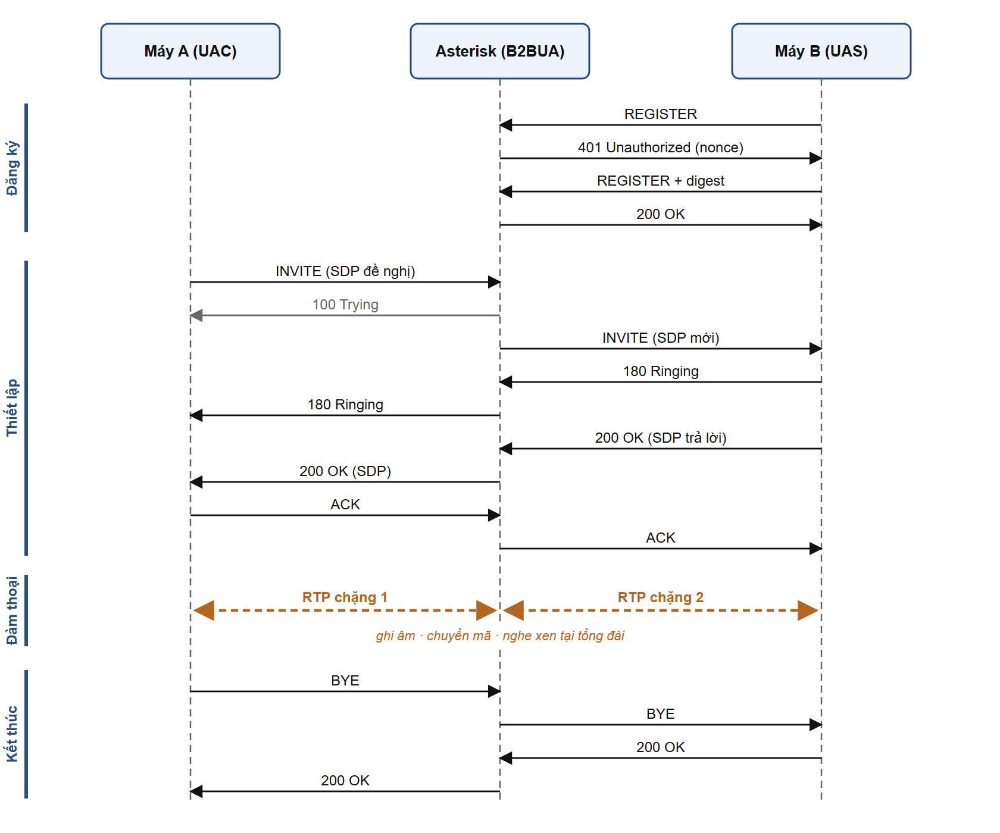
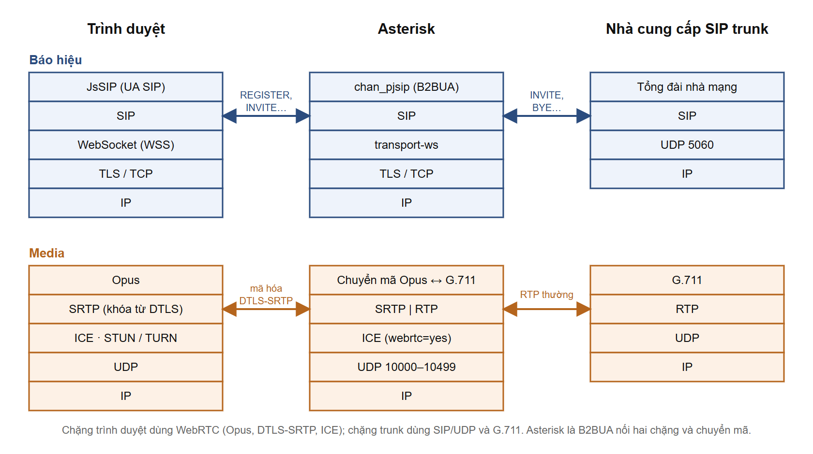
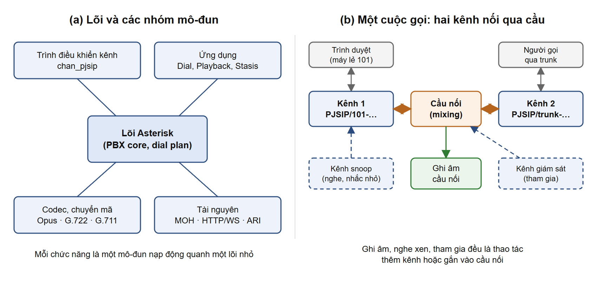
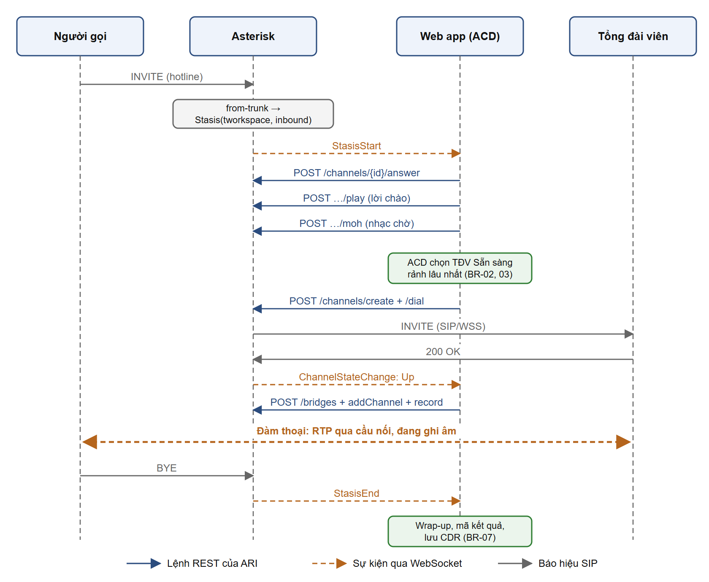
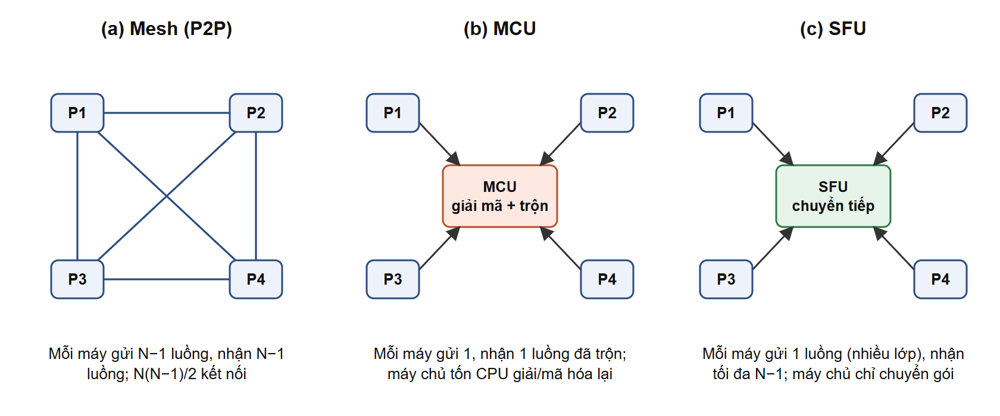

# CHƯƠNG 2. CƠ SỞ LÝ THUYẾT

Chương này trình bày các kiến thức nền tảng dùng để thiết kế và triển khai ba dịch vụ của đề tài. Tổng đài là phần lõi về hạ tầng nên được trình bày trước:

- Điện thoại IP và giao thức SIP/RTP (mục 2.1).
- Phần mềm tổng đài Asterisk cùng giao diện điều khiển ARI (mục 2.2).
- Lý thuyết vận hành call center và các chỉ số KPI (mục 2.3).
- Các phương pháp đánh giá chất lượng thoại và độ chịu tải (mục 2.4).

Các mục còn lại tóm tắt nền tảng của họp trực tuyến (WebRTC, kiến trúc SFU), video theo yêu cầu và các thành phần chung của ứng dụng web. Nội dung chỉ chọn những gì phục vụ trực tiếp cho các quyết định thiết kế ở Chương 3 và phương pháp đo ở Chương 6.

---

## 2.1 Điện thoại IP (VoIP)

### 2.1.1 Từ tổng đài PSTN đến IP-PBX

Mạng điện thoại công cộng truyền thống (PSTN) dùng chuyển mạch kênh. Mỗi cuộc gọi chiếm riêng một kênh 64 kbps từ đầu đến cuối trong suốt thời gian đàm thoại, kể cả lúc hai bên im lặng.

Trong một cơ quan, tổng đài nội bộ (PBX – Private Branch Exchange) cấp số máy lẻ cho từng phòng ban. Tổng đài kết nối ra PSTN qua một số đường trung kế thuê của nhà mạng. Mô hình này có ba hạn chế, và đây chính là bài toán đặt ra ở Chương 1:

- Chi phí thuê đường dây và cước gọi giữa các cơ sở.
- Khó mở rộng: muốn thêm máy lẻ phải đi dây và mở thêm cổng trên tổng đài.
- Gần như không có dữ liệu để thống kê hay ghi âm.

Điện thoại IP (VoIP – Voice over IP) số hóa và nén giọng nói, chia thành các gói nhỏ rồi truyền trên mạng IP sẵn có. Băng thông chỉ bị chiếm khi có gói tin. Cuộc gọi giữa hai máy lẻ trong cùng mạng của trường không đi qua nhà mạng nên không tính cước.

Một tổng đài IP (IP-PBX) là phần mềm chạy trên máy chủ thông thường, gồm ba nhóm chức năng:

- Đăng ký các máy lẻ (điện thoại IP, softphone).
- Định tuyến cuộc gọi theo bảng quy tắc (dial plan).
- Kết nối ra mạng điện thoại công cộng qua SIP trunk của nhà cung cấp.

Tách phần báo hiệu (thiết lập, kết thúc cuộc gọi) khỏi phần truyền media (luồng âm thanh) là đặc điểm cốt lõi của VoIP. Báo hiệu dùng giao thức SIP (mục 2.1.2). Media dùng RTP (mục 2.1.3).

Hình 2.1: Tổng đài PBX truyền thống và tổng đài IP với SIP trunk

### 2.1.2 Giao thức khởi tạo phiên SIP

SIP (Session Initiation Protocol) là giao thức báo hiệu dạng văn bản ở tầng ứng dụng, cú pháp tương tự HTTP. SIP dùng để tạo, thay đổi và kết thúc các phiên đa phương tiện giữa hai hay nhiều bên (Rosenberg và cộng sự, 2002). SIP chỉ thương lượng *có* phiên nào và *ở đâu*. Nội dung của phiên (codec, địa chỉ nhận media) được mô tả trong phần thân thông điệp bằng SDP.

**Thành phần.** Mỗi đầu cuối SIP là một tác tử người dùng (User Agent – UA). UA đóng vai UAC khi gửi yêu cầu và vai UAS khi trả lời. Phía mạng có ba loại máy chủ:

- **Registrar:** ghi nhận địa chỉ hiện tại của một máy lẻ.
- **Proxy:** chuyển tiếp yêu cầu đến đích.
- **B2BUA (Back-to-Back User Agent):** kết thúc cuộc gọi ở một phía rồi tự khởi tạo một cuộc gọi mới ở phía kia, nhờ đó toàn quyền kiểm soát cả hai chặng.

Asterisk hoạt động như một B2BUA. Đây là điều kiện để tổng đài ghi âm, chuyển máy, nghe xen và chuyển mã giữa hai chặng có codec khác nhau.

**Yêu cầu và đáp ứng.** Bảng 2.1 liệt kê các phương thức và mã đáp ứng xuất hiện trong hệ thống. Mã đáp ứng chia thành sáu lớp: 1xx tạm thời, 2xx thành công, 3xx chuyển hướng, 4xx lỗi phía khách, 5xx lỗi máy chủ, 6xx lỗi toàn cục.

Bảng 2.1: Các thông điệp SIP chính

| Thông điệp | Ý nghĩa | Dùng trong hệ thống |
| --- | --- | --- |
| REGISTER | Máy lẻ báo địa chỉ hiện tại cho registrar | Softphone web, Zoiper/Linphone đăng ký vào Asterisk |
| INVITE | Mời tham gia phiên, mang SDP đề nghị | Mọi cuộc gọi |
| ACK | Xác nhận đã nhận đáp ứng cuối của INVITE | Hoàn tất bắt tay ba bước |
| BYE | Kết thúc phiên đang diễn ra | Gác máy |
| CANCEL | Hủy INVITE chưa được trả lời | Người gọi gác máy khi đang đổ chuông |
| OPTIONS | Hỏi khả năng hoặc kiểm tra còn sống | Asterisk kiểm tra máy lẻ định kỳ (qualify) |
| REFER | Yêu cầu bên kia gọi tới một đích khác (Sparks, 2003) | Chuyển máy theo chuẩn SIP |
| 100 Trying, 180 Ringing | Đã nhận, đang đổ chuông | Hiện trạng thái "Đổ chuông" |
| 200 OK | Thành công, mang SDP trả lời | Nhận máy |
| 401/407 | Yêu cầu xác thực digest | Đăng ký máy lẻ có mật khẩu |
| 486 Busy Here, 487 Request Terminated | Máy bận; INVITE đã bị hủy | Chuyển sang hộp thư thoại; bỏ máy |

**Luồng một cuộc gọi.** Hình 2.2 minh họa một cuộc gọi cơ bản qua B2BUA:

1. Máy A gửi INVITE kèm SDP đề nghị tới tổng đài.
2. Tổng đài xác thực, tra dial plan, rồi gửi một INVITE mới tới máy B.
3. Máy B trả 180 Ringing, tổng đài chuyển tiếp về A.
4. B nhấc máy và trả 200 OK kèm SDP trả lời. A gửi ACK và luồng RTP bắt đầu.
5. Một bên gửi BYE để kết thúc. Bên kia trả 200 OK.

Một lần trao đổi yêu cầu–đáp ứng gọi là một *giao dịch* (transaction). Mối quan hệ giữa hai UA từ lúc INVITE thành công đến lúc BYE gọi là một *hội thoại* (dialog).

Hình 2.2: Đăng ký và một cuộc gọi SIP qua B2BUA

**Xác thực.** SIP dùng cơ chế digest kiểu HTTP. Khi máy lẻ gửi REGISTER hoặc INVITE, máy chủ trả 401 kèm một giá trị nonce. UA tính băm từ tên đăng nhập, mật khẩu và nonce rồi gửi lại, mật khẩu không bao giờ đi trên mạng. Tổng đài mở ra Internet thường bị dò mật khẩu hàng loạt, nên đề tài kết hợp thêm danh sách IP được phép (ACL) và fail2ban để chặn địa chỉ thử sai nhiều lần.

**Mô tả phiên SDP và mô hình đề nghị/trả lời.** SDP (Handley và cộng sự, 2006) là văn bản liệt kê, cho từng luồng media:

- Địa chỉ IP và cổng nhận.
- Danh sách codec theo thứ tự ưu tiên.
- Các thuộc tính khác (hướng gửi/nhận, khóa mã hóa).

Theo mô hình đề nghị/trả lời (Rosenberg & Schulzrinne, 2002b), bên gọi đưa ra danh sách codec, bên nhận chọn tập con mình hỗ trợ. Nếu hai chặng của B2BUA chọn codec khác nhau, tổng đài phải chuyển mã. Ví dụ: Opus ở chặng trình duyệt, G.711 ở chặng SIP trunk.

**Truyền phím DTMF.** IVR cần nhận phím người gọi bấm. Phím có thể truyền theo ba cách:

- Âm thanh trong luồng thoại (dễ hỏng khi codec nén mạnh).
- Thông điệp SIP INFO.
- Gói RTP sự kiện riêng theo RFC 4733 (Schulzrinne & Taylor, 2006). Đây là cách phổ biến nhất và là mặc định của Asterisk.

### 2.1.3 Truyền thoại bằng RTP và các codec

Luồng thoại được đóng gói bằng RTP (Schulzrinne và cộng sự, 2003) và chạy trên UDP. Mỗi gói RTP mang:

- Số thứ tự: phát hiện mất gói và sắp xếp lại.
- Nhãn thời gian theo đồng hồ lấy mẫu: phát đúng nhịp, tính jitter.
- Định danh nguồn SSRC.

RTCP đi kèm, định kỳ gửi báo cáo về tỉ lệ mất gói, jitter và thời gian khứ hồi. UDP được chọn thay cho TCP vì một gói thoại đến muộn thì không còn giá trị. Việc gửi lại của TCP chỉ làm tăng độ trễ.

**Jitter** là độ biến thiên thời gian đến giữa các gói. Bên nhận dùng bộ đệm jitter (jitter buffer) để giữ gói một khoảng ngắn trước khi phát, đổi lại độ trễ tăng thêm. RFC 3550 định nghĩa jitter ước lượng như sau. Gọi $D(i-1,i)$ là chênh lệch giữa khoảng cách thời điểm đến và khoảng cách nhãn thời gian của hai gói liên tiếp. Khi đó:

$$J_i = J_{i-1} + \frac{|D(i-1,i)| - J_{i-1}}{16} \tag{2.1}$$

Đây là trung bình trượt có trọng số 1/16, giúp làm mượt nhiễu tức thời. Wireshark và công cụ đo của đề tài (Chương 6) đều tính theo công thức này.

**Codec thoại.** Bảng 2.2 so sánh các codec được cấu hình trong hệ thống.

Bảng 2.2: Các codec thoại sử dụng

| Codec | Tần số lấy mẫu | Tốc độ bit | Đặc điểm | Dùng ở chặng |
| --- | --- | --- | --- | --- |
| G.711 (μ-law/A-law) | 8 kHz | 64 kbps | Không nén thực sự, gần như không tốn CPU, mọi thiết bị và nhà mạng đều hỗ trợ (ITU-T, 1988) | SIP trunk, điện thoại IP |
| G.722 | 16 kHz | 64 kbps | Băng rộng (wideband), tiếng rõ hơn G.711 cùng tốc độ bit | Softphone cài máy, điện thoại IP |
| Opus | 8–48 kHz | 6–510 kbps | Thích ứng, có sửa lỗi nội tuyến (FEC) và che mất gói; bắt buộc trong WebRTC (Valin và cộng sự, 2012) | Softphone web |

Ước lượng băng thông cho G.711 với chu kỳ đóng gói 20 ms:

- Mỗi gói mang 160 byte thoại, cộng 12 byte tiêu đề RTP, 8 byte UDP và 20 byte IPv4, tổng 200 byte.
- Mỗi giây có 50 gói, nên một chiều chiếm 80 kbps ở tầng IP, khoảng 87 kbps khi tính thêm tiêu đề Ethernet.

Con số này dùng để định cỡ số kênh trunk và đường truyền ở Chương 3.

### 2.1.4 SIP trunk và vấn đề NAT

**SIP trunk** là một kết nối SIP giữa tổng đài và nhà cung cấp dịch vụ thoại. Nhà cung cấp gán cho trunk một hoặc nhiều đầu số thật trên mạng điện thoại công cộng:

- **Cuộc gọi vào:** nhà cung cấp gửi INVITE tới tổng đài.
- **Cuộc gọi ra:** tổng đài gửi INVITE tới nhà cung cấp, kèm thông tin xác thực hoặc từ một địa chỉ IP đã đăng ký trước.

Số cuộc gọi đồng thời bị giới hạn bởi số kênh của gói cước. Vì vậy tổng đài phải tự giới hạn số cuộc gọi ra (quy tắc BR-21). Đề tài dùng trunk của Pitel với đầu số 028 7106 7388.

**NAT.** Khác với HTTP, SIP ghi địa chỉ IP và cổng *bên trong* nội dung thông điệp: tiêu đề Via, Contact và phần SDP. Khi máy lẻ đứng sau NAT, các địa chỉ này là địa chỉ riêng mà tổng đài không gửi tới được. Hậu quả điển hình là cuộc gọi kết nối được nhưng chỉ nghe một chiều hoặc không có tiếng. Các kỹ thuật xử lý gồm:

- **rport** (Rosenberg & Schulzrinne, 2003): máy chủ trả đáp ứng về đúng địa chỉ và cổng nguồn quan sát được, không dùng địa chỉ ghi trong Via. Asterisk bật bằng tùy chọn `force_rport`.
- **Viết lại Contact** (`rewrite_contact`): ghi đè địa chỉ đăng ký bằng địa chỉ nguồn thực.
- **RTP đối xứng** (`rtp_symmetric`): gửi RTP về đúng địa chỉ mà gói RTP từ máy lẻ đến, không tin địa chỉ trong SDP.
- **Giữ kết nối** (`qualify_frequency`): gửi OPTIONS định kỳ để ánh xạ NAT không bị hết hạn.
- Với softphone trên trình duyệt: dùng ICE/STUN/TURN của WebRTC (mục 2.5).

Cấu hình PJSIP của đề tài bật cả ba tùy chọn trên cho các máy lẻ SIP và tắt `direct_media`. Như vậy mọi luồng RTP đều đi qua tổng đài để ghi âm và nghe xen được.

### 2.1.5 Softphone trên trình duyệt: SIP qua WebSocket và WebRTC

Trình duyệt không mở được socket UDP để nói SIP trực tiếp. RFC 7118 (Baz Castillo và cộng sự, 2014) định nghĩa WebSocket làm kênh vận chuyển cho SIP: các thông điệp SIP đi nguyên dạng văn bản trong khung WebSocket, qua cổng HTTP/HTTPS thông thường.

Phần media dùng WebRTC (mục 2.5): luồng thoại được mã hóa DTLS-SRTP và đi theo đường ICE đã chọn.

Phía trình duyệt, thư viện **JsSIP** cài đặt một UA SIP đầy đủ bằng JavaScript, gồm đăng ký, gọi, nhận cuộc gọi, giữ máy, gửi DTMF và chuyển máy. JsSIP gắn luồng micro và loa vào RTCPeerConnection của trình duyệt.

Phía tổng đài, endpoint WebRTC trong Asterisk được bật `webrtc=yes`. Tùy chọn này kích hoạt ICE, DTLS, ghép kênh RTCP và hồ sơ AVPF mà trình duyệt yêu cầu. Khi người dùng web gọi ra trunk, Asterisk chuyển mã từ Opus sang G.711.

Nhờ cơ chế này, mỗi giảng viên hay cán bộ có một máy lẻ ngay trong trang web mà không phải cài thêm phần mềm. Đây là một phần tự xây dựng của đề tài (Chương 4).

Hình 2.3: Chồng giao thức của softphone web và SIP trunk

---

## 2.2 Phần mềm tổng đài Asterisk

### 2.2.1 Tổng quan và kiến trúc

Asterisk là phần mềm tổng đài mã nguồn mở (giấy phép GPLv2), hiện do Sangoma duy trì. Asterisk được dùng rộng rãi làm lõi cho các sản phẩm IP-PBX và call center như FreePBX hay Issabel (Madsen và cộng sự, 2019). Đề tài dùng Asterisk 22, phiên bản hỗ trợ dài hạn (LTS).

Asterisk gồm một lõi nhỏ và nhiều mô-đun nạp động:

- **Trình điều khiển kênh** (channel driver): nói chuyện với từng loại đầu cuối. `chan_pjsip` là driver SIP hiện hành, xây trên thư viện PJSIP.
- **Ứng dụng** (application): các bước xử lý cuộc gọi như Dial, Playback, VoiceMail.
- **Codec và bộ chuyển mã.**
- **Định dạng tệp** âm thanh.
- **Tài nguyên** (resource): nhạc chờ, giao diện HTTP, ARI.

Hai khái niệm trung tâm của Asterisk:

- **Kênh** (channel): một chặng của cuộc gọi giữa Asterisk và một đầu cuối. Một cuộc gọi giữa A và B qua tổng đài gồm hai kênh.
- **Cầu nối** (bridge): đối tượng nối nhiều kênh để trộn hoặc chuyển âm thanh giữa chúng.

Ghi âm, nghe xen, hội nghị hay chuyển máy đều quy về thao tác thêm hoặc bớt kênh trong cầu nối.

Hình 2.4: Kiến trúc mô-đun của Asterisk và quan hệ kênh – cầu nối

### 2.2.2 Dial plan

Dial plan (tệp `extensions.conf`) là "chương trình" quyết định cuộc gọi đi đâu. Dial plan gồm các *ngữ cảnh* (context). Mỗi ngữ cảnh chứa các *số* (extension), mỗi số là một chuỗi *bước* (priority) gọi ứng dụng.

Mỗi kênh đi vào một ngữ cảnh xác định theo nguồn gốc. Ví dụ, cuộc gọi từ trunk vào ngữ cảnh `from-trunk`, cuộc gọi từ máy lẻ vào `from-internal`. Ngữ cảnh vì thế cũng là cơ chế phân quyền: một máy lẻ chỉ gọi được những số có trong ngữ cảnh của nó.

Số có thể là mẫu. `_X` khớp một chữ số bất kỳ, `_N` khớp chữ số 2–9, dấu `.` khớp một hoặc nhiều ký tự bất kỳ. Ví dụ, mẫu `_0[1-9]XXXXXXXX` khớp số di động 10 chữ số trong nước, còn `_00.` khớp mọi số bắt đầu bằng mã gọi quốc tế. Đề tài dùng chính các mẫu này để chặn gọi quốc tế (BR-20) ngay ở tầng tổng đài, độc lập với kiểm tra phía ứng dụng.

Các ứng dụng dial plan liên quan đến đề tài được tóm tắt ở Bảng 2.3.

Bảng 2.3: Các ứng dụng Asterisk liên quan

| Ứng dụng | Chức năng | Tương ứng trong đề tài |
| --- | --- | --- |
| Dial | Gọi tới một hoặc nhiều kênh, chờ trả lời trong thời gian giới hạn | Gọi nội bộ giữa máy lẻ, gọi ra trunk (giới hạn thời lượng bằng tùy chọn `S()`) |
| Playback, Background | Phát tệp âm thanh; Background vừa phát vừa nhận phím | Lời chào IVR, thông báo ghi âm |
| VoiceMail | Ghi tin nhắn thoại vào hộp thư | Thay bằng ghi âm qua ARI để lưu vào kho tệp chung |
| Queue | Hàng đợi có sẵn với các chiến lược phân phối | Không dùng; ACD tự xây qua ARI (mục 2.2.4) |
| MixMonitor | Ghi âm trộn cả hai chiều của một kênh | Thay bằng ghi âm cầu nối qua ARI |
| ChanSpy | Nghe xen kênh khác: nghe im lặng, nhắc nhỏ (whisper), tham gia (barge) | Thay bằng snoop qua ARI (mục 2.2.3) |
| Stasis | Giao quyền điều khiển kênh cho một ứng dụng ARI bên ngoài | Điểm nối giữa dial plan và web app |

### 2.2.3 Các giao diện lập trình: AMI, AGI và ARI

Asterisk có ba cách để một chương trình bên ngoài can thiệp vào cuộc gọi:

- **AMI** (Asterisk Manager Interface): kết nối TCP dạng văn bản, nhận sự kiện của toàn hệ thống và gửi lệnh như khởi tạo cuộc gọi hay gác máy. AMI phù hợp cho giám sát và tích hợp CTI. AMI không điều khiển được từng bước xử lý của kênh, nên logic vẫn nằm trong dial plan.
- **AGI** (Asterisk Gateway Interface): khi kênh chạy tới bước `AGI()`, Asterisk gọi một script và chờ nó trả lệnh từng bước. Mỗi cuộc gọi một tiến trình hoặc một kết nối, theo kiểu đồng bộ.
- **ARI** (Asterisk REST Interface): có từ Asterisk 12. ARI gồm một API REST để ra lệnh và một kết nối WebSocket để nhận sự kiện dạng JSON (Sangoma, n.d.).

ARI có một đặc điểm khác về bản chất so với hai giao diện kia. Khi dial plan chạy tới `Stasis(app, tham số...)`, kênh rời khỏi dial plan và thuộc quyền ứng dụng tên `app`. Ứng dụng nhận sự kiện `StasisStart`, sau đó tự quyết định mọi việc:

- Trả lời kênh, phát âm thanh, nhận phím, bật nhạc chờ.
- Tạo kênh mới để gọi tổng đài viên.
- Tạo cầu nối, đưa các kênh vào, ghi âm cầu nối.

Ứng dụng nhận thêm các sự kiện `ChannelStateChange`, `ChannelDtmfReceived`, `PlaybackFinished` và `StasisEnd` khi kênh rời đi.

Các tài nguyên ARI đề tài sử dụng gồm:

- `channels`: tạo, trả lời, gác máy, phát âm, nhạc chờ, ghi âm.
- `bridges`: tạo cầu trộn, thêm hoặc bớt kênh, ghi âm.
- `playbacks`.
- `channels/{id}/snoop`.
- `channels/externalMedia`: đưa luồng âm thanh ra ngoài, dùng để nối cuộc gọi điện thoại vào phòng họp.

**Nghe xen bằng snoop.** `snoop` tạo một kênh "nghe trộm" gắn vào kênh của tổng đài viên. Tham số `spy` chọn hướng nghe, tham số `whisper` chọn hướng nói. Ba chế độ giám sát của NV-CC4 tương ứng như sau:

- **Nghe im lặng:** `spy=both, whisper=none`. Giám sát nghe cả hai bên, không ai nghe giám sát.
- **Nhắc nhỏ:** `whisper=out`. Chỉ tổng đài viên nghe giám sát.
- **Tham gia:** đưa kênh của giám sát thẳng vào cầu nối của cuộc gọi. Cả ba bên nghe nhau.

Kết quả tương đương ứng dụng ChanSpy trong đặc tả. Điểm khác là được điều khiển từ web app, kiểm tra quyền "chỉ trong phòng ban của mình" trước khi tạo kênh.

Hình 2.5: Một cuộc gọi hotline điều khiển qua ARI/Stasis

### 2.2.4 Hàng đợi có sẵn hay ACD tự xây

Asterisk có ứng dụng `Queue` với các chiến lược phân phối dựng sẵn:

- `ringall`: đổ chuông mọi người.
- `leastrecent`: người lâu nhất chưa nhận cuộc gọi.
- `fewestcalls`: người nhận ít cuộc gọi nhất.
- `rrmemory`: xoay vòng có nhớ vị trí.
- `random`.

`Queue` hỗ trợ nhạc chờ, thông báo vị trí, thời gian wrap-up và ghi nhật ký `queue_log`.

Tuy vậy, nhiều quy tắc nghiệp vụ của đề tài phụ thuộc vào dữ liệu nằm trong cơ sở dữ liệu của web app:

- Tổng đài viên chỉ được Sẵn sàng khi đã hoàn thành khóa đào tạo (BR-18).
- Phạm vi phòng ban của từng hàng đợi.
- Bắt buộc chọn mã kết quả trước khi nhận cuộc gọi kế tiếp (BR-07).
- Tự tạo ticket khi cuộc gọi nhỡ (BR-05).
- Hiện hồ sơ người gọi khớp theo số điện thoại (BR-19).

Nếu dùng `Queue`, trạng thái tổng đài viên tồn tại song song ở hai nơi. Một nơi là Asterisk (thành viên hàng đợi, tạm dừng). Nơi kia là web app (ca trực, khóa học, ticket). Hai bên phải đồng bộ qua AMI, dễ lệch nhau khi mất kết nối.

Vì vậy đề tài chọn hướng điều khiển qua ARI. Asterisk chỉ lo SIP, media, ghi âm và phát âm thanh. Bộ phân phối cuộc gọi tự động (ACD) nằm trong web app và là nguồn sự thật duy nhất cho trạng thái hàng đợi và tổng đài viên.

Đổi lại, ứng dụng phải tự xử lý các tình huống lỗi:

- Đổ chuông quá hạn (BR-04).
- Người gọi gác máy giữa chừng.
- Mất kết nối ARI rồi kết nối lại.

Chương 3 trình bày máy trạng thái dùng để quản lý các tình huống này.

---

## 2.3 Lý thuyết vận hành call center

### 2.3.1 Các thành phần của một call center

Một call center tiếp nhận cuộc gọi (inbound) gồm các thành phần sau (Gans và cộng sự, 2003):

- **IVR** (Interactive Voice Response): menu thoại tự động. Người gọi bấm phím để chọn dịch vụ hoặc phòng ban. IVR cũng phát thông báo bắt buộc, ví dụ "cuộc gọi được ghi âm" (BR-06).
- **Hàng đợi:** nơi cuộc gọi chờ khi chưa có tổng đài viên rảnh. Người gọi nghe nhạc chờ (MOH).
- **ACD** (Automatic Call Distributor): chọn tổng đài viên nhận cuộc gọi theo một chiến lược. Chiến lược "rảnh lâu nhất" (longest idle) giao cho người chờ lâu nhất kể từ cuộc gọi trước, nhằm chia đều tải. Chiến lược "xoay vòng" (round robin) giao lần lượt. Đề tài cài đặt cả hai, mặc định là rảnh lâu nhất theo đặc tả NV-CC2.
- **CTI** (Computer Telephony Integration): gắn cuộc gọi với dữ liệu nghiệp vụ. Khi cuộc gọi đổ chuông, màn hình tổng đài viên tự hiện hồ sơ người gọi (screen pop).
- **Wrap-up** (After Call Work): khoảng thời gian sau khi gác máy để ghi chú và chọn **mã kết quả** (disposition). Trong thời gian này tổng đài viên chưa nhận cuộc gọi mới.
- **CDR** (Call Detail Record): bản ghi chi tiết mỗi cuộc gọi, gồm ai gọi, ai nhận, các mốc thời gian và kết quả. CDR là nguồn dữ liệu cho báo cáo.
- **Giám sát:** wallboard thời gian thực, nghe xen/nhắc nhỏ/tham gia, nghe lại ghi âm để đánh giá chất lượng (QA).

### 2.3.2 Các chỉ số hiệu suất (KPI)

Gọi $t_q$ là lúc cuộc gọi vào hàng đợi, $t_a$ là lúc được nhận máy, $T_{talk}$ là thời gian nói, $T_{wrap}$ là thời gian hoàn tất. Các KPI trong đặc tả được định nghĩa như sau:

$$ASA = \frac{1}{n_{ans}}\sum (t_a - t_q) \tag{2.2}$$

$$AHT = \frac{1}{n_{ans}}\sum (T_{talk} + T_{wrap}) \tag{2.3}$$

$$\text{Tỉ lệ bỏ máy} = \frac{n_{abandon}}{n_{offered}} \qquad SL_{20} = \frac{n_{ans}(t_a - t_q \le 20\,s)}{n_{offered}} \tag{2.4}$$

Trong đó:

- $n_{offered}$ là tổng số cuộc gọi đến hàng đợi.
- $n_{ans}$ là số cuộc được nhận.
- $n_{abandon}$ là số cuộc người gọi gác máy khi đang chờ.

Mục tiêu "80/20" (80% cuộc gọi được nhận trong 20 giây) là ngưỡng service level thông dụng trong ngành và cũng là mục tiêu của đề tài.

### 2.3.3 Mô hình hàng đợi Erlang C

Để biết cần bao nhiêu tổng đài viên cho một lưu lượng gọi, call center thường dùng mô hình hàng đợi M/M/N, còn gọi là Erlang C (Gans và cộng sự, 2003). Gọi:

- $\lambda$: số cuộc gọi đến mỗi giây.
- $AHT$: thời gian xử lý trung bình.
- $A = \lambda \cdot AHT$: lưu lượng tính bằng Erlang, tức số tổng đài viên bận trung bình.
- $N > A$: số tổng đài viên.

Xác suất một cuộc gọi phải chờ là:

$$P_w = \frac{\dfrac{A^N}{N!}\dfrac{N}{N-A}}{\displaystyle\sum_{k=0}^{N-1}\frac{A^k}{k!} + \dfrac{A^N}{N!}\dfrac{N}{N-A}} \tag{2.5}$$

Từ đó suy ra thời gian chờ trung bình và service level với ngưỡng $t$:

$$ASA = P_w \cdot \frac{AHT}{N-A} \qquad SL(t) = 1 - P_w \, e^{-(N-A)\,t/AHT} \tag{2.6}$$

Ví dụ, một hotline nhận 60 cuộc/giờ với AHT = 3 phút có lưu lượng $A = 3$ Erlang. Bảng 2.4 cho thấy kết quả thay đổi mạnh theo số người trực.

Bảng 2.4: Ví dụ Erlang C với A = 3 Erlang, AHT = 180 s

| Số tổng đài viên N | P(phải chờ) | ASA | SL 20 s |
| --- | --- | --- | --- |
| 4 | 50,9% | 91,7 s | 54,4% |
| 5 | 23,6% | 21,2 s | 81,1% |
| 6 | 9,9% | 5,9 s | 92,9% |

Thêm một người từ 4 lên 5 đưa service level từ 54% lên 81%. Quan hệ phi tuyến này giải thích vì sao ca cao điểm mô phỏng ở Chương 6 có ASA vượt ngưỡng dù lưu lượng chỉ tăng vừa phải.

Erlang C giả định người gọi không bao giờ bỏ máy, nên đánh giá thời gian chờ bi quan hơn thực tế. Mô hình Erlang A có tính thêm hành vi bỏ máy, nhưng nằm ngoài phạm vi đề tài.

### 2.3.4 Ghi âm, lưu trữ và quyền riêng tư

Ghi âm phục vụ đánh giá chất lượng, giải quyết khiếu nại và làm tài liệu đào tạo (luồng LT3). Do chứa dữ liệu cá nhân, ghi âm cần ba điều kiện:

- Người gọi được thông báo trước (BR-06).
- Thời hạn lưu giới hạn (BR-17: 90 ngày).
- Chỉ người có thẩm quyền mới nghe được, và mỗi lượt nghe được ghi nhật ký.

Đề tài ghi âm ở mức cầu nối nên tệp chứa cả hai chiều. Tệp được lưu vào kho đối tượng chung với bản ghi hình của dịch vụ họp, áp chung chính sách lưu trữ.

---

## 2.4 Đánh giá chất lượng thoại và độ chịu tải

### 2.4.1 Các yếu tố ảnh hưởng chất lượng thoại

Chất lượng cảm nhận của một cuộc gọi VoIP phụ thuộc bốn nhóm yếu tố:

- **Độ trễ một chiều** (miệng đến tai): gồm thời gian đóng gói, truyền trên mạng, bộ đệm jitter và xử lý. Theo khuyến nghị G.114 (ITU-T, 2003), dưới 150 ms là chấp nhận được với hầu hết ứng dụng. Trên 400 ms thì hội thoại bị chồng tiếng rõ rệt.
- **Mất gói:** gói thất lạc trên mạng hoặc đến quá muộn so với bộ đệm. Các codec có cơ chế che mất gói (PLC) chịu được mất gói tốt hơn đáng kể.
- **Jitter:** buộc bộ đệm phải lớn hơn, gián tiếp làm tăng độ trễ.
- **Suy hao do codec:** codec nén mạnh làm giảm độ trung thực ngay cả khi mạng hoàn hảo.

### 2.4.2 Thang MOS và các phương pháp đo

**MOS** (Mean Opinion Score) là điểm trung bình người nghe chấm theo thang 1–5: 5 xuất sắc, 4 tốt, 3 khá, 2 kém, 1 rất kém (ITU-T, 1996). Có ba cách xác định MOS:

- **Chủ quan:** tổ chức người nghe chấm điểm. Chính xác nhất nhưng tốn kém và không lặp lại được.
- **Khách quan có tham chiếu:** so sánh tín hiệu gốc với tín hiệu nhận được, ví dụ PESQ (P.862) và POLQA (P.863). Cần cả hai tệp âm thanh.
- **Tham số (mô hình mạng):** ước lượng từ các thông số đo được trên mạng như độ trễ, mất gói và codec. Đại diện là E-model (G.107). Chỉ cần dữ liệu bắt gói nên đo được trên mọi cuộc gọi, kể cả cuộc gọi tải hàng loạt.

Đề tài chọn E-model vì phương pháp này đi đúng với yêu cầu "đánh giá chất lượng thoại bằng Wireshark" trong đặc tả. Các thông số đầu vào lấy trực tiếp từ tệp bắt gói.

### 2.4.3 E-model

E-model (ITU-T, 2015) tính hệ số truyền dẫn $R$ (thang 0–100) bằng cách lấy giá trị tối đa trừ đi các suy hao:

$$R = R_0 - I_s - I_d - I_{e,eff} + A \tag{2.7}$$

Trong đó:

- $R_0 - I_s$: tỉ số tín hiệu trên nhiễu cơ bản và suy hao đồng thời. Với tham số mặc định, giá trị này bằng 93,2.
- $I_d$: suy hao do độ trễ.
- $I_{e,eff}$: suy hao do codec và mất gói.
- $A$: hệ số "lợi thế" (bằng 0 với điện thoại cố định).

Cole và Rosenbluth (2001) đưa ra dạng rút gọn cho $I_d$ theo độ trễ một chiều $d$ (ms):

$$I_d = 0{,}024\,d + 0{,}11\,(d - 177{,}3)\,H(d - 177{,}3) \tag{2.8}$$

Với $H$ là hàm bậc thang. Như vậy suy hao tăng chậm cho tới khoảng 177 ms rồi tăng nhanh.

Suy hao do mất gói ngẫu nhiên với tỉ lệ $P_{pl}$ (%) được tính bằng:

$$I_{e,eff} = I_e + (95 - I_e)\,\frac{P_{pl}}{P_{pl} + B_{pl}} \tag{2.9}$$

Với G.711, $I_e = 0$. $B_{pl}$ đo độ bền của codec trước mất gói: $B_{pl} = 25{,}1$ khi có che mất gói, chỉ $4{,}3$ khi không có (ITU-T G.113, Phụ lục I).

Cuối cùng, $R$ được quy đổi sang MOS:

$$MOS = 1 + 0{,}035R + 7\cdot10^{-6}\,R\,(R-60)(100-R), \quad 0 < R < 100 \tag{2.10}$$

Với mạng hoàn hảo ($R = 93{,}2$), MOS tối đa của G.711 là khoảng 4,41. Đây là trần lý thuyết để đối chiếu kết quả đo ở Chương 6.

Bảng 2.5: Quan hệ giữa R, MOS và mức hài lòng (theo G.107/G.109)

| R | MOS | Mức hài lòng của người dùng |
| --- | --- | --- |
| 90–100 | 4,34–4,5 | Rất hài lòng |
| 80–90 | 4,03–4,34 | Hài lòng |
| 70–80 | 3,60–4,03 | Một số người không hài lòng |
| 60–70 | 3,10–3,60 | Nhiều người không hài lòng |
| 50–60 | 2,58–3,10 | Gần như tất cả không hài lòng |

Đề tài đặt mục tiêu MOS ≥ 4,0, tương ứng mức "hài lòng".

### 2.4.4 Công cụ đo: Wireshark và SIPp

**Wireshark** (và phiên bản dòng lệnh tshark) bắt và giải mã gói tin. Với VoIP, Wireshark nhận diện được hội thoại SIP và luồng RTP. Chức năng phân tích luồng RTP cho biết:

- Số gói mất và lỗi thứ tự.
- Khoảng cách tối đa giữa hai gói.
- Jitter tính theo công thức (2.1).

Đề tài trích các trường `rtp.ssrc`, `rtp.seq`, `rtp.timestamp` và thời điểm bắt từ tệp `.pcap`, sau đó tính độ trễ, mất gói và jitter cho từng cuộc gọi rồi đưa vào E-model.

**SIPp** là công cụ mã nguồn mở tạo lưu lượng SIP theo kịch bản XML. Kịch bản mô tả chuỗi thông điệp gửi và nhận, ví dụ INVITE, chờ 180/200, gửi ACK, giữ máy một khoảng, rồi BYE. SIPp điều chỉnh được ba tham số:

- Tốc độ tạo cuộc gọi (cuộc/giây).
- Giới hạn số cuộc đồng thời.
- Tổng số cuộc.

SIPp thống kê số cuộc thành công, thất bại và thời gian đáp ứng. Chế độ `-rtp_echo` gửi trả nguyên mọi gói RTP nhận được, cùng SSRC và số thứ tự. Nhờ đó một máy đo duy nhất xác định được thời gian khứ hồi của từng gói mà không cần đồng bộ đồng hồ giữa hai máy.

**Đo độ chịu tải.** Lưu lượng đặt lên tổng đài tính bằng Erlang, bằng tốc độ cuộc gọi nhân thời gian giữ máy. Phép đo tăng dần số cuộc đồng thời theo từng mức và ghi nhận ba chỉ số ở mỗi mức:

- Tỉ lệ cuộc gọi thành công.
- Thời gian thiết lập cuộc gọi.
- Tài nguyên CPU và bộ nhớ của tổng đài và ứng dụng.

*Điểm bão hòa* là mức mà tỉ lệ thành công bắt đầu giảm hoặc thời gian thiết lập tăng đột biến. Điểm này cho biết thành phần nào là nút cổ chai: tầng SIP/media của Asterisk hay tầng ARI/ACD của ứng dụng.

---

## 2.5 WebRTC

WebRTC là bộ API của trình duyệt cùng tập giao thức để truyền âm thanh, video và dữ liệu thời gian thực mà không cần cài thêm phần mềm (Alvestrand, 2021). Trong đề tài, WebRTC dùng ở hai chỗ: softphone trên web (mục 2.1.5) và phòng họp trực tuyến.

**Báo hiệu.** WebRTC không quy định kênh báo hiệu. Softphone dùng SIP qua WebSocket. Phòng họp dùng Socket.IO với các cấu trúc JSON của mediasoup (RTP capabilities, ICE và DTLS parameters) thay cho SDP.

**Vượt NAT với ICE, STUN, TURN.** ICE (Keränen và cộng sự, 2018) thu thập các địa chỉ ứng viên rồi kiểm tra từng cặp để chọn đường tốt nhất. Có ba loại ứng viên:

- **host:** địa chỉ cục bộ.
- **server reflexive:** địa chỉ công khai do máy chủ STUN cho biết.
- **relayed:** địa chỉ trung chuyển do máy chủ TURN cấp (Reddy và cộng sự, 2020).

TURN là phương án cuối khi mạng chặn UDP. Lúc đó lưu lượng có thể đi qua TURN/TCP. Đề tài dùng coturn làm máy chủ TURN.

**Bảo mật.** Hai bên bắt tay DTLS trên cùng kênh UDP, rồi dùng khóa thu được cho SRTP (Baugher và cộng sự, 2004). Mọi luồng WebRTC vì thế đều được mã hóa giữa trình duyệt và điểm cuối kia, tức Asterisk hoặc SFU.

**Codec.** Âm thanh dùng Opus, bật FEC và tắt DTX để tránh cắt cuối từ. Video dùng VP8, codec mà mọi trình duyệt chính đều hỗ trợ (Bankoski và cộng sự, 2011).

## 2.6 Hội nghị đa điểm và mediasoup

### 2.6.1 Ba kiến trúc Mesh, MCU, SFU

Khi có từ ba người trở lên, có ba cách đưa media của mỗi người tới những người còn lại (Westerlund & Wenger, 2015):

- **Mesh:** mỗi máy kết nối trực tiếp với mọi máy khác, phải mã hóa và gửi N−1 luồng.
- **MCU:** máy chủ giải mã, trộn rồi mã hóa lại thành một luồng cho mỗi người. Máy khách nhẹ nhưng máy chủ rất tốn CPU.
- **SFU:** máy chủ nhận một luồng từ mỗi người và chuyển tiếp nguyên gói RTP, không giải mã, cho những người cần xem.

Hình 2.6: Ba kiến trúc hội nghị đa điểm: Mesh, MCU và SFU

Gọi $b$ là tốc độ bit một luồng video và $N$ là số người bật camera. Băng thông lên (U) và xuống (D) của mỗi máy khách là:

$$U_{mesh} = D_{mesh} = (N-1)\,b;\quad U_{sfu} = \textstyle\sum_l b_l,\ D_{sfu} = \sum_{i=1}^{N-1} b_{l_i};\quad U_{mcu} = D_{mcu} = b \tag{2.11}$$

Bảng 2.6: So sánh ba kiến trúc hội nghị đa điểm

| Tiêu chí | Mesh | MCU | SFU |
| --- | --- | --- | --- |
| Luồng lên mỗi máy | N−1 | 1 | 1 (nhiều lớp simulcast) |
| Luồng xuống mỗi máy | N−1 | 1 (đã trộn) | Tối đa N−1, chọn lớp |
| CPU máy chủ media | Không có | Rất cao | Thấp (chỉ chuyển gói) |
| CPU máy khách | Cao, tăng theo N | Thấp | Trung bình |
| Độ trễ | Thấp nhất | Cao hơn | Thấp |
| Quy mô phù hợp | Vài người | Lớn nhưng đắt | Hàng chục đến hàng trăm |

Đề tài chọn SFU làm lõi phòng họp và lớp học live. Mesh được dùng làm mốc so sánh trong thực nghiệm.

Asterisk cũng có thể làm hội nghị thoại (ConfBridge) theo kiểu MCU. Đề tài không dùng cách này cho phòng họp vì cần video cho nhiều người. Thay vào đó, đề tài nối cuộc gọi điện thoại vào phòng họp SFU qua `externalMedia` (mục 2.2.3).

### 2.6.2 Simulcast, chọn luồng và thích ứng

- **Simulcast:** người gửi mã hóa cùng một nguồn camera thành nhiều lớp độ phân giải khác nhau. SFU chọn lớp phù hợp cho từng người xem theo kích thước ô hình và chất lượng mạng của họ, không cần mã hóa lại. Hình 2.7 (`diagrams/hinh-2-2-simulcast.png`)
- **Chọn luồng theo người nói (Last-N):** chỉ chuyển tiếp video chất lượng cao của vài người gần đây nhất đã nói hoặc đang được xem (Grozev và cộng sự, 2015). Nhờ vậy băng thông xuống không tăng tuyến tính theo số người trong phòng.
- **Thích ứng theo mạng:** đo mất gói và RTT bằng `getStats()`. Khi mạng xấu thì hạ lớp video, có thể chỉ giữ âm thanh. Khi mạng tốt lại thì nâng lớp chậm rãi theo nguyên tắc "hạ nhanh, nâng chậm".

### 2.6.3 mediasoup

mediasoup là thư viện SFU mã nguồn mở. Phần xử lý gói viết bằng C++, chạy trong các tiến trình worker, điều khiển từ Node.js (mediasoup, n.d.). Các khái niệm chính:

- **Worker:** một tiến trình xử lý gói tin, chạy trên một lõi CPU.
- **Router:** một phòng, nằm trong một worker, định nghĩa các codec được hỗ trợ.
- **WebRtcTransport:** kết nối ICE/DTLS giữa trình duyệt và router.
- **PlainTransport:** truyền RTP thuần. Đề tài dùng để đưa luồng sang FFmpeg ghi hình và để nối âm thanh với Asterisk.
- **Producer / Consumer:** luồng gửi lên / luồng chuyển xuống. Với producer simulcast, mỗi consumer chọn lớp bằng `setPreferredLayers`.

mediasoup không có sẵn báo hiệu. Giao thức báo hiệu qua Socket.IO là phần đề tài tự xây dựng.

### 2.6.4 Chỉ số chất lượng phòng họp

Bảng 2.7: Các chỉ số QoS của phòng họp lấy từ `RTCPeerConnection.getStats()`

| Chỉ số | Ý nghĩa | Nguồn |
| --- | --- | --- |
| RTT (ms) | Thời gian khứ hồi | candidate-pair.currentRoundTripTime |
| Jitter (ms) | Biến thiên thời gian đến | inbound-rtp.jitter |
| Mất gói (%) | Tỉ lệ gói không đến trong cửa sổ đo | inbound-rtp.packetsLost / packetsReceived |
| Băng thông (kbps) | Tốc độ bit thực gửi/nhận | bytesSent, bytesReceived |
| FPS nhận | Số khung hình giải mã mỗi giây | inbound-rtp.framesPerSecond |

Các chỉ số tốc độ và tỉ lệ mất gói được tính trên hiệu của hai lần lấy mẫu, không tính trên cả phiên, để phản ánh tình trạng hiện tại.

## 2.7 Ghi hình, video theo yêu cầu và nhận dạng giọng nói

- **FFmpeg:** công cụ chuyển mã và đóng gói media (FFmpeg, n.d.). Chế độ sao chép (`-c copy`) ghi gói đã nén mà không giải mã. Đề tài dùng chế độ này để ghi hình phòng họp trực tiếp từ PlainTransport của mediasoup.
- **HLS** (HTTP Live Streaming): chia video thành các đoạn nhỏ cùng một danh sách phát `.m3u8`, phát qua HTTP thông thường (Pantos & May, 2017). HLS cho phép tua, lưu trên kho đối tượng S3 và tận dụng bộ đệm CDN. Bản ghi buổi họp và video bài giảng đều được chuyển sang HLS. Nhờ vậy luồng LT2 tự đăng bản ghi buổi live thành bài video trong khóa học.
- **Nhận dạng giọng nói (ASR):** mô hình Whisper (Radford và cộng sự, 2022) hỗ trợ tiếng Việt và có thể tự lưu trữ qua API tương thích `/v1/audio/transcriptions`. Đề tài dùng ASR ở hai nơi:
  - Chép lời bản ghi họp thành phụ đề WebVTT.
  - Chép lời ghi âm cuộc gọi hotline, giúp giám sát đọc và tìm kiếm nội dung cuộc gọi mà không phải nghe lại.

## 2.8 Nền tảng ứng dụng web

### 2.8.1 Ứng dụng trang đơn, REST và Socket.IO

- **Giao diện:** ứng dụng trang đơn (SPA) viết bằng React. Mã giao diện tải một lần, nội dung cập nhật bằng lời gọi API.
- **REST** (Fielding, 2000): biểu diễn tài nguyên bằng URL và thao tác bằng phương thức HTTP. REST là phi trạng thái nên có thể nhân bản máy chủ API.
- **WebSocket** (Fette & Melnikov, 2011) và thư viện **Socket.IO:** cung cấp kênh hai chiều để máy chủ đẩy sự kiện ngay khi xảy ra. Các sự kiện gồm cuộc gọi đổ chuông, thay đổi trạng thái tổng đài viên, số liệu wallboard và lệnh điều hành phòng họp. Socket.IO bổ sung tự kết nối lại, xác nhận thông điệp và khái niệm phòng (room).
- **Nhiều tiến trình API:** khi chạy nhiều tiến trình, sự kiện được chuyển giữa các tiến trình bằng adapter PostgreSQL. Adapter này dựa trên cơ chế LISTEN/NOTIFY nên không cần thêm Redis.

### 2.8.2 PostgreSQL và kho đối tượng

PostgreSQL cung cấp giao dịch ACID và ràng buộc khóa ngoại. Ngoài ra, đề tài tận dụng ba cơ chế đồng bộ của PostgreSQL thay cho các dịch vụ phụ trợ:

- **Khóa hàng** (`SELECT … FOR UPDATE`): tuần tự hóa thao tác nhạy cảm. Ví dụ: hai tiến trình không được giao cùng một cuộc gọi cho hai tổng đài viên (BR-02).
- **`FOR UPDATE SKIP LOCKED`:** nhiều worker cùng lấy việc từ một bảng hàng đợi mà không lấy trùng. Dùng cho chuyển mã video và chép lời.
- **Khóa tư vấn** (advisory lock): bầu một tiến trình duy nhất chạy các tác vụ định kỳ như tự đóng ticket (BR-08) và xóa ghi âm hết hạn (BR-17).

Tệp lớn (ghi âm, ghi hình, video bài giảng, tài liệu PDF) lưu trong kho đối tượng tương thích S3 (MinIO). Ghi âm và tin nhắn thoại chỉ được phát qua đường dẫn có chữ ký, hết hạn sau 60 giây. Máy chủ kiểm tra chữ ký và quyền trước khi phát, đồng thời ghi mỗi lượt nghe vào nhật ký.

### 2.8.3 Mô hình phân quyền

Kiểm soát truy cập theo vai trò (RBAC) gán quyền cho vai trò rồi gán vai trò cho người dùng (Sandhu và cộng sự, 1996). Người có nhiều vai trò được hợp các quyền. RBAC thuần không diễn đạt được hai loại ràng buộc mà đặc tả yêu cầu:

- "Chỉ trong phòng ban của mình".
- "Chỉ khi là chủ phòng họp hoặc giảng viên phụ trách khóa".

Vì vậy đề tài kết hợp ba lớp:

1. Vai trò hệ thống (RBAC).
2. Phạm vi dữ liệu: toàn trường, đơn vị, hoặc của mình.
3. Vai trò theo ngữ cảnh, gắn trên từng đối tượng cụ thể.

Cả ba lớp được kiểm tra ở mọi API và mọi sự kiện socket. Chương 3 trình bày chi tiết thiết kế này.

---

## 2.9 Tóm tắt chương

Bảng 2.8 tóm tắt cách các kiến thức trong chương dẫn tới quyết định thiết kế ở các chương sau.

Bảng 2.8: Từ cơ sở lý thuyết đến quyết định thiết kế

| Kiến thức | Quyết định trong đề tài | Trình bày ở |
| --- | --- | --- |
| SIP, B2BUA, NAT | Asterisk làm B2BUA, tắt direct media để mọi RTP qua tổng đài; bật rport, rewrite_contact, rtp_symmetric | 3.2, 4.3.1 |
| SIP qua WebSocket, JsSIP | Softphone ngay trên web, không cài phần mềm | 4.3.3 |
| ARI/Stasis so với Queue | ACD tự xây trong web app, một nguồn sự thật cho trạng thái | 3.3, 4.3.2 |
| Mẫu số trong dial plan | Chặn gọi quốc tế và giới hạn thời lượng ngay ở tổng đài (BR-20, BR-21) | 4.3.7 |
| ARI snoop | Nghe im lặng, nhắc nhỏ, tham gia, có kiểm tra phạm vi phòng ban | 3.6.3, 4.3.5 |
| KPI, Erlang C | Công thức báo cáo ASA, AHT, SL; giải thích kết quả ca cao điểm | 4.3.8, 6.5 |
| E-model, Wireshark, SIPp | Phương pháp đo MOS từ tệp bắt gói và đo điểm bão hòa | 6.3, 6.4 |
| SFU, simulcast, mediasoup | Lõi phòng họp và lớp học live | 4.4 |
| HLS, ASR | Bản ghi xem lại, luồng LT2, chép lời cuộc gọi | 4.5, 4.7 |
| PostgreSQL, RBAC ba lớp | Hàng đợi tác vụ, khóa, phân quyền theo đơn vị và ngữ cảnh | 3.7 |

---

## Tài liệu tham khảo bổ sung cho chương này

Định dạng APA, chèn vào danh mục chung. Các mục WebRTC, mediasoup, HLS, Whisper, REST, WebSocket đã có trong báo cáo cũ.

- Baz Castillo, I., Millán Villegas, J., & Pascual, V. (2014). *The WebSocket protocol as a transport for the Session Initiation Protocol (SIP)* (RFC 7118). IETF.
- Cole, R. G., & Rosenbluth, J. H. (2001). Voice over IP performance monitoring. *ACM SIGCOMM Computer Communication Review, 31*(2), 9–24.
- Gans, N., Koole, G., & Mandelbaum, A. (2003). Telephone call centers: Tutorial, review, and research prospects. *Manufacturing & Service Operations Management, 5*(2), 79–141.
- Handley, M., Jacobson, V., & Perkins, C. (2006). *SDP: Session Description Protocol* (RFC 4566). IETF.
- ITU-T. (1988). *G.711: Pulse code modulation (PCM) of voice frequencies*.
- ITU-T. (1996). *P.800: Methods for subjective determination of transmission quality*.
- ITU-T. (2003). *G.114: One-way transmission time*.
- ITU-T. (2015). *G.107: The E-model: a computational model for use in transmission planning*.
- ITU-T. (2001). *G.113 Appendix I: Provisional planning values for the equipment impairment factor Ie and packet-loss robustness factor Bpl*.
- Madsen, L., Van Meggelen, J., & Bryant, R. (2019). *Asterisk: The definitive guide* (5th ed.). O'Reilly Media.
- Rosenberg, J., Schulzrinne, H., Camarillo, G., Johnston, A., Peterson, J., Sparks, R., Handley, M., & Schooler, E. (2002). *SIP: Session Initiation Protocol* (RFC 3261). IETF.
- Rosenberg, J., & Schulzrinne, H. (2002b). *An offer/answer model with the Session Description Protocol (SDP)* (RFC 3264). IETF.
- Rosenberg, J., & Schulzrinne, H. (2003). *An extension to the Session Initiation Protocol (SIP) for symmetric response routing* (RFC 3581). IETF.
- Sandhu, R. S., Coyne, E. J., Feinstein, H. L., & Youman, C. E. (1996). Role-based access control models. *IEEE Computer, 29*(2), 38–47.
- Sangoma. (n.d.). *Asterisk REST Interface (ARI)*. Asterisk Documentation. https://docs.asterisk.org/Configuration/Interfaces/Asterisk-REST-Interface-ARI/
- Schulzrinne, H., Casner, S., Frederick, R., & Jacobson, V. (2003). *RTP: A transport protocol for real-time applications* (RFC 3550). IETF.
- Schulzrinne, H., & Taylor, T. (2006). *RTP payload for DTMF digits, telephony tones, and telephony signals* (RFC 4733). IETF.
- SIPp. (n.d.). *SIPp: A free open source test tool / traffic generator for the SIP protocol*. https://sipp.sourceforge.net/
- Sparks, R. (2003). *The Session Initiation Protocol (SIP) Refer method* (RFC 3515). IETF.
- Wireshark Foundation. (n.d.). *Wireshark user's guide: RTP analysis*. https://www.wireshark.org/docs/

## Tệp hình của chương

| Hình | Tệp (SVG và PNG 2x cùng tên) |
| --- | --- |
| 2.1 | diagrams/hinh-2-1-pbx-ippbx |
| 2.2 | diagrams/hinh-2-2-sip-b2bua |
| 2.3 | diagrams/hinh-2-3-softphone-web |
| 2.4 | diagrams/hinh-2-4-asterisk-kenh-cau |
| 2.5 | diagrams/hinh-2-5-stasis-ari |
| 2.6 | diagrams/hinh-2-1-mesh-mcu-sfu (hình cũ, đánh số lại) |
| 2.7 | diagrams/hinh-2-2-simulcast (hình cũ, đánh số lại) |

Hình 2.1–2.5 sinh bằng `python diagrams/ve-hinh-chuong-2.py diagrams`; sửa nhãn trong script rồi chạy lại.
