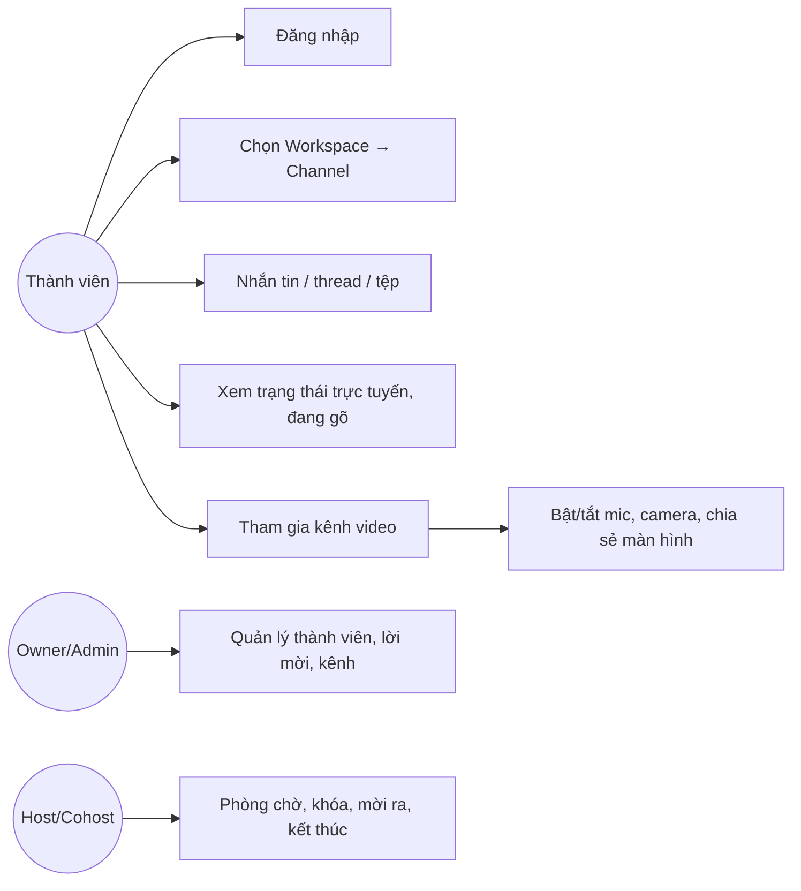
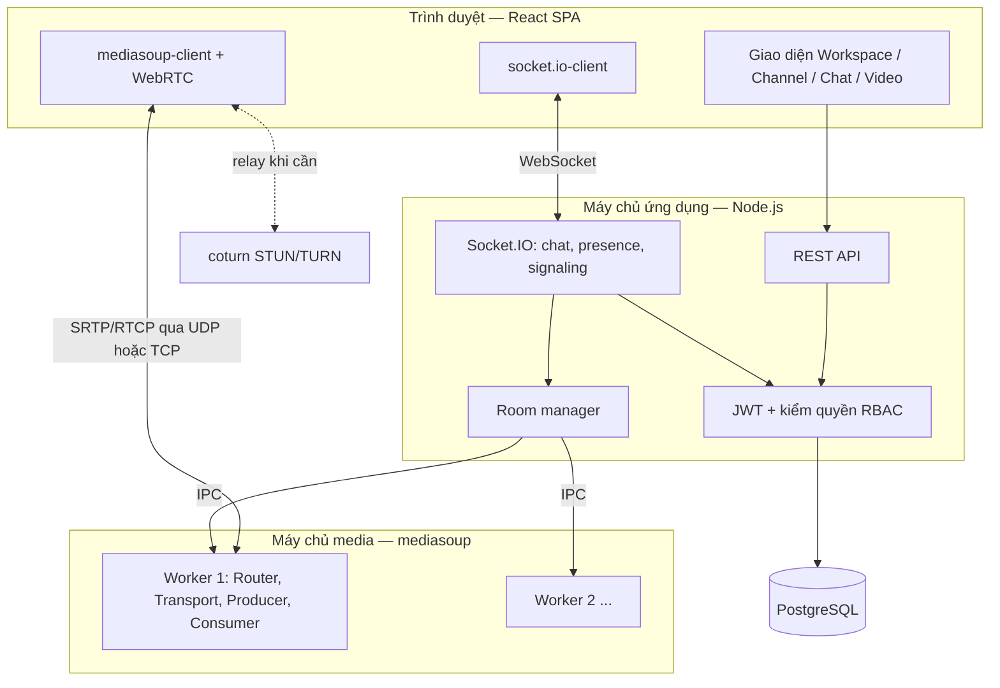
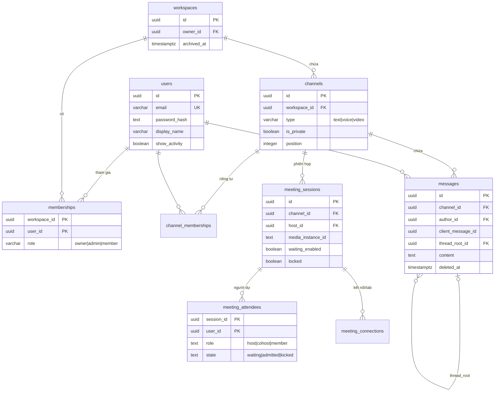
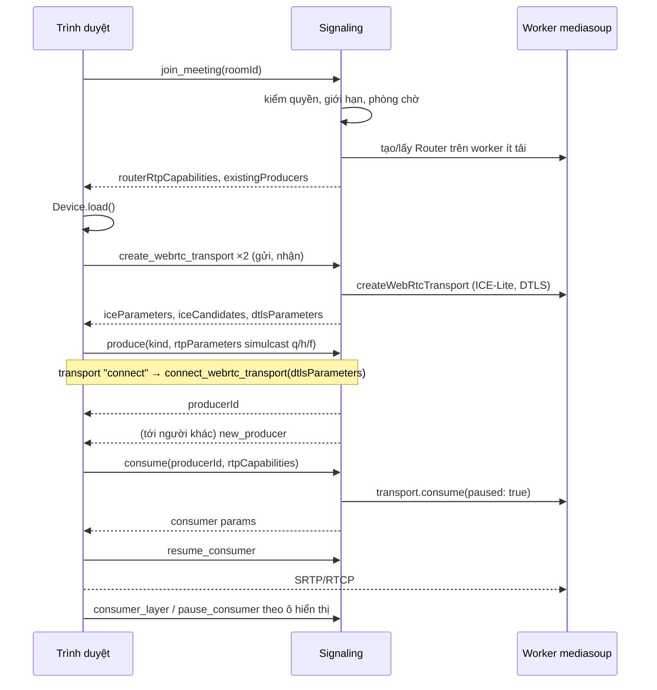

# CHƯƠNG 3. PHÂN TÍCH VÀ THIẾT KẾ HỆ THỐNG

## 3.1. Phân tích yêu cầu

### 3.1.1. Tác nhân

| Tác nhân | Mô tả |
| --- | --- |
| Khách | Chưa đăng nhập; xem trang giới thiệu, đăng ký, đăng nhập, mở liên kết mời |
| Thành viên | Thuộc một hoặc nhiều Workspace; nhắn tin, tham gia kênh thoại/video |
| Quản trị viên (admin) | Thành viên được giao quản lý kênh, thành viên, lời mời |
| Chủ sở hữu (owner) | Người tạo Workspace; toàn quyền, đổi vai trò, chuyển giao, lưu trữ |
| Chủ trì / đồng chủ trì (host/cohost) | Vai trò trong một phiên họp; điều hành phòng |

### 3.1.2. Yêu cầu chức năng

| Mã | Nhóm | Yêu cầu |
| --- | --- | --- |
| F1 | Tài khoản | Đăng ký có xác thực email OTP, đăng nhập (mật khẩu/Google), làm mới phiên bằng refresh token, quên mật khẩu |
| F2 | Không gian | Tạo Workspace; mời thành viên bằng liên kết/email; vai trò owner/admin/member; lưu trữ/khôi phục |
| F3 | Kênh | Kênh văn bản, thoại, video; kênh riêng tư có danh sách thành viên; sắp xếp kênh |
| F4 | Nhắn tin | Gửi/sửa/xóa tin theo kênh, trả lời theo luồng, nhắc tên, cảm xúc, ghim, lưu, tệp đính kèm, tìm kiếm |
| F5 | Trạng thái | Hiển thị trực tuyến/ngoại tuyến, đang gõ, số tin chưa đọc theo thời gian thực |
| F6 | Hội nghị | Tham gia/rời kênh video; bật/tắt micro, camera; chia sẻ màn hình; lưới video động |
| F7 | Điều hành họp | Phòng chờ, khóa phòng, cho vào, mời ra, tắt micro người khác, giơ tay, kết thúc |
| F8 | Đo kiểm | Hiển thị và xuất số liệu QoS (RTT, jitter, mất gói, bitrate) của phiên họp |

### 3.1.3. Yêu cầu phi chức năng

| Nhóm | Yêu cầu | Cách kiểm chứng |
| --- | --- | --- |
| Độ trễ | Tin nhắn tới người nhận trong < 100 ms (p95) ở mạng nội bộ | Kịch bản tải 50/100/200 kết nối (5.3) |
| Khả năng mở rộng media | Uplink, CPU client không tăng theo số người trong phòng | Thực nghiệm Mesh/SFU (5.4) |
| Chất lượng media | Mất gói ≈ 0, jitter < 30 ms, RTT < 150 ms trong điều kiện mạng tốt | Thu `getStats()` (5.4) |
| Tin cậy | Không mất/trùng tin khi mất ACK hoặc kết nối lại; tự khôi phục ICE | Kiểm thử tích hợp (5.2) |
| Bảo mật | Băm mật khẩu, JWT ngắn hạn, kiểm quyền mỗi sự kiện, DTLS-SRTP | Kiểm thử quyền (5.2) |
| Mở rộng ngang | Chạy nhiều tiến trình API, chia phòng họp theo worker/node | Kiểm thử 2 tiến trình API (5.2) |

### 3.1.4. Ca sử dụng chính



## 3.2. Kiến trúc tổng thể

### 3.2.1. Ba khối chức năng



- **Client (SPA):** hiển thị bố cục ba cột *Workspace → Channel → Chat/Video* và giữ trạng thái điều hướng trên URL, nên tải lại trang hay bấm back/forward vẫn đúng ngữ cảnh. Client mở một kết nối Socket.IO cho chat/presence, và khi vào kênh video thì mở thêm hai transport WebRTC (gửi, nhận) tới SFU.
- **Signaling/API Server:** cung cấp REST cho dữ liệu tĩnh (danh sách kênh, lịch sử, tệp) và Socket.IO cho mọi thứ thời gian thực, gồm cả signaling WebRTC. Mọi sự kiện đi qua middleware xác thực và kiểm quyền.
- **SFU Media Server:** mediasoup chạy trong cùng tiến trình Node với API, điều khiển một pool worker C++ (mặc định 2 worker). Mỗi phòng họp là một Router đặt trên worker có ít phòng nhất. Media không đi qua Node.js mà đi thẳng trình duyệt ↔ worker.

### 3.2.2. Tách luồng điều khiển và luồng dữ liệu

| Luồng | Giao thức | Đi qua |
| --- | --- | --- |
| Điều khiển (tin nhắn, presence, signaling) | WSS (Socket.IO) | API Node.js |
| Dữ liệu media | SRTP/SRTCP trên UDP (dự phòng ICE-TCP, TURN) | Trình duyệt ↔ worker mediasoup |
| Dữ liệu bền vững | SQL | PostgreSQL |

Tách luồng như vậy giúp tiến trình Node.js chỉ xử lý thông điệp nhỏ. Toàn bộ chi phí chuyển tiếp gói media nằm trong worker C++, và kết quả đo ở 5.4 cho thấy CPU của tiến trình Node chỉ khoảng 0,2%.

### 3.2.3. Mở rộng ngang

- **Chat/presence:** nhiều tiến trình API dùng chung PostgreSQL. Adapter Socket.IO PostgreSQL (LISTEN/NOTIFY) chuyển tiếp sự kiện giữa các node. Bảng `socket_presence` có TTL kèm heartbeat, giúp dọn kết nối của node bị dừng đột ngột.
- **Media:** một phòng họp chỉ nằm trên **một** node/worker (room affinity), vì transport và router không chia sẻ được giữa các tiến trình. Bảng `meeting_sessions.media_instance_id` ghi node chủ của phòng, và client hỏi `media-location` để kết nối socket media tới đúng node đó.

## 3.3. Thiết kế cơ sở dữ liệu

Cơ sở dữ liệu PostgreSQL gồm 36 bảng (20 migration có version), chia thành các tầng nghiệp vụ.

| Tầng | Bảng chính | Ghi chú |
| --- | --- | --- |
| Định danh | `users`, `refresh_sessions`, `email_otps`, `password_resets` | Mật khẩu băm có salt; refresh token và OTP chỉ lưu hash |
| Tổ chức | `workspaces`, `memberships`, `channels`, `channel_memberships`, `workspace_invitations`, `audit_events` | Một owner duy nhất (unique index + constraint trigger); token mời lưu SHA-256 |
| Giao tiếp | `messages`, `message_attachments`, `message_reactions`, `message_mentions`, `message_pins`, `message_bookmarks`, `thread_reads`, `channel_preferences`, `notifications` | `unique(author_id, client_message_id)` chống tin trùng khi gửi lại |
| Hội nghị | `meeting_sessions`, `meeting_attendees`, `meeting_connections`, `meeting_participations`, `meeting_schedules` | Một phiên hoạt động mỗi kênh (partial unique index) |
| Vận hành | `socket_presence`, `api_instances`, `request_rate_limits`, `storage_cleanup`, `schema_migrations` | TTL presence, lease của tiến trình, giới hạn tần suất |
| Mở rộng | `tasks`, `task_*` | Bảng công việc Kanban (ngoài trọng tâm) |



**View `channel_access`** ghép `memberships × channels` (kèm `channel_memberships` đối với kênh riêng tư) và trả về `can_write` (Workspace và kênh chưa lưu trữ). Mọi truy vấn quyền đọc/ghi (REST, socket, tìm kiếm, tải tệp, media) đều dùng chung view này, nhờ vậy chính sách quyền chỉ định nghĩa ở một nơi.

## 3.4. Phân quyền (RBAC)

| Thao tác | owner | admin | member | Ghi chú |
| --- | :---: | :---: | :---: | --- |
| Đọc/gửi tin kênh công khai | ✓ | ✓ | ✓ | Không gian/kênh chưa lưu trữ |
| Đọc/gửi tin kênh riêng tư | ✓* | ✓* | ✓* | *Phải có `channel_memberships`, kể cả owner |
| Tạo/sửa/sắp xếp kênh | ✓ | ✓ | – | |
| Mời, thu hồi lời mời | ✓ | ✓ | – | Token 7 ngày, chỉ lưu hash |
| Đổi vai trò, chuyển owner, lưu trữ | ✓ | – | – | Giao dịch có khóa Workspace |
| Tham gia kênh video | ✓ | ✓ | ✓ | Giới hạn người/tab/nguồn mỗi phiên |

| Thao tác trong phiên họp | host | cohost | member |
| --- | :---: | :---: | :---: |
| Bật phòng chờ, khóa phòng | ✓ | ✓ | – |
| Cho vào, mời ra, tắt micro người khác | ✓ | ✓ | – |
| Chỉ định cohost, kết thúc phiên | ✓ | – | – |
| Giơ tay, bật/tắt thiết bị của mình | ✓ | ✓ | ✓ |

Khi một thành viên bị thu hồi quyền, server phát `access_revoked`, ngắt socket ở mọi node và đóng tài nguyên họp của người đó. Client kết nối lại và tải dữ liệu theo quyền mới.

## 3.5. Thiết kế giao thức thời gian thực

### 3.5.1. Danh mục sự kiện Socket.IO

Hợp đồng sự kiện được định nghĩa một lần bằng kiểu TypeScript trong `packages/shared/src/socket.ts` và dùng chung cho cả client lẫn server.

| Nhóm | Client → Server (có ACK) | Server → Client |
| --- | --- | --- |
| Kênh | `join_channel`, `leave_channel`, `mark_channel_read` | `channel_read` |
| Tin nhắn | `send_message`, `edit_message`, `delete_message`, `react_message` | `new_message`, `message_changed` |
| Trạng thái | `typing` | `user_typing`, `user_presence`, `online_users` |
| Phiên họp | `join_meeting`, `leave_meeting`, `meeting_state`, `meeting_action` | `meeting_state_changed`, `meeting_closed`, `meeting_mute` |
| Signaling SFU | `create_webrtc_transport`, `connect_webrtc_transport`, `produce`, `consume`, `resume_consumer`, `pause_consumer`, `consumer_layer`, `close_producer`, `restart_ice` | `new_producer`, `producer_closed`, `peer_left` |

### 3.5.2. Luồng gửi tin nhắn (bảo đảm không mất, không trùng)

```mermaid
sequenceDiagram
 participant U as Người gửi (outbox IndexedDB)
 participant A as Socket API
 participant D as PostgreSQL
 participant R as Người nhận có quyền
 U->>A: send_message(clientMessageId, nội dung)
 A->>D: kiểm quyền hiện tại (channel_access)
 A->>D: advisory lock (tác giả, clientMessageId)
 alt Lần gửi đầu
  D-->>A: INSERT message
  A-->>R: new_message
 else Gửi lại giống hệt
  D-->>A: trả tin đã có (không phát lại)
 end
 A-->>U: ACK(message)
 U->>U: xóa khỏi outbox
 Note over U,A: Mất ACK → giữ nguyên ID, gửi lại; mất kết nối → REST ?after=cursor để bù tin
```

### 3.5.3. Luồng tham gia kênh video



## 3.6. Thiết kế giao diện

- **Bố cục ba cột:** cột Workspace/điều hướng → danh sách kênh → khung nội dung (chat hoặc phòng họp), kèm panel thông tin có thể đóng mở. Trên di động, các cột thu thành ngăn kéo.
- **Lưới video động:** số cột được tính sao cho ô 16:9 lớn nhất vừa khung. Có phân trang (4/6/9 ô theo bề rộng màn hình) và chế độ *Tiêu điểm* (một ô lớn cùng dải ô nhỏ). Ô nằm ngoài trang hiện tại không được render, và luồng video tương ứng bị tạm dừng tại SFU (chi tiết ở 4.4).
- **Trạng thái kết nối:** tiêu đề kênh hiển thị số thành viên đang trực tuyến hoặc trạng thái kết nối lại. Tin chưa gửi được hiển thị dưới khung soạn thảo kèm nút *Thử gửi lại*.
