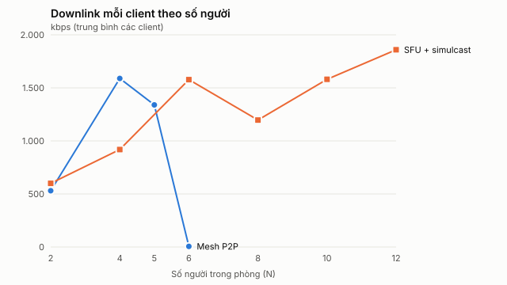
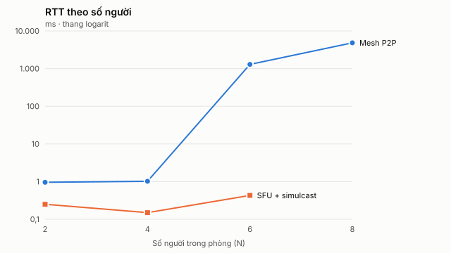
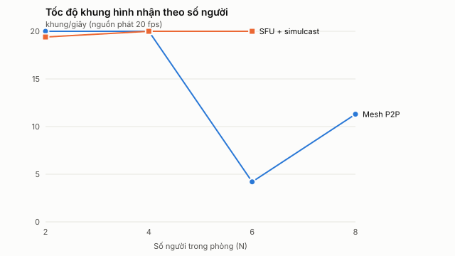

# CHƯƠNG 5. THỰC NGHIỆM VÀ ĐÁNH GIÁ

Chương này kiểm chứng hệ thống theo ba nhóm yêu cầu đã đặt ra ở mục 3.1.3: tính đúng và độ tin cậy (5.2), độ trễ của lõi nhắn tin thời gian thực (5.3), và khả năng mở rộng của lõi hội nghị so với mô hình Mesh (5.4). Mục 5.5 đối chiếu kết quả với yêu cầu, mục 5.6 nêu các giới hạn của phép đo. Mọi con số đều lấy từ dữ liệu gốc trong `docs/evidence/`; con số tự tính từ dữ liệu gốc được ghi rõ là "tính lại".

## 5.1. Phương pháp và môi trường

### 5.1.1. Môi trường chung

| Thành phần | Giá trị |
| --- | --- |
| Phần cứng | AMD Ryzen 7 6800HS, 16 luồng logic, 23,26 GiB RAM |
| Hệ điều hành | Windows 11 (win32 x64) |
| Phần mềm | Node.js 22.19.0, PostgreSQL 17.11 (Docker), trình duyệt Microsoft Edge (Chromium) |
| Mạng | Toàn bộ client, máy chủ API và SFU chạy trên **cùng một máy**; lưu lượng đi qua giao diện nội bộ |

Điều kiện "cùng một máy" ảnh hưởng đến cách đọc mọi kết quả và được thảo luận ở 5.6.

### 5.1.2. Các đại lượng đo

Các đại lượng media lấy từ `getStats()` của trình duyệt theo định nghĩa ở mục 2.2.4 và 4.4.2:

- **Uplink/downlink** (kbps): tính từ chênh lệch byte trên chênh lệch thời gian, gồm cả header RTP.
- **CPU client** (%): tổng thời gian CPU của mọi tiến trình thuộc một trình duyệt, đọc qua giao thức CDP `SystemInfo.getProcessInfo`; 100% tương ứng một lõi.
- **RTT** (ms): của cặp ICE được chọn. **Jitter** (ms): của luồng audio và video nhận. **Mất gói** (%): theo cửa sổ `Δlost/(Δreceived+Δlost)`.
- **FPS nhận**, **độ trễ jitter buffer**, **số lần đóng băng hình** (`freezeCount`), **số encoder đang phát** (số luồng video gửi đi có tốc độ trên 1 kbps), và tỉ lệ thời gian bị giới hạn chất lượng (`qualityLimitationReason`).
- **CPU máy chủ**: CPU của worker mediasoup (`getResourceUsage`) và của tiến trình Node.

Độ trễ tin nhắn (5.3) dùng phân vị nearest-rank trên từng mẫu: p50, p95, p99.

## 5.2. Kiểm thử chức năng và độ tin cậy

### 5.2.1. Bộ kiểm thử tự động

| Nhóm | Phạm vi | Kết quả |
| --- | --- | --- |
| Unit frontend | URL định danh, bố cục lưới, QoS, thao tác media, giơ tay, khôi phục khi mất kết nối, chuyển động | 39/39 qua (chạy ngày 06/10/2026) |
| Unit API | Xác thực, kiểm tra sức khỏe, hợp đồng | 15 qua; 8 suite cần PostgreSQL/SFU bị bỏ qua có chủ đích ở lệnh mặc định (chạy ngày 06/10/2026) |
| Tích hợp PostgreSQL + mediasoup (`npm run test:sfu`) | 8 suite DB/SFU, trong đó có hai tiến trình API riêng và kill worker thật | 9 test qua, 0 bỏ qua (theo báo cáo nghiệm thu ngày 01/10/2026, chưa chạy lại hôm viết chương) |
| Kiểm tra tĩnh | `typecheck`, `lint`, `build` toàn workspace | Không có lỗi kiểu; `lint` không báo lỗi |

Các suite tích hợp nằm ở `services/api/test/`: xác thực, quản trị/quyền (`governance`), chat/thread/tìm kiếm (`conversations`), Kanban (`tasks`), phiên họp (`meeting-sessions`), lưu trữ (`storage`), phân tán hai node (`distributed`) và khôi phục worker (`worker-recovery`).

### 5.2.2. Các tính chất được kiểm chứng

Các kiểm thử dưới đây tương ứng trực tiếp với yêu cầu "không mất, không trùng" (3.5.2) và kiểm quyền từng sự kiện (4.2.1):

- **Idempotency của tin nhắn.** 6 yêu cầu gửi đồng thời cùng `clientMessageId` chỉ tạo đúng 1 bản ghi. Khi cố ý bỏ ACK rồi gửi lại, chỉ có 1 lần phát `new_message`. Phân trang `after` không trả trùng bản ghi.
- **Thu hồi quyền.** Sau khi thu hồi quyền truy cập kênh riêng tư, cả gửi lại lẫn lấy bù tin sau reconnect đều bị chặn.
- **Quản trị.** Kiểm tra chéo quyền trên REST, socket, tìm kiếm, tải tệp, lịch họp và media; lời mời sai email, hết hạn, bị thu hồi hoặc nhận đồng thời; chuyển owner và việc CSDL chặn xóa owner duy nhất.
- **Tìm kiếm.** Kiểm tra tiếng Việt, ký tự `%` và `_`, mở tin nằm ngoài 100 tin gần nhất. Truy vấn mẫu trên 10.000 tin (trong giao dịch rollback) với `EXPLAIN ANALYZE, BUFFERS` được lưu ở `evidence/search-2026-09-30.json`; kết quả cho thấy index theo timeline hiện có đã đủ cho phạm vi này.
- **Kanban.** Kiểm thử đồng thời với phiên bản (version) và xung đột, thứ tự ổn định, quyền.
- **Điều hành họp.** Phòng chờ, khóa, mời ra, kết thúc, giới hạn số người và số tab; kiểm tra bốn tổ hợp mic/camera để chắc chắn nguồn bị tắt không được phát (không có producer nào xuất hiện ở client thứ hai).
- **Chịu lỗi worker.** Với pool 2 worker, kill một worker thật: peer thuộc worker còn lại không bị ảnh hưởng và lượt join mới được tạo worker thay thế.
- **Hai tiến trình API.** Với `SOCKET_ADAPTER=postgres`, chat, công việc và thông báo được đồng bộ giữa hai tiến trình; thu hồi quyền có hiệu lực qua node.
- **Migration và khôi phục.** 20 migration có checksum; hai runner chạy đồng thời trên cùng CSDL không xung đột (khóa migration). Bản sao lưu QA được khôi phục vào một CSDL mới, dữ liệu Unicode và schema khớp (`evidence/restore-2026-10-01.json`).

Phần này kiểm tra **tính đúng** của tín hiệu điều khiển và quyền; nó không chứng minh chất lượng luồng RTP. Chất lượng RTP được đo riêng ở 5.4.

## 5.3. Độ trễ của lõi nhắn tin

### 5.3.1. Kịch bản

Hai tiến trình API riêng, `SOCKET_ADAPTER=postgres`, pool 8 kết nối mỗi node; 4 workspace, mỗi workspace 2 kênh văn bản. Các socket kết nối qua WebSocket nội bộ. Mỗi mức tải (50, 100, 200 socket) chạy 30 giây, lặp 2 lượt, với **tổng 4 tin/giây** và 4 lần gửi song song. Mỗi lượt có 6 lần cố ý bỏ ACK rồi gửi lại cùng ID, và 2 tin gửi lúc một client đang ngoại tuyến để thử khôi phục.

Đây là kịch bản "nhiều người nhận, ít người gửi": các socket chủ yếu nhận broadcast, không phải 200 người gửi liên tục.

### 5.3.2. Kết quả

Độ trễ (ms), gộp 2 lượt mỗi mức:

| Socket | ACK p50 / p95 / p99 | Receipt p50 / p95 / p99 | Tin duy nhất / receipt | Lỗi / trùng |
| ---: | --- | --- | --- | --- |
| 50 | 24,99 / 39,88 / 53,79 | 25,01 / 32,23 / 47,02 | 244 / 3.052 | 0 / 0 |
| 100 | 23,69 / 46,09 / 56,81 | 23,78 / 34,87 / 48,07 | 244 / 6.096 | 0 / 0 |
| 200 | 25,23 / 48,58 / 140,26 | 25,38 / 45,93 / 137,86 | 244 / 12.196 | 0 / 0 |

ACK là thời gian từ lúc client phát tin đến khi nhận phản hồi thành công. Receipt là thời gian từ lúc phát đến khi từng client nhận `new_message`; phân vị receipt được cân theo số người nhận. Tổng cộng 732 tin và 21.344 receipt; số bản ghi trong CSDL bằng số tin duy nhất ở mọi lượt (không mất, không trùng). Có 36 lần gửi lại sau khi mất ACK và 6 lần reconnect; mỗi lần reconnect khôi phục đủ 2 tin bị lỡ qua REST `after` trong 21,5–54,9 ms.

Tài nguyên (tối đa quan sát được):

| Socket | RSS mỗi API (MiB) | CPU mỗi API (% một lõi) | Pool chờ tối đa | CSDL (CPU / RAM) |
| ---: | ---: | ---: | ---: | --- |
| 50 | 98,84 | 5,60 | 13 | 5,10–5,23% / 107–112 MiB |
| 100 | 95,75 | 3,75 | 31 | 4,95–5,95% / 111–113 MiB |
| 200 | 115,17 | 4,66 | 120 | 4,78–5,63% / 112–113 MiB |

### 5.3.3. Nhận xét

- p50 gần như không đổi (23,7–25,4 ms) khi số socket tăng 4 lần. p95 tăng nhẹ từ 32 lên 46 ms (receipt); độ trễ đuôi chỉ nở rõ ở p99 của mức 200 socket (khoảng 138–140 ms).
- CPU và bộ nhớ mỗi API thấp (dưới 6% một lõi, dưới 120 MiB).
- Số kết nối chờ trong pool tăng theo số socket (13, 31, 120) và xuất hiện chủ yếu ở đợt kết nối ban đầu, hết ở các mẫu cuối. Điều này cho thấy đợt kết nối dồn dập (và cập nhật presence đi kèm) là điểm cần tối ưu trước khi tăng tải, chứ không nên tăng kích thước pool một cách máy móc.
- Mức tải 4 tin/giây trong 30 giây × 2 lượt chưa đủ để xác định giới hạn tối đa; đây là bằng chứng về độ đúng và độ trễ ở tải vừa, không phải năng lực cực đại.

## 5.4. Thực nghiệm Mesh và SFU

Đây là thực nghiệm chính của đề tài, nhằm kiểm chứng lựa chọn SFU ở mục 2.3.4: khi số người N tăng, mô hình nào còn giữ được chất lượng với tài nguyên chấp nhận được.

### 5.4.1. Thiết kế thực nghiệm

Phòng thí nghiệm media (`experiments/media-lab/`) chạy mỗi người tham gia là **một tiến trình trình duyệt riêng** (Edge) dùng camera và micro giả của Chromium.

| Mục | Mesh | SFU |
| --- | --- | --- |
| Kiến trúc | Một `RTCPeerConnection` cho mỗi cặp người, qua relay signaling tối giản | API thật và mediasoup thật; client dùng lại `MediasoupClientService` của ứng dụng |
| Mã hóa video | 1 encoding, tối đa 1.200 kbps cho mỗi kết nối | Simulcast 3 lớp `q/h/f` = 150/400/1.200 kbps |
| Chọn lớp nhận | – | Chính sách của ứng dụng: trên 6 consumer → lớp 0; trên 2 → lớp 1; còn lại → lớp 2 |
| Nguồn video | 960×540, 30 fps lý tưởng (thực tế phát 20 fps), VP8; âm thanh Opus | Như Mesh |
| Hiển thị video nhận | Tắt (`--render=0`: giải mã nhưng không vẽ) | Tắt |
| Các mức N | 2, 4, 6, 8 | 2, 4, 6 |
| Thời gian | Khởi động 30 s, đo 60 s, lấy mẫu mỗi 2 s | Như Mesh |

Lệnh chạy lại và định nghĩa chi tiết ở `experiments/media-lab/README.md`. Số liệu gốc từng mẫu theo từng client lưu ở `docs/evidence/media-lab/*.json`; bảng tổng hợp được sinh tự động bằng `node experiments/media-lab/summarize.mjs`. Fixture (người dùng và workspace `lab-*@example.test`) được tạo riêng cho từng mức và xóa đúng theo ID khi chạy xong.

**Vì sao tắt hiển thị.** Trên máy thử, trình duyệt headless vẽ video bằng phần mềm (SwiftShader) và tốn khoảng 94% một lõi cho mỗi client: CPU của hai client Mesh là 120% khi vẽ và 26% khi không vẽ. Chi phí vẽ giống nhau ở Mesh và SFU với cùng số ô, và trên máy thật do GPU đảm nhiệm. Vì vậy thực nghiệm chính chỉ đo chi phí của tầng truyền tải và codec.

### 5.4.2. Sai lệch đo lường thứ nhất: SFU announce địa chỉ loopback

Khi SFU announce `127.0.0.1`, trình duyệt không thu thập loopback candidate nên kiểm tra kết nối UDP đến địa chỉ này thất bại, và ICE rơi xuống candidate TCP thụ động của mediasoup. Khi đó RTP đi qua TCP, bị chặn đầu hàng đợi (head-of-line blocking): NACK xuất hiện dày và jitter tăng cao, dù không có mất gói thật. Cách xử lý là cho harness announce **địa chỉ LAN của máy** (`192.168.1.60` trong lần đo này); kết quả SFU ở 5.4.4 đều đi qua UDP. Môi trường phát triển của ứng dụng cũng cần đặt `MEDIASOUP_ANNOUNCED_IP` là địa chỉ LAN. Mesh không bị ảnh hưởng vì các kết nối ngang hàng dùng candidate máy chủ thông thường (cột "giao thức" của số liệu gốc là UDP ở mọi lượt).

### 5.4.3. Sai lệch đo lường thứ hai: luồng probation

mediasoup gửi các gói padding trên SSRC 1234 (`mid=probator`) để thăm dò băng thông trước khi nâng lớp của một consumer. Luồng này có "mất gói" và jitter lớn giả tạo (khoảng 200 ms), trong khi luồng media thật có mất gói bằng 0 và jitter xấp xỉ 0. Tại SFU, thống kê consumer cũng xác nhận 0 mất gói và 0 NACK. Do đó, byte của luồng probation vẫn được tính vào downlink (vì nó thật sự đi qua đường truyền) nhưng bị loại khỏi các chỉ số chất lượng (jitter, mất gói). Nếu không loại, SFU sẽ bị đánh giá oan là kém hơn Mesh.

### 5.4.4. Kết quả

Mỗi dòng là trung bình trên các client trong một lượt đo (60 s, 30 mẫu mỗi client).

**Bảng 5.1. Mesh P2P**

| N | Uplink (kbps) | Downlink (kbps) | CPU client (%) | Encoder hoạt động | RTT (ms) | Jitter video (ms) | Mất gói (%) | FPS nhận |
| ---: | ---: | ---: | ---: | ---: | ---: | ---: | ---: | ---: |
| 2 | 525 | 525 | 29,1 | 1 | 1,0 | 0 | 0 | 20 |
| 4 | 1.579 | 1.579 | 84,8 | 3 | 1,0 | 0,9 | 0 | 20 |
| 6 | 1.505 | 804 | 220,7 | 2,3 | 1.292,7 | 799 | 0,63 | 4,2 |
| 8 | 1.587 | 676 | 162,0 | 1,7 | 4.830,7 | 363,7 | 0,13 | 11,3 |

**Bảng 5.2. SFU + simulcast (mediasoup)**

| N | Uplink (kbps) | Downlink (kbps) | CPU client (%) | Encoder hoạt động | RTT (ms) | Jitter video (ms) | Mất gói (%) | FPS nhận | CPU worker SFU (% một lõi) | CPU Node (%) |
| ---: | ---: | ---: | ---: | ---: | ---: | ---: | ---: | ---: | ---: | ---: |
| 2 | 1.007 | 594 | 26,1 | 3 | 0,25 | 0 | 0 | 19,4 | 2,7 | 0,2 |
| 4 | 984 | 934 | 29,7 | 3 | 0,15 | 0,03 | 0 | 20 | 6,6 | 0,2 |
| 6 | 999 | 1.561 | 33,1 | 3 | 0,43 | 0,04 | 0 | 20 | 12,3 | 0,4 |

Jitter âm thanh ở mọi lượt SFU nằm trong khoảng 0,7–0,9 ms. Với Mesh, jitter âm thanh là 0,6–0,9 ms ở N = 2 và 4, nhưng tăng lên 72–76 ms ở N = 6 và 8. Số lần đóng băng hình (`freezeCount`, cộng dồn trong lượt đo) của mỗi client là 0 ở mọi lượt SFU; ở Mesh là 0 khi N = 2 và 4, nhưng 40–58 khi N = 6 và 44–78 khi N = 8.

*Hình 5.1. Uplink mỗi client theo số người.*

*Hình 5.2. Downlink mỗi client theo số người.*

*Hình 5.3. CPU mỗi client theo số người (100% = một lõi).*

*Hình 5.4. RTT theo số người (thang logarit).*

*Hình 5.5. Tốc độ khung hình nhận theo số người (nguồn phát 20 fps).*

#### Uplink

- **Mesh** tăng tỉ lệ thuận với số kết nối: mỗi luồng khoảng 525 kbps (525 kbps với 1 encoder ở N = 2; 1.579/3 ≈ 526 kbps mỗi encoder ở N = 4). Đúng như lý thuyết, uplink bằng (N−1)·b.
- **SFU** gần như không đổi theo N: 1.007, 984 và 999 kbps, chênh lệch tối đa khoảng 2,3% so với trung bình, với đúng 3 encoder (ba lớp simulcast) ở mọi mức.
- Ở N = 2, uplink của SFU (1.007 kbps) **cao hơn** Mesh (525 kbps) khoảng 92% vì phải phát ba lớp thay vì một. Đây là cái giá cố định của simulcast. Từ số liệu Mesh, uplink 2 kết nối ngang hàng sẽ khoảng 1.050 kbps ở N = 3 (tính lại bằng ngoại suy tuyến tính, chưa đo), tức điểm hòa vốn nằm quanh N = 3. Với N ≥ 4, SFU luôn có lợi: ở N = 4 uplink thấp hơn 37,7% (984 so với 1.579 kbps).
- Giá trị Mesh ở N = 6 và 8 (1.505 và 1.587 kbps) **không** phản ánh nhu cầu lý thuyết (5 và 7 luồng, tức khoảng 2.600 và 3.700 kbps): số encoder thực sự phát chỉ còn trung bình 2,3 và 1,7 vì các kết nối bị nghẹn, và độ lệch p95 rất lớn (khoảng 5.600 kbps). Đây là trạng thái quá tải, không phải trạng thái ổn định.

#### Downlink

- Mesh: mỗi luồng nhận khoảng 525 kbps, tổng tăng theo N−1 (525 → 1.579 kbps).
- SFU: 594 → 934 → 1.561 kbps ứng với 1, 3 và 5 luồng nhận. Chia theo số luồng (tính lại), mỗi luồng tốn khoảng **594 kbps ở N = 2 nhưng chỉ khoảng 311–312 kbps ở N = 4 và 6**. Mức giảm xấp xỉ 48% này là tác dụng của chính sách chọn lớp theo số consumer (lớp 2 khi chỉ có 1 consumer, lớp 1 khi nhiều hơn 2): SFU tự chuyển các consumer sang lớp trung bình khi phòng đông hơn.
- Ở N = 4, downlink của SFU (934 kbps) thấp hơn Mesh (1.579 kbps) khoảng 40,9%.

#### CPU

- **Mesh:** CPU client tăng từ 29,1% lên 84,8% khi N đi từ 2 lên 4 (tăng khoảng 2,9 lần, tương ứng số luồng mỗi client xử lý tăng từ 1 lên 3). Ở N = 6 và 8 CPU trung bình mỗi client là 220,7% và 162,0%, tức mỗi trình duyệt dùng hơn hai lõi; con số này vượt xa năng lực của một thiết bị người dùng thông thường (xem thêm 5.6).
- **SFU:** CPU client gần như phẳng: 26,1% → 29,7% → 33,1%, tăng khoảng 1,75 điểm phần trăm cho mỗi người tham gia thêm. Ở N = 4 CPU client thấp hơn Mesh 65% (29,7% so với 84,8%).
- **Máy chủ:** CPU worker mediasoup là 2,7%, 6,6% và 12,3% một lõi ở N = 2, 4 và 6 (tăng nhanh hơn tuyến tính theo N, vì số luồng chuyển tiếp tỉ lệ với N(N−1)). Tiến trình Node, nơi chạy signaling và API, chỉ dùng 0,2–0,4% CPU và 79–92 MiB RSS. Điều này xác nhận thiết kế tách luồng điều khiển và luồng dữ liệu ở mục 3.2.2: Node không chạm vào gói media.
- **Tổng tải của toàn bộ thí nghiệm** (tính lại bằng N × CPU trung bình): Mesh N = 4 là khoảng 339% (3,4 lõi); SFU N = 6 là khoảng 199% (2 lõi) cộng 12,3% của worker. Ở N = 6 và 8, Mesh dùng khoảng 1.324% và 1.296% (13 lõi trên 16 lõi của máy).

#### RTT, jitter, mất gói và FPS

- **SFU:** RTT 0,15–0,43 ms, jitter video ≤ 0,04 ms, mất gói 0%, 19,4–20 fps, không có lần đóng băng hình nào, `nackPerMin` bằng 0 ở mọi mức.
- **Mesh:** đạt chất lượng tương đương ở N = 2 và 4 (RTT khoảng 1 ms, mất gói 0%, 20 fps). Ở **N = 6** chất lượng sụp đổ: RTT 1,29 giây, jitter video 799 ms, jitter buffer 2,65 giây, FPS nhận còn 4,2, mất gói 0,63%, và 18% thời gian bị trình duyệt giới hạn chất lượng do băng thông. Ở **N = 8** tình trạng còn tệ hơn về độ trễ (RTT 4,83 giây) và toàn bộ thời gian đo bị giới hạn chất lượng (băng thông và CPU). FPS ở N = 8 (11,3) cao hơn ở N = 6 (4,2) không có nghĩa là N = 8 tốt hơn: số encoder hoạt động giảm còn 1,7 nên có ít luồng cần giải mã hơn; trong vùng quá tải các số đo không còn đơn điệu.
- Thời gian đến khung hình đầu tiên (`firstFrameMs`, trung bình các client) của Mesh tăng từ 3,2 giây (N = 2) lên 7,4 giây (N = 8); của SFU nằm trong khoảng 4,6–5,7 giây.

### 5.4.5. Hiệu quả của chọn lớp theo nhu cầu

Mục 4.4.3 mô tả hai cơ chế giảm downlink: chọn lớp simulcast nhỏ nhất vẫn đủ phủ ô hiển thị, và tạm dừng consumer của ô nằm ngoài trang hiện tại. Dữ liệu hiện có đo được **tác dụng của chính sách chọn lớp mặc định** như đã nêu ở phần downlink: mỗi luồng nhận giảm từ khoảng 594 xuống khoảng 311 kbps (−48%) khi phòng chuyển từ 2 lên 4 người trở lên.

Phép đo riêng cho việc **tạm dừng consumer theo ô hiển thị** chưa được thực hiện, vì phòng thí nghiệm chạy ở chế độ không vẽ video và do đó không có "ô hiển thị" để phân trang. Mức tiết kiệm của cơ chế này vì vậy mới chỉ được thiết kế và kiểm thử đơn vị (bố cục lưới, phân trang, `layerForTile`), chưa có số liệu RTP. Đây là một mục trong 5.6.

### 5.4.6. Thảo luận

1. **Mesh sụp đổ giữa N = 4 và N = 6, SFU không có dấu hiệu suy giảm đến N = 6.** Điều này khớp với dự đoán lý thuyết ở bảng 2.3.4: tài nguyên của Mesh tăng tuyến tính theo N−1 ở cả uplink, downlink và CPU, còn SFU giữ uplink và CPU client gần như cố định.
2. **SFU không rẻ hơn ở mọi N.** Ở N = 2, simulcast làm uplink gấp khoảng 1,9 lần Mesh. Với phòng 1–1, việc chuyển sang Mesh hay phát một lớp (`--simulcast=0`) là hướng tối ưu hợp lý; đề tài chưa hiện thực chuyển chế độ tự động theo N.
3. **Uplink SFU thực đo (khoảng 1,0 Mbps) thấp hơn con số 1,75 Mbps ở ví dụ mục 2.3.4.** Con số 1,75 Mbps là tổng ngưỡng trần của ba lớp (150 + 400 + 1.200 kbps). Với nguồn giả có nội dung đơn giản ở 960×540 và 20 fps, bộ mã hóa không dùng hết trần. Với camera thật, uplink có thể tiến gần hơn đến trần; ý nghĩa của kết quả nằm ở **tính không đổi theo N**, không nằm ở giá trị tuyệt đối.
4. **Chi phí chuyển sang máy chủ là có thật.** Băng thông ra của SFU là tổng downlink của mọi client (khoảng 6 × 1.561 kbps ≈ 9,4 Mbps ở N = 6), và CPU worker tăng nhanh hơn tuyến tính theo N. Máy chủ SFU phải được cấp băng thông ra tương ứng; đây là điểm mà Mesh không phải trả.

## 5.5. Đối chiếu với yêu cầu phi chức năng

Đối chiếu với bảng ở mục 3.1.3:

| Yêu cầu | Kết quả đo | Đánh giá |
| --- | --- | --- |
| Tin nhắn tới người nhận trong < 100 ms (p95) ở mạng nội bộ | Receipt p95: 32,2 / 34,9 / 45,9 ms (50 / 100 / 200 socket); ACK p95 tối đa 48,6 ms. p99 ở mức 200 socket là khoảng 138–140 ms | **Đạt** theo tiêu chí p95 trong điều kiện nội bộ; độ trễ đuôi p99 ở 200 socket vượt 100 ms |
| Uplink và CPU client không tăng theo số người (SFU) | Uplink 1.007 / 984 / 999 kbps; CPU client 26,1 / 29,7 / 33,1% (N = 2 / 4 / 6) | **Đạt về uplink**; CPU **tăng nhẹ** (khoảng 1,75 điểm phần trăm mỗi người), không tăng theo N−1 như Mesh. Đã đo đến N = 6 |
| Mất gói ≈ 0, jitter < 30 ms, RTT < 150 ms trong điều kiện mạng tốt | SFU: mất gói 0%, jitter video ≤ 0,04 ms, jitter audio ≤ 0,9 ms, RTT ≤ 0,43 ms | **Đạt**, nhưng đo trên đường truyền nội bộ, nên không phản ánh chất lượng mạng thật |
| Không mất/trùng tin khi mất ACK hoặc kết nối lại; tự khôi phục ICE | 0 lỗi, 0 trùng trên 732 tin; 36 lần gửi lại sau mất ACK; 6 lần reconnect có backfill đủ | **Đạt** trong kịch bản đo. Khôi phục ICE được kiểm ở mức signaling, chưa đo trên mạng thật |
| Băm mật khẩu, JWT ngắn hạn, kiểm quyền từng sự kiện, DTLS-SRTP | Bộ kiểm thử quyền chéo qua (5.2.2); DTLS-SRTP là mặc định của WebRTC | **Đạt** với kiểm quyền; **chưa có bằng chứng bắt gói** xác nhận DTLS-SRTP |
| Chạy nhiều tiến trình API; chia phòng họp theo worker/node | Hai tiến trình API và kill worker thật qua test tích hợp | **Đạt** với nhiều tiến trình và nhiều worker trên một máy; nhiều node SFU chưa nghiệm thu |

## 5.6. Hạn chế của phép đo và hướng tiếp theo

Các hạn chế dưới đây quyết định phạm vi được phép kết luận từ chương này.

1. **Tất cả chạy trên một máy.** Mọi client trình duyệt, API, PostgreSQL và SFU dùng chung 16 luồng. Khi tổng CPU gần giới hạn máy, mọi chỉ số xấu đi vì tranh chấp tài nguyên chứ không riêng vì giao thức. Mesh ở N = 6 và 8 dùng khoảng 13 trên 16 lõi, nên một phần sự sụp đổ ở hai mức này đến từ giới hạn của máy thử. Trên thực tế mỗi người dùng có thiết bị riêng, và điểm gãy của Mesh nằm ở uplink hoặc CPU của từng thiết bị, có thể ở N khác. Kết luận vững chắc từ số liệu là xu hướng tăng tuyến tính của Mesh ở N = 2 → 4 (có kèm CPU từng client), không phải vị trí chính xác của điểm sụp.
2. **Đường truyền nội bộ.** Không có mất gói, trễ hay giới hạn băng thông thật; RTT, jitter và mất gói phản ánh tải xử lý chứ không phản ánh chất lượng mạng. Chưa đo qua nhiều mạng, qua TURN hoặc với giả lập suy giảm mạng.
3. **Mỗi mức N chỉ đo một lượt (60 s).** Chưa có khoảng tin cậy hay độ lệch giữa các lượt lặp; chỉ có độ lệch giữa các client và giữa các mẫu trong một lượt (p95 trong số liệu gốc).
4. **Phạm vi N.** SFU mới đo đến N = 6 (Mesh đến N = 8). Chưa đo 10 client như mục tiêu ban đầu của đề tài, nên chưa kiểm chứng được xu hướng của SFU ở N lớn (điểm mà chi phí worker và downlink bắt đầu đáng kể).
5. **Nguồn media giả và không vẽ video.** Camera giả có nội dung đơn giản nên bitrate thấp hơn camera thật, và chi phí hiển thị bị loại khỏi phép đo (5.4.1). CPU client thực tế sẽ cao hơn bảng 5.1 và 5.2 một khoảng như nhau cho cả hai mô hình.
6. **Chưa có phép đo cho tạm dừng consumer theo ô hiển thị** (5.4.5), cho chia sẻ màn hình, và cho thiết bị cấu hình yếu.
7. **Chưa bắt gói tin.** Công cụ phân tích (`experiments/packet-capture/`) và quy trình bắt gói bằng Wireshark đã có, nhưng chưa có tệp bắt gói nào, nên chưa có bằng chứng ở mức gói tin cho STUN, bắt tay DTLS, RTP/RTCP (SR/RR, NACK, PLI).
8. **Kịch bản chat chỉ ở tải vừa.** 4 tin/giây, chưa chạy soak hay đo giới hạn bão hòa; chưa mô phỏng mất mạng dài hoặc mạng di động.
9. **Phần chưa kiểm chứng ngoài phạm vi máy phát triển:** CI từ xa, sao lưu trên môi trường thật, S3 và email trên đám mây, HTTPS công khai, TURN thật. Hệ thống không được kết luận là sẵn sàng cho môi trường sản xuất.

**Hướng tiếp theo, theo thứ tự ưu tiên:**

1. Chạy SFU với N = 8 và 10 trên cùng phòng thí nghiệm và lặp mỗi mức ít nhất 3 lượt: `npm run lab -- --mode=sfu --clients=8,10 --seconds=60 --warmup=30 --render=0`, sau đó `node experiments/media-lab/summarize.mjs` để sinh lại bảng và hình.
2. Bắt gói bằng Wireshark trong một ca SFU (hướng dẫn ở `experiments/packet-capture/README.md`) để xác nhận STUN, DTLS, RTP/RTCP và đối chiếu bitrate, mất gói, jitter với `getStats()`.
3. Lặp phép đo trên hai hoặc nhiều máy trong mạng LAN, sau đó thêm một client qua TURN và giả lập mất gói hoặc giới hạn băng thông tại bộ định tuyến.
4. Đo riêng mức tiết kiệm downlink của lớp simulcast (tham số `--layer=0|1|2`) và của cơ chế tạm dừng consumer.

## 5.7. Tóm tắt chương

- Bộ kiểm thử tự động (39 test frontend, 15 test API và 9 test tích hợp DB/SFU) xác nhận tính đúng của idempotency tin nhắn, kiểm quyền, quản trị, chịu lỗi worker, hai tiến trình API, migration và khôi phục dữ liệu.
- Lõi nhắn tin giữ p95 receipt dưới 46 ms ở 200 socket, không mất và không trùng trong 732 tin, với mức tải 4 tin/giây trên máy phát triển.
- Thực nghiệm Mesh so với SFU cho thấy SFU giữ uplink gần như không đổi (khoảng 1,0 Mbps) và CPU client gần như phẳng (26–33%) khi N tăng từ 2 lên 6, không có mất gói, RTT dưới 0,5 ms, FPS 19,4–20. Mesh tăng tuyến tính tài nguyên (CPU client tăng 2,9 lần từ N = 2 lên 4) và mất khả năng phục vụ ở N = 6 trên máy thử (RTT 1,29 giây, 4,2 fps).
- SFU tốn hơn Mesh ở N = 2 (uplink gấp khoảng 1,9 lần), có điểm hòa vốn quanh N = 3 và vượt trội từ N = 4.
- Toàn bộ kết quả thu trên một máy, qua đường truyền nội bộ, với mỗi mức N đo một lượt; chưa có RTP qua nhiều mạng, qua TURN, chưa đo SFU ở N = 10 và chưa bắt gói tin. Các kết luận về xu hướng là vững, còn các giá trị tuyệt đối cần được hiểu trong giới hạn đó.
