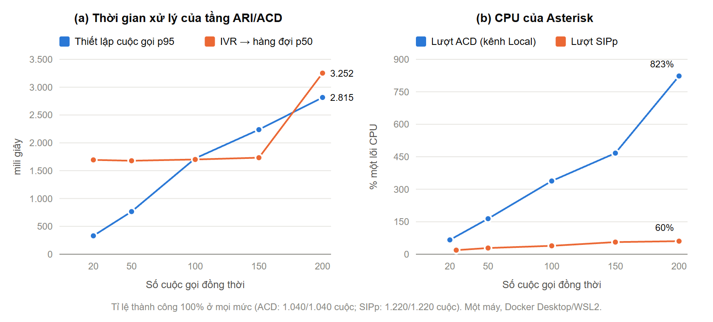
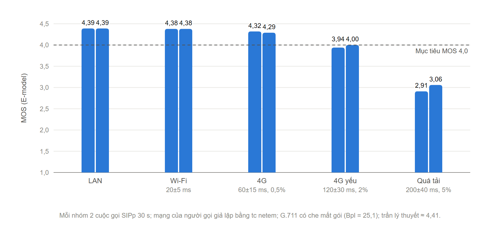
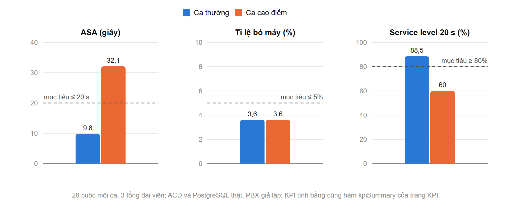
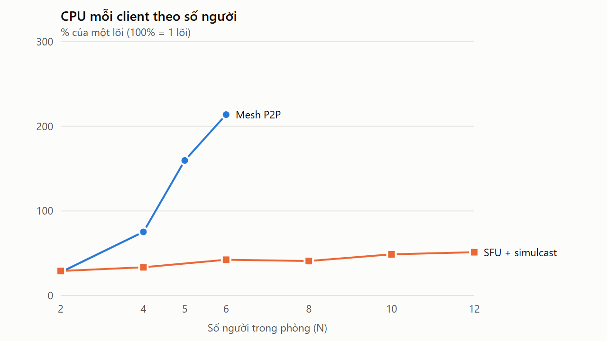
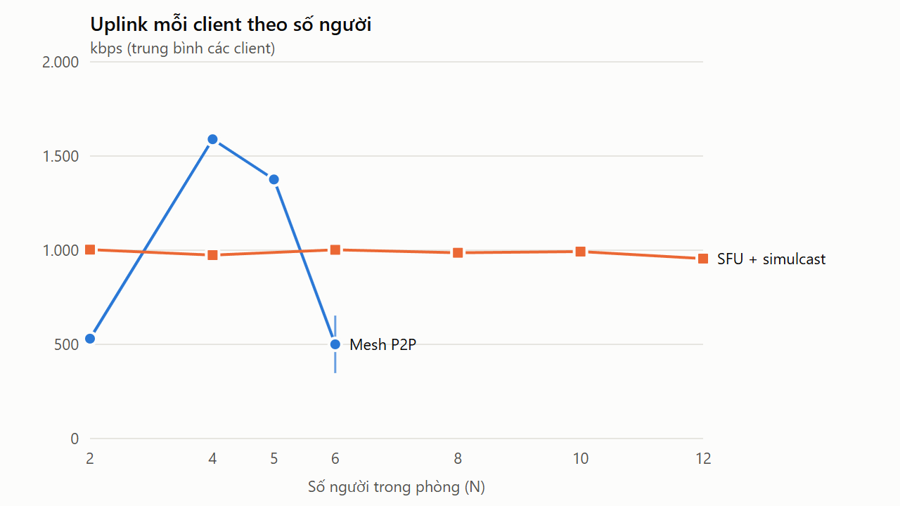

# CHƯƠNG 6. THỰC NGHIỆM VÀ ĐÁNH GIÁ

Chương này trình bày các thực nghiệm dùng để kiểm chứng hệ thống so với mục tiêu ở Chương 1 và đặc tả đề tài. Có hai nhóm đánh giá:

- **Đánh giá định lượng.** Đo độ chịu tải của tổng đài, chất lượng thoại, KPI của một ca trực và chất lượng họp qua nhiều điều kiện mạng.
- **Đánh giá chức năng.** Kiểm thử tự động và đối chiếu từng quy tắc nghiệp vụ trong 22 quy tắc của đặc tả.

Toàn bộ lệnh chạy, script và dữ liệu gốc nằm trong `docs/benchmarks/` và `docs/evidence/` của mã nguồn, để người đọc có thể lặp lại các phép đo.

---

## 6.1 Mục tiêu, tiêu chí và phương pháp

### 6.1.1 Tiêu chí đánh giá

Đặc tả đặt hai nhóm tiêu chí. Đề tài bổ sung thêm tiêu chí cho phần họp trực tuyến. Bảng 6.1 tổng hợp các tiêu chí này.

Bảng 6.1: Tiêu chí đánh giá

| Nhóm | Tiêu chí | Mục tiêu | Nguồn |
| --- | --- | --- | --- |
| Chịu tải tổng đài | Số cuộc gọi đồng thời xử lý được, đo bằng SIPp | ≥ 50 cuộc, 100% thành công | Đặc tả (công cụ), đề tài (con số) |
| Chất lượng thoại | MOS theo E-model, tính từ tệp bắt gói | ≥ 4,0 với mạng thông thường | Đặc tả (Wireshark), đề tài (ngưỡng) |
| KPI tổng đài | ASA | ≤ 20 s | Đặc tả NV-CC4 |
| | Tỉ lệ bỏ máy | ≤ 5% | Đặc tả NV-CC4 |
| | Service level 20 s | ≥ 80% | Đặc tả NV-CC4 |
| Họp trực tuyến | Có hình và tiếng qua mạng chặn UDP | Đi được qua TURN/TCP | Đề tài |
| | So sánh Mesh và SFU | Định lượng được ngưỡng của Mesh | Đề tài |
| Chức năng | 22 quy tắc nghiệp vụ | Mỗi quy tắc có cách kiểm chứng | Đặc tả mục 7 |

### 6.1.2 Phương pháp

Mỗi thực nghiệm đo trên **mã thật của hệ thống**, gồm Asterisk, ACD, PostgreSQL và SFU. Chỉ phía tạo tải (người gọi, người dự họp) là mô phỏng. Bốn công cụ chính:

- **SIPp:** sinh cuộc gọi SIP thật vào hotline, gồm xác thực digest, IVR, ACD và RTP G.711 (mục 2.4.4).
- **tcpdump/tshark:** bắt gói trong container Asterisk. Script `experiments/packet-capture/voice-quality.mjs` tính độ trễ, mất gói, jitter theo RFC 3550 rồi đưa vào E-model (mục 2.4.3).
- **Script ca trực:** chạy `AcdService` và repository PostgreSQL thật, thay Asterisk bằng một PBX giả lập trong script.
- **Media lab:** chạy nhiều trình duyệt Chrome headless thật vào phòng họp và đọc `getStats()` của từng trình duyệt.

Mạng xấu được giả lập bằng `tc netem` (độ trễ, jitter, mất gói ngẫu nhiên). Mạng chặn UDP được giả lập bằng chính sách ICE `relay`, buộc mọi luồng đi qua TURN.

## 6.2 Môi trường thực nghiệm

Bảng 6.2: Cấu hình máy đo

| Thành phần | Giá trị |
| --- | --- |
| Máy | ASUS ROG Strix G513RC |
| CPU | AMD Ryzen 7 6800HS, 8 lõi / 16 luồng, 3,2 GHz |
| RAM | 24 GB (máy ảo WSL2 của Docker Desktop: 12 GB, 16 CPU) |
| Hệ điều hành | Windows 11 Home 10.0.26300 |
| Node.js / Docker | v22.19.0 / 29.8.2 (kernel WSL2 6.6.87.2) |
| PostgreSQL | 17.11 |
| Asterisk | 22.11.0 (build từ `infra/asterisk`) |
| Trình duyệt | Google Chrome 155 headless |
| Mạng | loopback và Docker bridge trên cùng máy |

Bên tạo tải và bên chịu tải chạy chung một máy. Hệ quả:

- Số liệu phản ánh chi phí xử lý và giới hạn cấu hình của hệ thống, không phản ánh mạng thật.
- Ở mức tải cao, chỉ số xấu đi một phần do tranh chấp CPU giữa hai bên, nên kết quả nghiêng về phía bi quan.

Các lượt đo chính chạy ngày 02–03/11/2026. Phép so sánh Mesh/SFU chạy ngày 19/10/2026.

---

## 6.3 Thực nghiệm 1: độ chịu tải của tổng đài

### 6.3.1 Thiết kế

Tổng đài có hai tầng có thể trở thành nút cổ chai, nên đo riêng từng tầng:

- **Tầng SIP/RTP (SIPp).** Ở mỗi mức N, SIPp chạy với tham số `-l N -m 2N -r 10 -d 20000 -rtp_echo`. Mỗi cuộc:
  - Xác thực bằng một máy lẻ UDP tạm.
  - Gọi số hotline 9000.
  - Gửi và nhận G.711 trong 20 s rồi gác máy.

  Chỉ số chính là thời gian từ INVITE đến 200 OK, tính cả vòng thách thức 401.
- **Tầng điều khiển ARI/ACD.** Asterisk tự sinh N cuộc gọi bằng kênh Local vào hotline. Mỗi cuộc đi qua toàn bộ chuỗi Stasis → ACD → IVR → bấm phím 1 → vào hàng đợi phòng ban, chờ 8 s rồi gác máy. Hai chỉ số:
  - **Thiết lập:** từ lệnh originate đến khi ACD ghi dòng CDR, gồm sự kiện ARI, xử lý ACD và ghi PostgreSQL.
  - **IVR → hàng đợi:** gồm lời chào, phím bấm và định tuyến.

CPU và bộ nhớ lấy bằng `docker stats` khoảng 1–2 s một mẫu, tính theo % của một lõi.

**Điều chỉnh cấu hình trước khi đo.** Lượt đo đầu tiên ngày 19/10 dừng ở 50 cuộc vì hai giới hạn mặc định:

- `sessionlimit = 100` của máy chủ HTTP Asterisk, dùng chung cho ARI. Ở mức 100 cuộc, 147/199 cuộc thất bại.
- Dải RTP 10000–10099 chỉ đủ khoảng 50 cuộc. SIPp nhận `488 Not Acceptable Here`.

Lượt đo chính dùng `sessionlimit = 500` và dải RTP 10000–10499. Đây là cấu hình hiện hành của hệ thống.

### 6.3.2 Kết quả

Bảng 6.3: Tầng SIP/RTP đo bằng SIPp

| Đồng thời | Số cuộc | Thành công | INVITE→200 p50 / p95 / max (ms) | CPU Asterisk đỉnh | RAM Asterisk đỉnh |
| ---: | ---: | ---: | --- | ---: | ---: |
| 10 | 20 | 20 | 12 / 40 / 40 | 8,9% | 90 MiB |
| 25 | 50 | 50 | 12 / 16 / 20 | 18,7% | 94 MiB |
| 50 | 100 | 100 | 12 / 12 / 16 | 28,5% | 102 MiB |
| 75 | 150 | 150 | 12 / 16 / 20 | 43,2% | 109 MiB |
| 100 | 200 | 200 | 12 / 12 / 24 | 38,8% | 116 MiB |
| 150 | 300 | 300 | 12 / 28 / 3.188 | 56,1% | 144 MiB |
| 200 | 400 | 400 | 12 / 12 / 72 | 60,4% | 147 MiB |

Bảng 6.4: Tầng ARI/ACD đo bằng kênh Local

| Đồng thời | Số cuộc | Ghi nhận / vào hàng đợi | Thiết lập p50 / p95 (ms) | IVR→hàng đợi p50 / p95 (ms) | CPU Asterisk p50 | CPU PostgreSQL p95 |
| ---: | ---: | --- | --- | --- | ---: | ---: |
| 20 | 40 | 40 / 40 | 189 / 330 | 1.693 / 1.808 | 66% | 4% |
| 50 | 100 | 100 / 100 | 437 / 766 | 1.678 / 1.781 | 164% | 10% |
| 100 | 200 | 200 / 200 | 883 / 1.721 | 1.701 / 1.854 | 338% | 22% |
| 150 | 300 | 300 / 300 | 1.170 / 2.237 | 1.733 / 2.046 | 467% | 21% |
| 200 | 400 | 400 / 400 | 1.372 / 2.815 | 3.252 / 4.435 | 823% | 24% |

Hình 6.1: Thời gian xử lý của tầng ARI/ACD (a) và CPU của Asterisk (b) theo số cuộc gọi đồng thời

### 6.3.3 Nhận xét

1. **Vượt mục tiêu 50 cuộc đồng thời.** Đến 200 cuộc đồng thời, cả hai tầng đều thành công 100%: 1.220/1.220 cuộc SIPp và 1.040/1.040 cuộc ACD. Không còn lỗi nào do cấu hình.
2. **Tầng SIP/RTP rất nhẹ.** Thời gian INVITE→200 giữ ổn định ở 12 ms (p50) qua mọi mức. 200 cuộc G.711 chỉ dùng khoảng 60% một lõi và 147 MiB bộ nhớ. Giá trị max 3,2 s ở mức 150 là một cuộc đơn lẻ, p95 của mức đó vẫn là 28 ms. Trần tiếp theo của tầng này là dải cổng: 500 cổng RTP và RTCP đủ cho khoảng 250 cuộc, mở rộng được bằng cấu hình.
3. **Điểm bão hòa nằm ở tầng điều khiển, khoảng 150–200 cuộc.** Ở 200 cuộc, log Asterisk ghi hàng đợi sự kiện của ứng dụng ARI chạm ngưỡng 500 tác vụ (`Taskprocessor 'stasis/m:ari:application/tworkspace' queue reached 500 scheduled tasks`). Cùng lúc, thời gian IVR→hàng đợi tăng gần gấp đôi (p50 từ 1,7 s lên 3,3 s) và thời gian thiết lập p95 lên 2,8 s. Đây là cái giá của quyết định đưa ACD ra ngoài Asterisk (mục 2.2.4): mỗi bước của cuộc gọi là một vòng sự kiện → lệnh qua WebSocket và REST.
4. **CPU 823% ở lượt ACD không phản ánh tải thật.** Mỗi cuộc thử dùng kênh Local, tức hai kênh, cộng thêm phát IVR và nhạc chờ. Bên tạo tải cũng chạy trong chính Asterisk. Lượt SIPp, gần với cuộc gọi thật hơn, chỉ dùng 60% một lõi ở cùng mức.
5. **PostgreSQL không phải nút cổ chai.** CPU PostgreSQL không quá 24% một lõi ở mọi mức.

Với quy mô một trường đại học, mỗi phòng ban chỉ có vài tổng đài viên và gói trunk thường vài chục kênh. Ngưỡng 150 cuộc đồng thời trên một máy là dư cho nhu cầu thực tế.

## 6.4 Thực nghiệm 2: chất lượng thoại

### 6.4.1 Thiết kế

Thực nghiệm gồm 10 cuộc gọi SIPp vào hotline, mỗi cuộc 30 s, chia thành 5 điều kiện mạng, mỗi điều kiện 2 cuộc. Mạng của người gọi được giả lập bằng `tc netem`.

Các bước đo:

1. Bắt gói bằng `tcpdump` ngay trong container Asterisk.
2. Xuất các trường `rtp.ssrc`, `rtp.seq`, `rtp.timestamp` và thời điểm bắt bằng tshark.
3. SIPp chạy chế độ `-rtp_echo`, gửi trả nguyên từng gói RTP (cùng SSRC và số thứ tự). Vì vậy mỗi gói cho một mẫu độ trễ vòng mà không cần đồng bộ đồng hồ giữa hai máy.
4. Tính MOS theo E-model rút gọn (mục 2.4.3) cho G.711 với các tham số $I_e = 0$ và $B_{pl} = 25{,}1$, vì softphone WebRTC có che mất gói. Độ trễ một chiều được tính **bảo thủ**, coi cả vòng như một chiều:

$$d = RTT + 20\,\text{ms (khung G.711)} + \max(20\,\text{ms},\ 2 \times \text{jitter}) \tag{6.1}$$

### 6.4.2 Kết quả

Bảng 6.5: Chất lượng thoại theo điều kiện mạng

| Cuộc | Mạng giả lập | Mất gói | Jitter TB / max (ms) | RTT TB (ms) | d (ms) | R | MOS |
| ---: | --- | ---: | --- | ---: | ---: | ---: | ---: |
| 1 | LAN, không suy hao | 0% | 0,09 / 1,48 | 0,15 | 40 | 92,2 | 4,39 |
| 2 | LAN, không suy hao | 0% | 0,08 / 1,41 | 0,14 | 40 | 92,2 | 4,39 |
| 3 | Wi-Fi: 20 ± 5 ms | 0% | 5,32 / 7,71 | 20,3 | 60 | 91,8 | 4,38 |
| 4 | Wi-Fi: 20 ± 5 ms | 0% | 5,46 / 8,04 | 20,1 | 60 | 91,8 | 4,38 |
| 5 | 4G: 60 ± 15 ms, mất 0,5% | 0,33% | 14,05 / 21,49 | 60,2 | 108 | 89,4 | 4,32 |
| 6 | 4G: 60 ± 15 ms, mất 0,5% | 0,67% | 13,91 / 18,94 | 60,4 | 108 | 88,1 | 4,29 |
| 7 | 4G yếu: 120 ± 30 ms, mất 2% | 2,32% | 29,84 / 43,41 | 120,3 | 200 | 77,9 | 3,94 |
| 8 | 4G yếu: 120 ± 30 ms, mất 2% | 2,11% | 27,19 / 39,54 | 119,7 | 194 | 79,3 | 4,00 |
| 9 | Quá tải: 200 ± 40 ms, mất 5% | 5,40% | 37,01 / 53,35 | 201,0 | 295 | 56,4 | 2,91 |
| 10 | Quá tải: 200 ± 40 ms, mất 5% | 4,42% | 37,15 / 56,75 | 199,2 | 293 | 59,1 | 3,06 |

Hình 6.2: MOS theo điều kiện mạng của người gọi

### 6.4.3 Nhận xét

1. **Tổng đài gần như không làm giảm chất lượng thoại.** Trên LAN, luồng thoại qua Asterisk có RTT 0,15 ms, jitter dưới 0,1 ms, không mất gói. MOS đạt 4,39, sát trần lý thuyết 4,41 của G.711 (mục 2.4.3).
2. **Đạt mục tiêu MOS ≥ 4,0 với mạng thông thường.** Wi-Fi đạt 4,38, 4G đạt 4,29–4,32, tương ứng mức "hài lòng" đến "rất hài lòng" trong Bảng 2.5.
3. **Ở 4G yếu, MOS nằm đúng ngưỡng (3,94–4,00).** Khi mạng quá tải (mất 5%, trễ 200 ms), MOS khoảng 3, mức "nhiều người không hài lòng". Ở các điều kiện này chất lượng do mạng của người gọi quyết định, không do tổng đài.
4. **Che mất gói là yếu tố quyết định.** Tính lại với $B_{pl} = 4{,}3$ (không che mất gói) thì chỉ 0,5% mất gói đã kéo MOS xuống 3,94–4,16. Điều này ủng hộ việc dùng Opus/WebRTC ở chặng trình duyệt: Opus có FEC, và bộ đệm NetEQ của WebRTC có che mất gói.
5. **Cách tính bảo thủ làm MOS thấp hơn thực tế.** Coi RTT như độ trễ một chiều làm phép đo đánh giá thấp chất lượng, nhất là ở các mạng có độ trễ cao. MOS thật ở 4G yếu nhiều khả năng cao hơn giá trị trong bảng.

## 6.5 Thực nghiệm 3: KPI của một ca trực mô phỏng

### 6.5.1 Thiết kế

Script `scripts/callcenter/simulate-shift.mjs` chạy một ca trực theo thời gian thực. ACD (`AcdService`) và repository PostgreSQL là mã thật, chỉ Asterisk được thay bằng PBX giả lập. Kịch bản như sau:

- Ba tổng đài viên phòng Tuyển sinh ở trạng thái Sẵn sàng.
- Người gọi vào hotline, bấm phím 1 rồi chờ.
- Tổng đài viên nhấc máy sau 3–9 s đổ chuông, đàm thoại, rồi chọn mã kết quả và ghi chú.
- Một số người gọi gác máy khi chờ. Một số bấm `*` để hẹn gọi lại.

KPI được lấy bằng chính hàm `kpiSummary` mà trang **Tổng đài → KPI** dùng. CDR được xuất bằng chính dịch vụ xuất Excel/CSV của hệ thống.

Có hai ca:

- **Ca thường:** 19 cuộc rải đều trong khoảng 25 phút, cộng 3 đợt mỗi đợt 3 cuộc gọi cùng lúc.
- **Ca cao điểm:** 2 đợt gọi dồn với cuộc gọi dài 150–200 s. Thêm một tổng đài viên để chuông reo hết 20 s, kích hoạt BR-04.

### 6.5.2 Kết quả

Bảng 6.6: KPI hai ca trực mô phỏng

| Chỉ số | Mục tiêu | Ca thường | Ca cao điểm |
| --- | --- | ---: | ---: |
| Cuộc vào hàng đợi | – | 28 | 28 |
| Đã nghe | – | 25 | 24 |
| Hẹn gọi lại (phím `*`) | – | 2 | 3 |
| Bỏ máy | – | 1 | 1 |
| ASA | ≤ 20 s | **9,8 s** | 32,1 s |
| AHT (đàm thoại + hoàn tất) | theo dõi | 84,4 s | 130,8 s |
| Tỉ lệ bỏ máy | ≤ 5% | **3,6%** | **3,6%** |
| Service level 20 s | ≥ 80% | **88,5%** | 60,0% |

Hình 6.3: KPI ca thường và ca cao điểm so với mục tiêu

### 6.5.3 Nhận xét

**Ca thường đạt cả ba mục tiêu.**

- 25/28 cuộc được nghe, trong đó 23 cuộc được nhận trong 20 s.
- Hai cuộc phải chờ 26 s và 51 s vì đến đúng lúc cả ba người đang bận.

Để kiểm tra chéo với lý thuyết (mục 2.3.3): ca thường có khoảng 28 cuộc trong 25 phút, nên $\lambda \approx 0{,}0187$ cuộc/s. Với AHT = 84,4 s, lưu lượng là $A \approx 1{,}58$ Erlang. Áp công thức (2.5)–(2.6) với N = 3 cho:

- $P_w \approx 26\%$.
- ASA khoảng 16 s.
- SL 20 s khoảng 81%.

Kết quả đo (ASA 9,8 s, SL 88,5%) tốt hơn dự báo. Điều này phù hợp với nhận xét rằng Erlang C bi quan vì không tính hành vi bỏ máy và hẹn gọi lại, vốn làm hàng đợi ngắn đi.

**Ca cao điểm không đạt ASA và service level, nhưng vẫn đạt tỉ lệ bỏ máy.**

- Trong hai đợt gọi dồn, cả ba tổng đài viên bận liền khoảng 3 phút. Các cuộc đến sau phải chờ 40–184 s.
- Với AHT 130,8 s, ba người chỉ phục vụ tối đa khoảng 3/130,8 ≈ 1,4 cuộc/phút. Trong một đợt dồn, tốc độ cuộc gọi đến vượt mức này, tức $A \ge N$ và hàng đợi tăng liên tục. Erlang C không còn nghiệm ổn định trong trường hợp này.

Bảng 2.4 cũng cho thấy thêm một người trực có thể đưa service level từ khoảng 54% lên trên 80%. Kết luận vận hành là phòng ban cần thêm người trực vào khung giờ cao điểm. Đây chính là thông tin mà trang KPI theo giờ cung cấp cho giám sát viên.

**Cuộc "hẹn gọi lại" được tách khỏi bỏ máy.**

- Người gọi bấm `*` khi chờ được ghi kết quả `callback` và có ticket ưu tiên cao để gọi lại.
- Các cuộc này có trong số cuộc vào hàng đợi, nhưng không tính là bỏ máy và không tính vào mẫu số của service level. Đây là lý do mẫu số SL của ca thường là 26 chứ không phải 28.

**Ràng buộc BR-07 được giữ đúng.** Mọi cuộc đã nghe đều có mã kết quả và ghi chú trong CDR xuất ra.

## 6.6 Thực nghiệm 4: họp qua TURN (mạng chặn UDP)

### 6.6.1 Thiết kế

Mạng của nhiều cơ quan chặn UDP ra ngoài, khi đó WebRTC chỉ còn đường đi qua TURN.

Cấu hình thực nghiệm:

- Một máy chủ coturn chạy trong Docker, dùng cùng cơ chế xác thực `--use-auth-secret` như cấu hình triển khai.
- API cấp thông tin TURN có thời hạn cho từng người.
- Media lab ép `iceTransportPolicy = "relay"` để trình duyệt chỉ được đi qua TURN.

Thực nghiệm chạy 4 lượt: 3 và 6 người, mỗi số người đo hai kiểu kết nối:

- **TURN/UDP.**
- **TURN/TCP:** trình duyệt nói chuyện với TURN hoàn toàn bằng TCP. Đây là trường hợp mạng chặn hẳn UDP.

### 6.6.2 Kết quả

Bảng 6.7: Họp qua TURN

| Đường đi | Số người | RTT (ms) | Jitter audio / video (ms) | Mất gói | FPS nhận | Uplink / downlink mỗi người (kbps) | Khung hình đầu (ms) |
| --- | ---: | ---: | --- | ---: | ---: | --- | ---: |
| TURN/UDP | 3 | 4,0 | 1,16 / 1,28 | 0% | 19,8 | 1.192 / 1.186 | 6.499 |
| TURN/UDP | 6 | 2,7 | 1,12 / 1,67 | 0% | 20,1 | 1.195 / 1.655 | 9.724 |
| TURN/TCP | 3 | 16,9 | 1,73 / 4,26 | 0% | 19,2 | 1.186 / 1.131 | 6.301 |
| TURN/TCP | 6 | 2,6 | 1,04 / 0,97 | 0% | 20,0 | 1.195 / 1.704 | 8.208 |

### 6.6.3 Nhận xét

- **Cả 4 lượt đều có hình và tiếng giữa mọi người, mất gói 0%, khoảng 20 fps.**
  - `getStats()` xác nhận cặp candidate được chọn là relay qua `turn-udp` hoặc `turn-tcp`.
  - Log coturn ghi đúng 36 lần cấp phát (`ALLOCATE`, `CREATE_PERMISSION`, `CHANNEL_BIND`) thành công, khớp với số người × số kiểu kết nối × số lượt.
- **RTT 16,9 ms ở lượt TURN/TCP 3 người** do tranh chấp CPU lúc khởi động. Lượt 6 người cùng đường đi chỉ 2,6 ms.
- **Khung hình đầu tiên mất 6–10 s**, gồm khởi động Chrome headless, thu thập ICE và cấp phát TURN. Thời gian này lớn hơn khi người dùng thật vào phòng vì cả 6 trình duyệt khởi động cùng lúc trên một máy.
- **TURN chạy cùng máy** nên RTT ở đây gần như bằng 0. Qua mạng thật, RTT sẽ cộng thêm độ trễ từ người dùng tới máy chủ TURN.

## 6.7 Thực nghiệm 5: so sánh Mesh và SFU

### 6.7.1 Thiết kế

Media lab chạy 2 đến 12 trình duyệt Chrome headless trong cùng một phòng. Mỗi trình duyệt phát camera giả lập. Mỗi mức đo 40 s sau 20 s khởi động.

Hai kiến trúc được so sánh:

- **Mesh:** các trình duyệt kết nối trực tiếp với nhau.
- **SFU:** các trình duyệt kết nối qua mediasoup, mỗi người phát simulcast 3 lớp.

### 6.7.2 Kết quả

Bảng 6.8: Mesh và SFU theo số người bật camera

| N | Mesh: CPU mỗi client | Mesh: uplink (kbps) | Mesh: RTT (ms) | Mesh: FPS nhận | SFU: CPU mỗi client | SFU: uplink (kbps) | SFU: downlink (kbps) | SFU: RTT (ms) | SFU: CPU worker |
| ---: | ---: | ---: | ---: | ---: | ---: | ---: | ---: | ---: | ---: |
| 2 | 27,5% | 530 | 0,9 | 19,9 | 29,0% | 1.003 | 600 | 0,3 | 3,3% |
| 4 | 75,2% | 1.589 | 0,8 | 20 | 33,4% | 974 | 919 | 0,3 | 9,8% |
| 5 | 159,6% | 1.376 | 183 | 18,2 | – | – | – | – | – |
| 6 | 213,8% | 500 | 9.023 | – | 42,3% | 1.002 | 1.578 | 0,6 | 19,4% |
| 8 | không khởi chạy được | | | | 40,8% | 986 | 1.197 | 0,5 | 31,5% |
| 10 | không khởi chạy được | | | | 48,7% | 993 | 1.581 | 1,2 | 40,6% |
| 12 | không khởi chạy được | | | | 51,2% | 955 | 1.859 | 1,9 | 56,2% |

Hình 6.4: CPU mỗi client theo số người, Mesh và SFU

Hình 6.5: Băng thông lên mỗi client theo số người, Mesh và SFU

### 6.7.3 Nhận xét

**Mesh sập ở 6 người.**

- Mỗi client phải mã hóa N−1 luồng, nên CPU tăng gần tuyến tính theo N, đúng với công thức (2.11).
- Ở N = 6, sáu trình duyệt dùng khoảng 12,8/16 luồng CPU của máy. RTT vọt lên 7–10 s và không còn khung hình nào được giải mã. Cả hai lượt đo ở N = 6 đều cho kết quả này.
- Từ N = 8 trình duyệt không còn phản hồi.

**SFU ổn định đến 12 người.**

- Uplink mỗi client giữ khoảng 1 Mbps bất kể N, vì mỗi người chỉ phát một luồng simulcast.
- CPU client tăng chậm từ 29% lên 51%, do số luồng phải giải mã tăng theo số ô hình.
- Mất gói luôn bằng 0, FPS luôn khoảng 20.

**Chi phí dồn sang máy chủ nhưng nhỏ.** Worker mediasoup dùng 56% một lõi ở N = 12. Một máy chủ nhiều lõi chạy được nhiều worker song song.

**Giới hạn 12 người là của máy đo, không phải của SFU.** Mỗi người là một tiến trình Chrome trên cùng máy, và ở N = 12 riêng phía client đã dùng khoảng 6 lõi. Muốn đo 20–50 camera cần nhiều máy client.

Kết quả này xác nhận lựa chọn SFU cho phòng họp và lớp học live (mục 2.6.1).

---

## 6.8 Kiểm thử chức năng

### 6.8.1 Kiểm thử tự động

Bảng 6.9: Bộ kiểm thử tự động

| Bộ test | Số test | Phạm vi | Kết quả |
| --- | ---: | --- | --- |
| Unit test giao diện (`apps/web/test`) | 64 | Logic giao diện: trạng thái cuộc gọi, phòng họp, khóa học, phân quyền menu | 64/64 đạt |
| Test API (`services/api/test`) | 100 | Quy tắc miền (ACD, KPI, E-model, quiz, điểm danh) và luồng nghiệp vụ trên PostgreSQL thật | 99/100 đạt với `RUN_DB_TESTS=1` (1 test worker pool bị bỏ qua); không có DB thì chạy 71 test |
| Test đầu-cuối (Playwright, `e2e/app.spec.ts`) | 8 | Đăng nhập, phân quyền menu, lên lịch họp, hai người vào cùng phòng họp và tự vào lại sau khi mất mạng, mở trang Tổng đài và Khóa học, nhắn tin | **Cần chạy lại** sau khi đổi giao diện; chưa chạy trong lượt rà này |

Các test của ACD dùng **đồng hồ giả**. Nhờ vậy những quy tắc phụ thuộc thời gian kiểm được tức thì và lặp lại được, không phải chờ thật:

- Đổ chuông 20 s.
- Hoàn tất 60 s.
- Mất đăng ký 30 s.
- Chờ tối đa.

### 6.8.2 Đối chiếu 22 quy tắc nghiệp vụ

Bảng 6.10 liệt kê cách kiểm chứng từng quy tắc trong đặc tả. Cột "Kiểm chứng" ghi tên test tự động nếu có. Nếu không có, cột ghi cách kiểm tay theo kịch bản demo.

Bảng 6.10: Kiểm chứng các quy tắc nghiệp vụ

| Mã | Quy tắc (rút gọn) | Kiểm chứng | Kết quả |
| --- | --- | --- | --- |
| BR-01 | Ngoài giờ làm việc vào hộp thư thoại | `callcenter-acd`: hàm `isOpen` theo giờ của phòng ban | Đạt |
| BR-02 | Mỗi tổng đài viên một cuộc gọi | `callcenter-acd`: "agents cannot pick a state mid-call" | Đạt |
| BR-03 | Chỉ giao cho người Sẵn sàng, đúng hàng đợi | `callcenter-acd`: "IVR → queue → longest idle agent" | Đạt |
| BR-04 | Đổ chuông 20 s không nhận: về đầu hàng đợi, người đó Không sẵn sàng | `callcenter-acd`: "unanswered offer requeues to the next agent" | Đạt |
| BR-05 | Chờ quá thời gian tối đa: hộp thư thoại, Nhỡ, tạo ticket | `callcenter-acd`: "max wait sends the caller to voicemail"; "hangs up in the queue opens a missed-call ticket" | Đạt |
| BR-06 | Ghi âm hotline, báo trước; nội bộ không ghi | `callcenter-acd`: "hears the recording notice exactly once" | Đạt |
| BR-07 | Bắt buộc mã kết quả; hoàn tất tối đa 60 s | `callcenter-acd`: luồng "…answered → wrap-up → ready"; CDR ca trực mô phỏng | Đạt |
| BR-08 | Ticket Đã giải quyết 3 ngày tự đóng | `callcenter-retention`: ticket giải quyết 4 ngày được đóng, kèm sự kiện do hệ thống ghi; ticket mới giải quyết hoặc đang mở giữ nguyên; chạy lại không ghi thêm | Đạt |
| BR-09 | Không Ngoại tuyến khi đang gọi; mất kết nối 30 s thì Ngoại tuyến | `callcenter-acd`: "softphone stays unregistered 30 s goes offline" | Đạt |
| BR-10 | Người ngoài danh sách mời qua phòng chờ | `meeting-invites`: "invitees skip the waiting room" | Đạt |
| BR-11 | Chỉ chủ phòng ghi hình; mọi người thấy biểu tượng | `meeting-recording`: "host manages, attendees watch" (người khác nhận 403) | Đạt |
| BR-12 | Kết luận hội đồng sau khi đủ phiếu | **Đã bỏ khỏi phạm vi** (mục 1.3.3) | – |
| BR-13 | Tự đăng ký chỉ cho khóa mở | `elearning`: luồng ghi danh mở / cần duyệt | Đạt |
| BR-14 | Có mặt buổi live khi tham gia ≥ 70% | `elearning-domain`: "live attendance (>= 70% of the class, overlapping tabs once)" | Đạt |
| BR-15 | Quiz lấy điểm cao nhất; hết giờ tự nộp | `elearning`: "BR-15 keeps the best score"; `elearning-domain`: hạn nộp có ân hạn | Đạt |
| BR-16 | Hoàn thành khi xong bài bắt buộc và đạt quiz cuối | `elearning`: tiến độ "3 of 4 done"; `elearning-domain`: xem 90% video là hoàn thành | Đạt |
| BR-17 | Ghi âm, ghi hình, voicemail lưu 90 ngày | `callcenter-retention`: ghi âm và voicemail quá 90 ngày bị gỡ, khóa tệp trả về để xóa; voicemail gắn ticket giữ dòng, chỉ mất âm thanh. `meeting-recording`: bản ghi hình quá 90 ngày bị xóa cùng tệp; bản đang ghi và bản đã làm bài giảng e-learning được giữ. Bản 10 ngày giữ nguyên | Đạt |
| BR-18 | Hoàn thành khóa đào tạo mới được Sẵn sàng | `callcenter-training-qa`: "training gate on Ready" | Đạt |
| BR-19 | Khớp số gọi đến với hồ sơ TDTU | Kịch bản demo 2.2: hồ sơ người gọi hiện khi đổ chuông | Kiểm tay |
| BR-20 | Chỉ người được cấp quyền gọi ra; chặn quốc tế | `callcenter-admin`: máy lẻ có quyền vào ngữ cảnh `from-internal-out`; `callcenter-acd`: "BR-20"; dial plan chặn `_00.` và `_+.` | Đạt |
| BR-21 | Gọi ra tối đa 30 phút; không vượt số kênh trunk | `callcenter-acd`: lệnh Dial mang `S(1800)`; dial plan `OUTBOUND_MAX = 4` | Đạt |
| BR-22 | Máy lẻ theo dải của phòng ban | `callcenter-admin`: "gets the next free máy lẻ", trả số về dải khi xóa tài khoản | Đạt |

Tổng hợp 22 quy tắc:

- **20 quy tắc** có test tự động.
- **1 quy tắc** (BR-19) đã cài đặt nhưng mới kiểm tay.
- **1 quy tắc** (BR-12) đã bỏ cùng chức năng họp hội đồng.

Test của BR-08 và BR-17 chạy trực tiếp các tác vụ định kỳ mà API gọi 10 phút một lần, trên PostgreSQL thật. Với ghi hình phòng họp, tệp được xóa trước rồi mới xóa dòng, nên nếu xóa tệp lỗi thì lần chạy sau thử lại. Có hai ngoại lệ có chủ đích. Voicemail đã gắn với ticket chỉ mất phần âm thanh, ticket vẫn còn. Bản ghi hình đã được dùng làm bài giảng e-learning được giữ lại cùng bài giảng. Thời hạn chỉnh được qua biến `RECORDING_RETENTION_DAYS`, mặc định 90 ngày.

## 6.9 Đối chiếu với đặc tả

Bảng 6.11: Kết quả so với mục tiêu

| Tiêu chí | Mục tiêu | Kết quả | Đánh giá |
| --- | --- | --- | --- |
| Chịu tải SIP (SIPp) | ≥ 50 cuộc đồng thời | 200 cuộc, 100% thành công; bão hòa tầng ARI/ACD ở 150–200 cuộc | Đạt, vượt mục tiêu (đo trên một máy) |
| Chất lượng thoại (bắt gói) | MOS ≥ 4,0 | 4,39 (LAN), 4,38 (Wi-Fi), 4,29–4,32 (4G); 3,94–4,00 (4G yếu) | Đạt với mạng thông thường (giả lập) |
| ASA | ≤ 20 s | Ca thường 9,8 s; ca cao điểm 32,1 s | Đạt ở ca thường (mô phỏng) |
| Tỉ lệ bỏ máy | ≤ 5% | 3,6% ở cả hai ca | Đạt (mô phỏng) |
| Service level 20 s | ≥ 80% | Ca thường 88,5%; ca cao điểm 60% | Đạt ở ca thường (mô phỏng) |
| Họp qua mạng chặn UDP | Có hình và tiếng | TURN/UDP và TURN/TCP, 3 và 6 người, mất gói 0%, khoảng 20 fps | Đạt (TURN cùng máy) |
| Mesh và SFU | Định lượng ngưỡng | Mesh sập ở 6 người; SFU ổn định đến 12 người | Đạt |
| Quy tắc nghiệp vụ | 22 quy tắc | 20 test tự động, 1 kiểm tay, 1 đã bỏ | Đạt |

## 6.10 Hạn chế và các yếu tố ảnh hưởng độ tin cậy

1. **Đo trên một máy.**
   - Bên tạo tải và bên chịu tải chia nhau CPU, nên số liệu tải nghiêng về phía bi quan.
   - Ngược lại, mạng loopback không có độ trễ thật, nên số liệu độ trễ nghiêng về phía lạc quan.
2. **Mạng xấu là giả lập.**
   - `netem` tạo mất gói ngẫu nhiên đều. Mạng di động thật thường mất gói theo cụm, gây hại nhiều hơn với cùng tỉ lệ.
   - Bù lại, độ trễ được tính bảo thủ (cả vòng như một chiều).
3. **Chưa đo qua trunk thật.** Trunk Pitel mới thông chiều gọi ra. Chưa có số liệu chất lượng thoại và độ trễ thiết lập qua mạng nhà cung cấp.
4. **Ca trực là mô phỏng.**
   - ACD và cơ sở dữ liệu là thật, nhưng người gọi và tổng đài viên chạy theo kịch bản, PBX là giả lập.
   - Ca chạy vào khoảng 0 giờ nên biểu đồ KPI theo giờ chỉ có một cột.
   - Đây chưa phải số liệu vận hành thật.
5. **TURN và media lab chạy cùng máy.** RTT không gồm độ trễ tới máy chủ TURN. Số người tối đa bị giới hạn ở 12 bởi số tiến trình Chrome một máy chạy được.
6. **Số mẫu nhỏ.** Mỗi điều kiện mạng chỉ có 2 cuộc gọi và mỗi ca trực chỉ có 28 cuộc. Kết quả đủ để so với ngưỡng nhưng chưa đủ để kết luận thống kê về phân phối.

Khi có máy chủ VPS, các phép đo này có thể lặp lại bằng cùng công cụ trên hạ tầng thật. Quy trình chi tiết nằm ở mục 5 của `docs/thesis/chuong-danh-gia.md`, gồm: gọi từ điện thoại thật qua trunk, đường tải SIPp tới điểm bão hòa, một ca trực thật 30 phút, và họp qua Wi-Fi, 4G và mạng chặn UDP.

## 6.11 Tóm tắt chương

Các thực nghiệm cho thấy hệ thống đạt các mục tiêu chính của đặc tả trong điều kiện đo:

- **Tổng đài:** xử lý 200 cuộc gọi đồng thời không lỗi. Nút cổ chai nằm ở tầng điều khiển ARI/ACD, đúng với đánh đổi đã chấp nhận khi tự xây ACD.
- **Chất lượng thoại:** đạt MOS ≥ 4,0 với Wi-Fi và 4G. Bản thân tổng đài gần như không làm suy giảm chất lượng.
- **KPI:** ca thường đạt cả ba chỉ số. Ca cao điểm chỉ ra đúng nhu cầu tăng người trực, khớp với dự báo của mô hình Erlang C.
- **Họp trực tuyến:** đi được qua mạng chặn UDP bằng TURN/TCP. SFU giữ chất lượng ổn định ở quy mô mà Mesh đã sập.
- **Chức năng:** 20 quy tắc nghiệp vụ có test tự động, 1 quy tắc mới kiểm tay.

Hạn chế lớn nhất là chưa có số liệu trên hạ tầng thật: trunk của nhà cung cấp, mạng di động, máy chủ riêng. Đây là hướng hoàn thiện đầu tiên được nêu ở Chương 7.

---

## Ghi chú cho bản Word

- Hình 6.4 và 6.5 dùng lại `diagrams/c-cpu.png` và `diagrams/c-uplink.png` của bản cũ (cùng số liệu ngày 19/10).
- Hình 6.1–6.3 sinh bằng `python docs/thesis/figures/ve-bieu-do-chuong-6.py docs/thesis/figures`. Sửa số liệu trong script rồi chạy lại nếu đo lại.
- Hai thực nghiệm cũ (k6 HTTP API: 153 req/s, p95 8,2 ms; độ trễ chat Socket.IO: p95 48 ms ở 200 socket) chuyển xuống phụ lục, lấy từ mục 1 và 2 của `docs/benchmarks/README.md`.
